# Designing a plugin's UI

A plugin must look and read like the rest of Magnusim. A user should not be able to tell where the app ends and a plugin begins. This page says how.

The pictures:

- screenshots of the UI kit's dev sheet, `#/dev/ui-kit` (a dev server started with `VITE_MAGNUSIM_DEV_SHEETS=1`), which draws every kit component in every state;
- screenshots of the Airfoil plugin (`bundled-plugins/airfoil`), a workspace built on the kit;
- three "don't" specimens in section 11. The app has no wrong screens to take them from, so they are drawn on the app's own `theme.css` and kit CSS, with the mistakes added by hand.

The kit is `@magnusim/plugin-ui`. In a workspace frame, import it. In the app's page, use `host.pluginUi.kit`. API.md, section 3, lists every component and prop.

## 1. Principles

1. Use the kit. Draw your own control only when the kit has none, and build it from the tokens.
2. Say what is true. A control that cannot work says why. A result says where it came from.
3. Give feedback after every action: a saved value shows, a run shows progress, a failure says why.
4. Keep it plain. Short labels, short hints, no decoration.

## 2. Tokens

`/plugin-sdk/theme.css` is loaded in every workspace page before your CSS. It defines the `--mg-*` tokens. The app's own page uses the same file. Use the tokens and never their values: a hex value in your CSS is a `plugin:check` warning.

Colour roles:

| Token | Value | Use |
| --- | --- | --- |
| `--mg-primary` | `#1570ef` | The one main action of a screen (Run, Generate, Start) |
| `--mg-primary-hover` | `#175cd3` | The main action, hovered |
| `--mg-primary-text` | `#ffffff` | Text on the primary colour |
| `--mg-text` | `#101828` | Body text |
| `--mg-text-strong` | `#1a1d24` | Titles |
| `--mg-text-body` | `#344054` | Values and settings text |
| `--mg-text-muted` | `#667085` | Labels, hints, secondary lines |
| `--mg-text-subtle` | `#98a2b3` | Placeholders, empty charts |
| `--mg-bg` | `#ffffff` | The page and cards |
| `--mg-surface` | `#f9fafb` | A raised area inside a card |
| `--mg-surface-muted` | `#f2f4f7` | Behind cards |
| `--mg-border` | `#d0d5dd` | Inputs and cards |
| `--mg-border-subtle` | `#eaecf0` | Lines between rows |
| `--mg-selected-bg`, `--mg-selected-border` | `#eff4ff`, `#b2ccff` | A selected row or item |
| `--mg-link` | `#175cd3` | Links and link buttons |
| `--mg-danger` | `#b42318` | Error text |
| `--mg-danger-solid` | `#c62828` | A destructive button |
| `--mg-success` | `#027a48` | A finished, good state |
| `--mg-warning` | `#b54708` | A warning that does not block |
| `--mg-focus` | `rgba(21, 112, 239, 0.35)` | Focus rings you draw yourself |
| `--mg-series-1` … `--mg-series-7` | `#1570ef`, `#6941c6`, `#12b76a`, `#f79009`, `#0ba5ec`, `#dd2590`, `#667085` | Plot lines, in this order |

Type, space and shape:

| Token | Value | Use |
| --- | --- | --- |
| `--mg-font` | Segoe UI, system-ui, … | All text |
| `--mg-font-mono` | ui-monospace, Consolas, … | Code, file names, ids |
| `--mg-text-xs` | 11 px | Hints, legends, table notes |
| `--mg-text-sm` | 12 px | Buttons, labels |
| `--mg-text-md` | 13 px | Body text and values |
| `--mg-text-lg` | 14 px | Card titles |
| `--mg-text-xl`, `--mg-text-2xl` | 16 px, 18 px | Page titles; the status block's clock |
| `--mg-weight-regular`, `-medium`, `-semibold` | 400, 500, 600 | Body; values and units; buttons and titles |
| `--mg-line` | 1.45 | Line height |
| `--mg-space-1` … `--mg-space-6`, `--mg-space-8` | 4, 8, 12, 16, 20, 24 px; 32 px (there is no `-7`) | All gaps and padding |
| `--mg-radius-sm`, `-md`, `-lg` | 4, 6, 8 px | Buttons, inputs and plots; cards and toasts; larger surfaces |
| `--mg-shadow-sm`, `-md` | | Toasts; a card drawn in a frame |
| `--mg-duration-fast`, `--mg-duration`, `--mg-ease` | 120 ms, 200 ms | Hover and open transitions |

`src/theme/tokens.css` has the full list, about 100 tokens. The dev sheet's first column shows each one.

Rules:

1. Space on a 2 px grid. Between blocks, use the spacing tokens (4, 8, 12 … px). Inside a control, 2, 6 and 10 px are fine: the kit's own controls use them.
2. Body text is 13 px. Hints are 11 px. Titles are 14 px semibold. Sentence case everywhere.
3. One primary button per screen or card. Everything else is secondary, neutral or a link.
4. The theme is light only today (`ws.context.theme.name` is `"light"`). Using tokens means a later theme needs no change from you.

## 3. Layout anatomy

### The workspace header is the host's

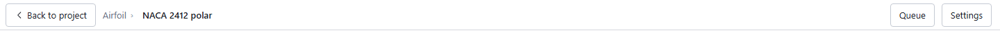

The app draws the header over every workspace: **Back to project**, `<Plugin> › <Study>` (click the study name to rename it), **Queue** and **Settings**. Your page starts under it.

1. Do not draw a Back button, the study title or a close button in your page.
2. Leave with `ws.nav.back()`. Rename comes from the header and reaches you through `ws.on('study')`.
3. A start action with `"header"` in `places` adds its button to the project header. You draw nothing for it.
4. Title each card with what it holds ("Inputs", "Polar"), never with the study's name.

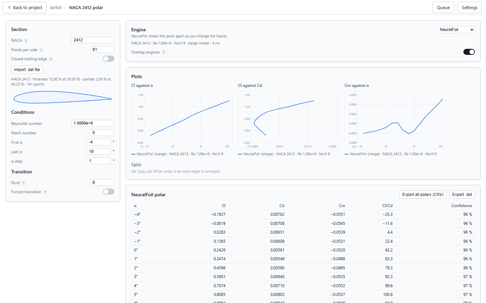

Airfoil's page is a column of cards: inputs on the left, the engine, plots and tables on the right. Each card has a 14 px title and its rows.

### Flyouts and panels: head, body, foot

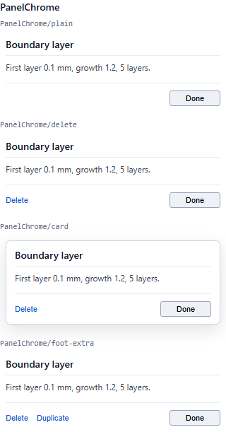

`PanelChrome` draws a panel the way the app draws its flyouts: a title (head), your content (body), and a foot.

1. **Done** is always there, at the right of the foot. It closes the panel. Pass `onDone`: `host.pluginUi.panelDone` in the app's page. In a workspace frame, a panel is a part of your page (an editor for one item, a side panel), and Done closes that part. It is not the way out of the workspace: the header's Back is.
2. Do not wrap a whole workspace page in `PanelChrome`. Its title would repeat the header and its Done the header's Back.
3. The title names what the panel edits ("Boundary layer"), never the study.
4. **Delete** shows only when there is something to remove, at the left of the foot.
5. Never put a tick, a cross or a save button in the head.
6. Save as the user goes: on a committed field (Enter or leaving it), on Apply, on Generate. Done never means "save".
7. Use `card` in a frame. In the app's flyout the host draws the card.

```tsx test
import { connect } from '@magnusim/workspace';
import { Field, NumberUnitInput, PanelChrome } from '@magnusim/plugin-ui';
import { useState } from 'react';

const ws = await connect();

// One panel of a workspace page: Done closes it, the page stays.
export function Refinement({ onClose, onDelete }: { onClose: () => void; onDelete?: () => void }) {
  const [study, setStudy] = useState(ws.context.study);
  const save = async (patch: Record<string, unknown>) => setStudy(await ws.study.update(patch, study.rev));
  return (
    <PanelChrome title="Boundary layer" card onDone={onClose} onDelete={onDelete}>
      <Field label="First layer" help="The thickness of the layer on the wall.">
        <NumberUnitInput
          label="First layer"
          quantity="length"
          units={ws.context.units}
          valueSi={typeof study.first_layer_m === 'number' ? study.first_layer_m : null}
          onCommitSi={(v) => void save({ first_layer_m: v })}
        />
      </Field>
    </PanelChrome>
  );
}
```

## 4. Which kit component when

| You need | Use | Not |
| --- | --- | --- |
| The main action | `Button variant="primary"` | A coloured `<button>` of your own |
| Other actions | `Button` (`secondary`), `neutral` (Done), `link` (Delete, small actions), `danger` (a destructive action that is the point of the screen) | |
| A link that fixes a problem | `Button variant="fix"`, or `DisabledReason` with `fix` | A plain link to nowhere |
| A labelled setting | `Field` with a control inside; `help` for a tip | A label above the input |
| A number with a unit | `NumberUnitInput` with `quantity` and `units` | A text box and a unit you convert yourself |
| A whole number, or one in a range | `NumberUnitInput` without `quantity`; check the value in `onCommitSi` (section 6) | A number input with `min` and `max` the kit does not have |
| A value the user typed wrong | `Hint tone="danger"` under the control, saying what is allowed | A toast, or `DisabledReason` (that is for an action that cannot run) |
| Short free text (a label, a file name) | The kit has no text field. For a name, `ws.ui.prompt`. Otherwise an `<input type="text">` with an `aria-label`, drawn with the tokens | An input with your own colours and sizes |
| A choice from a list | `Select` | Radio buttons for more than three choices |
| On or off | `Toggle` (a switch) | A checkbox with a label on the right |
| A short note under a control | `Hint` (`muted`, `warning`, `danger`) | Body-size grey text |
| Why something cannot run | `DisabledReason` | A disabled button with no reason |
| An empty list or chart | `EmptyState` (`list`, `chart`) | A blank area |
| Progress of a job or run | `StatusBlock` with `Elapsed` | A spinner alone |
| What just happened | `ws.ui.toast` (frame), `pluginUi.toast` (page) | `alert()` |
| A question before something lasting | `ws.ui.confirm` | Your own modal |
| A name | `ws.ui.prompt` | Your own modal |
| A small line chart | `LinePlot` | A charting library |
| A colour scale | `ColorLegend` and the kit's colour maps | Your own gradient |
| A panel's frame | `PanelChrome` | Your own card with a header button |
| A panel that failed | `PanelError` | A raw error text |
| An icon | `Icon` | An icon font or emoji |

The components, as the dev sheet draws them:

| | |
| --- | --- |
| 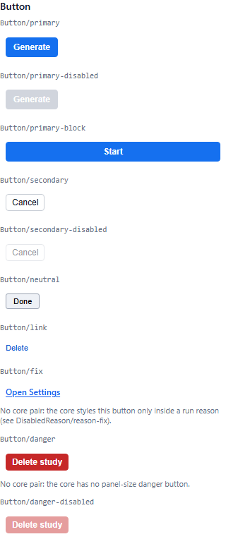 | 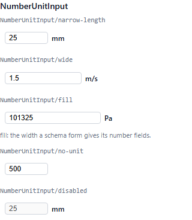 |
| 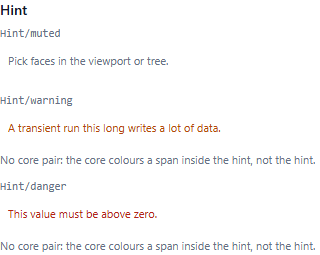 | 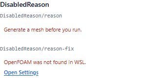 |
| 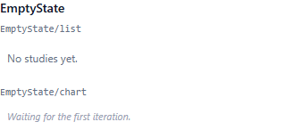 | 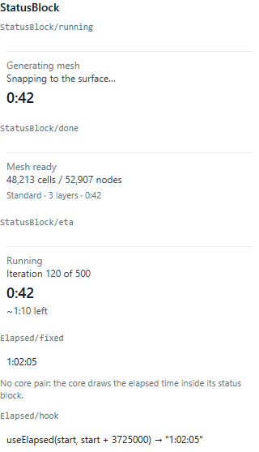 |
| 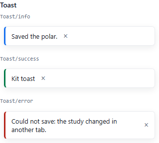 | 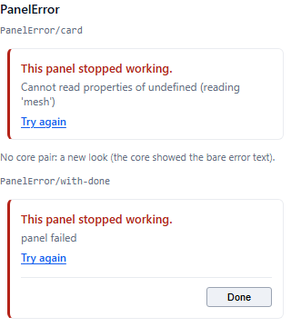 |
| 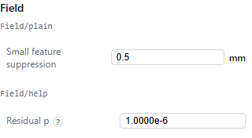 | 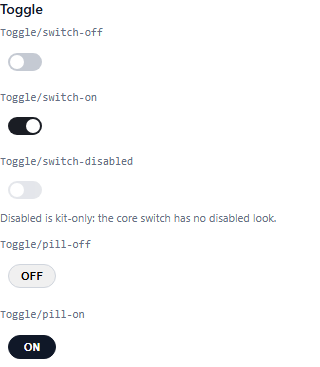 |

## 5. Copy rules

1. **Buttons** are a verb first, in sentence case: "Compute area", "Run XFOIL", "Import .dat file". Not "Area Computation" or "OK".
2. **Pending** labels end in "…": "Computing…", "Running…", "Saving…". The button is disabled until the work ends.
3. **Hints** are 11 px, in the second person, in plain physics: "Pick faces in the viewport or tree." Not "The user may select faces."
4. **A disabled control says why**, and how to fix it, with a link to the fix: "Fix the inputs first: Enter a NACA 4-digit or 5-digit designation." with **Change the NACA designation**.
5. **Empty states** say "No X yet", and the one action that fills it: "No OpenFOAM run yet". Not "No data." or "Nothing here!".
6. **Errors** say what failed, then why: "Save failed: the study changed in another tab." The pattern is "<Action> failed: <why>". Never "Error!" or a stack trace alone.
7. **Success** says what happened: "Run finished", "Saved the polar.".
8. **Units** use their Unicode characters: m², m³/s, °, µm, Δt, α, Re. A space between a number and its unit ("0.1 mm", "96 %"), none before a degree sign ("4°").
9. **Names** come from the user's data. Say "NACA 2412", not "the airfoil".
10. **No placeholders.** No "coming soon", no "TODO", no "lorem", no "beta" on something that does not work. If it is not built, it is not shown.
11. **No hedging and no blame.** "OpenFOAM was not found in WSL." Not "Oops, something may have gone wrong."

```tsx test
import { connect } from '@magnusim/workspace';
import { Button, DisabledReason, EmptyState } from '@magnusim/plugin-ui';
import { useState } from 'react';

const ws = await connect();

export function RunCard({ problem, runs, focusField }: { problem: string | null; runs: string[]; focusField: () => void }) {
  const [busy, setBusy] = useState(false);
  async function run() {
    setBusy(true);
    try {
      await ws.service('polar', {});
      await ws.ui.toast('Run finished', { kind: 'success' });
    } catch (err) {
      await ws.ui.toast(`Run failed: ${err instanceof Error ? err.message : String(err)}`, { kind: 'error' });
    } finally {
      setBusy(false);
    }
  }
  return (
    <div>
      <Button variant="primary" disabled={busy || !!problem} onClick={() => void run()}>
        {busy ? 'Running…' : 'Run XFOIL'}
      </Button>
      {problem ? (
        <DisabledReason reason={`Fix the inputs first: ${problem}`} fix={{ label: 'Change the NACA designation', onFix: focusField }} />
      ) : null}
      {runs.length === 0 ? <EmptyState>No XFOIL run yet</EmptyState> : <ul>{runs.map((r) => <li key={r}>{r}</li>)}</ul>}
    </div>
  );
}
```

## 6. Numbers

1. **Store SI.** The study and your files hold metres, pascals, seconds. Show them in the user's units: `NumberUnitInput` with `quantity` and `units` (`ws.context.units`, `pluginUi.unitSystem()`).
2. **Follow unit changes.** Listen to `ws.on('units')` and draw again.
3. **Scientific notation** when the magnitude is below 1e-3 or at least 1e6. `formatSci` does it: `formatSci(0.0000153)` is `"1.5300e-5"`, `formatSci(62.31559)` is `"62.3156"`. An input shows `formatSci`'s text, so the user can type it back.
4. **Read-only values** may use the minus sign "−" (U+2212) and a short exponent, as Airfoil's tables do ("−0.0551", "1.00e+6").
5. **Tabular numerals** for numbers that change or line up: tables, live residuals, clocks. Set `font-variant-numeric: tabular-nums`. The kit's status block and legend ticks already do.
6. **Round for the reader.** Give the digits the method can stand behind: Cl to 4 places, a percentage to whole numbers.
7. **Counts** use a thousands separator: "48,213 cells".
8. **Times** use the kit's formatters: `formatElapsed` ("1:02:05"), `formatEta` ("~1:10 left"), `formatSimTime` (simulated seconds).

```ts test
import { formatElapsed, formatSci, fromSi, toSi } from '@magnusim/plugin-ui';

export const shown = [formatSci(0.0000153), formatSci(62.31559), formatElapsed(3_725_000)];
// 2 in in metres, and back.
export const metres = toSi('length', 2, 'in');
export const inches = fromSi('length', metres, 'in');
```

`NumberUnitInput` has no `min`, `max` or `step`. Check a whole number or a range when it is committed, save only a good value, and say what is allowed:

```tsx test
import { Field, Hint, NumberUnitInput } from '@magnusim/plugin-ui';
import { useState } from 'react';

// "Times": a whole number from 1 to 20, saved only when it is one.
export function TimesField({ times, onSave }: { times: number; onSave: (n: number) => void }) {
  const [problem, setProblem] = useState('');
  return (
    <Field label="Times">
      <NumberUnitInput
        label="Times"
        valueSi={times}
        onCommitSi={(v) => {
          if (!Number.isInteger(v) || v < 1 || v > 20) {
            setProblem('Enter a whole number from 1 to 20.');
            return;
          }
          setProblem('');
          onSave(v);
        }}
      />
      {problem ? <Hint tone="danger">{problem}</Hint> : null}
    </Field>
  );
}
```

## 7. Plots and colour maps

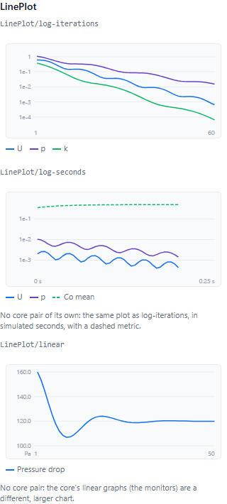

1. Use `LinePlot`. Residuals are `y.scale: 'log'`. Physical quantities are `linear`. Give the y unit.
2. The x axis is iterations, simulated seconds, or a linear number axis (`kind: 'linear'`, which may turn back, as a drag polar does).
3. Series take `--mg-series-1` … `-7` in order. Do not pick your own colours.
4. A per-step metric (a Courant number) is `dashed`.
5. Each legend entry says where the line came from: the engine and its settings. Airfoil writes "NeuralFoil (xlarge) · NACA 2412 · Re 1.00e+6 · Ncrit 9".
6. Give every plot a `label`: it is the plot's accessible name. Show the numbers in a table too, as Airfoil does.
7. A plot with no data yet shows `EmptyState variant="chart"` with what it is waiting for.

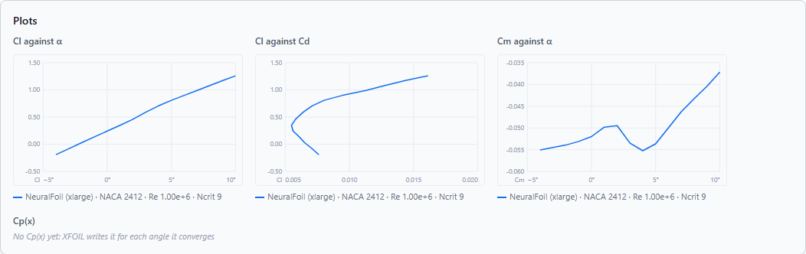

Colour maps (`ColorLegend`, `colormapRgb`, `colormapGradient`):

| Map | Use it for |
| --- | --- |
| `rainbow` | The app's results colouring. Use it when your plot sits beside the app's results |
| `viridis` | A one-sided quantity (speed, temperature) that must read in grey and for colour-blind users |
| `balance` | A signed quantity centred on zero (pressure coefficient, a difference). Set `centred` |
| `curl` | A signed rotation (vorticity). Set `centred` |

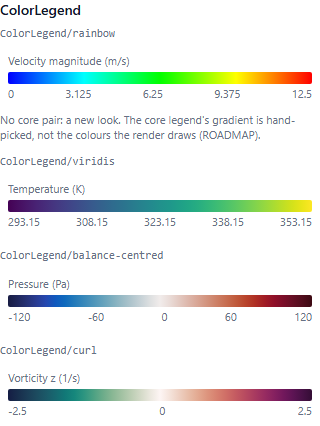

## 8. Icons

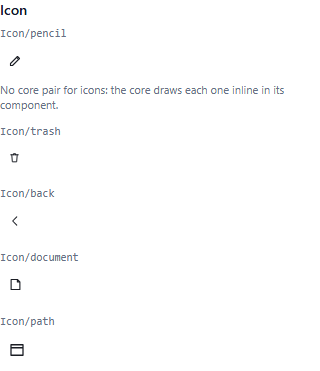

1. Use `Icon`: one of `pencil`, `trash`, `back`, `document`, or your own `path`.
2. A path is drawn in a 24 × 24 box, in the text colour (`currentColor`), with a stroke of 1.7 or 1.8, round caps and joins, and no fill.
3. Sizes are 13, 14, 15 (default), 16 or 18 px.
4. A manifest `icon` (workspaces, study kinds, start actions) is one SVG path in the same 24 × 24 box.
5. An icon that is the only content of a button needs `title` (or the button's `ariaLabel`). An icon next to text needs none.

## 9. Accessibility minimums

1. Every control has a name. Kit controls take `label`; it becomes the control's `aria-label`.
2. Everything works from the keyboard. Tab reaches it. Enter commits a number and Escape puts it back. Space flips a toggle.
3. Keep the focus ring. Do not set `outline: none` without drawing `--mg-focus` instead.
4. Colour is never the only signal. A failed state also says "failed", a reason is text, a series has a legend.
5. Text on a background uses the token pairs above, which meet contrast.
6. A short error is `role="alert"` (`DisabledReason role="alert"`, `PanelError`). A toast is `role="status"`.
7. A plot has a `label`, and its numbers are also in a table.
8. A `Field`'s help tip opens on hover and on focus of its "?".
9. Nothing moves or blinks without the user asking. Transitions use the motion tokens.
10. A test finds a control as the user does: by its role and its label ([GUIDE.md](GUIDE.md), "Testing", has the table).

## 10. Honesty rules

1. No "coming soon". Ship it working, or do not show it.
2. No dead buttons. A button that cannot work is disabled and says why.
3. No lying hints. A hint describes what happens now, not what was planned.
4. Feedback after every action: a value that saved shows saved; a job shows progress; a failure says why.
5. Results say where they came from: the engine, the settings, and how they stand ("15 of 15 angles converged").
6. A step that did not converge, a value that was clipped, a file that was repaired: say so.

## 11. Do and don't

| Do | Don't |
| --- | --- |
|  | 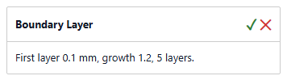 |
| Done in the foot, Delete only when something can go. | A tick or a cross in the head. Title Case. |
| 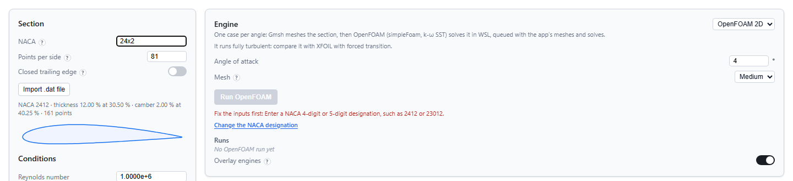 | 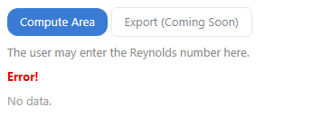 |
| A disabled action says why, with a link to the field that fixes it. | "Coming soon", a third-person hint, a bare "Error!", "No data.". Off-palette colours and radii. |
| 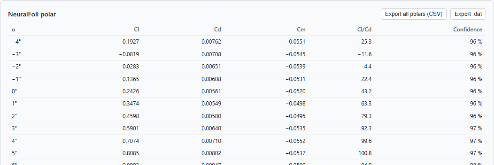 | 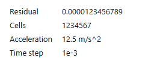 |
| Digits the method stands behind, aligned, with Unicode minus and degree signs. | Every float digit, `1234567`, an acceleration as `m/s^2` (write `m/s²`), `1e-3` in a read-only table. |
|  | `background: #3a7bd5; border-radius: 12px` |
| Kit buttons: one primary, the rest secondary, neutral or link. | A button of your own, with hex colours and its own shape. |
