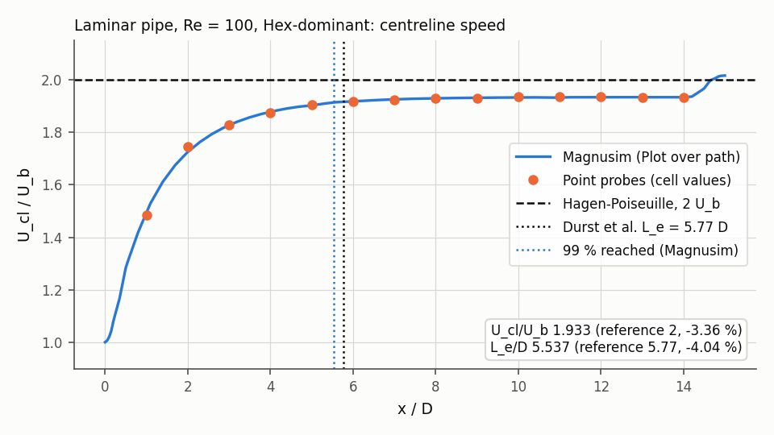
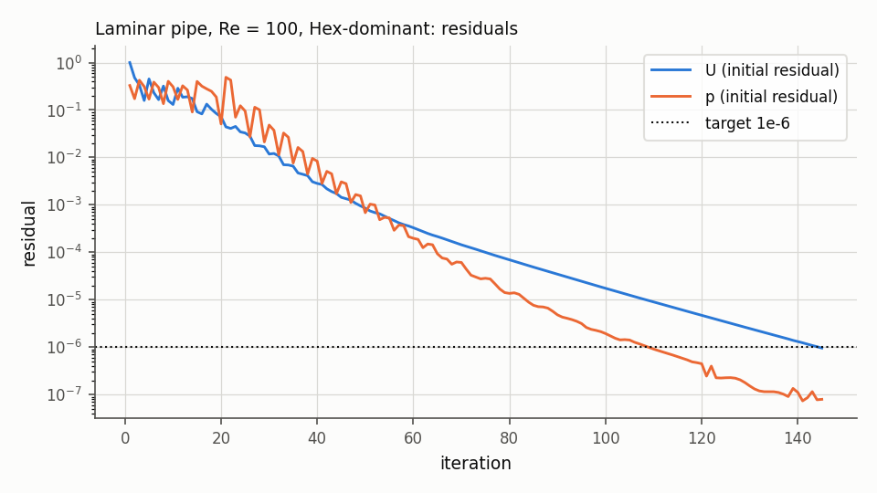
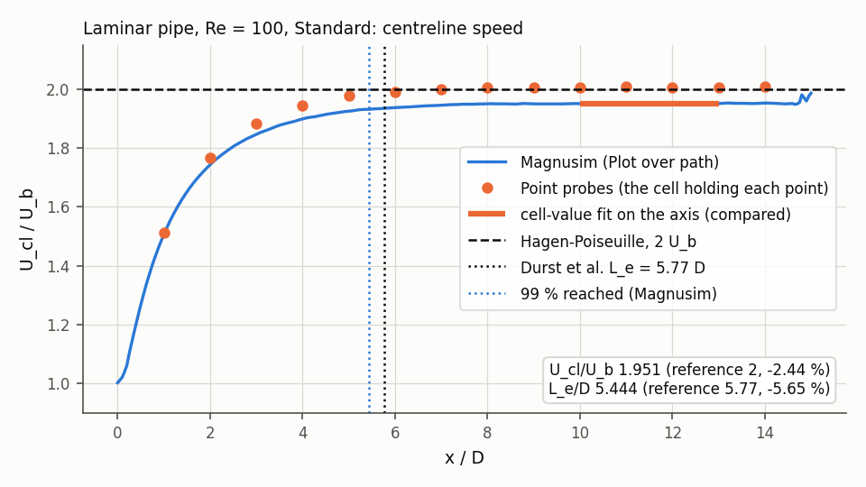
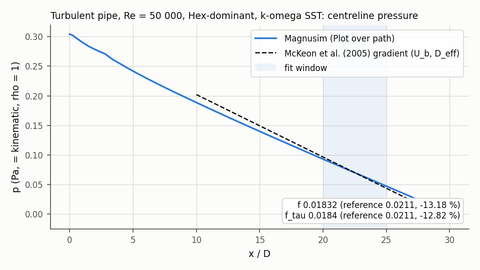
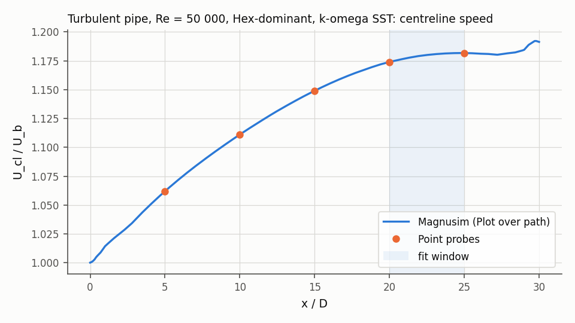
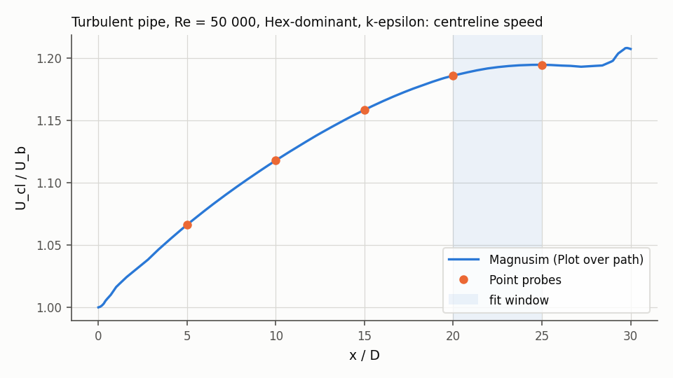
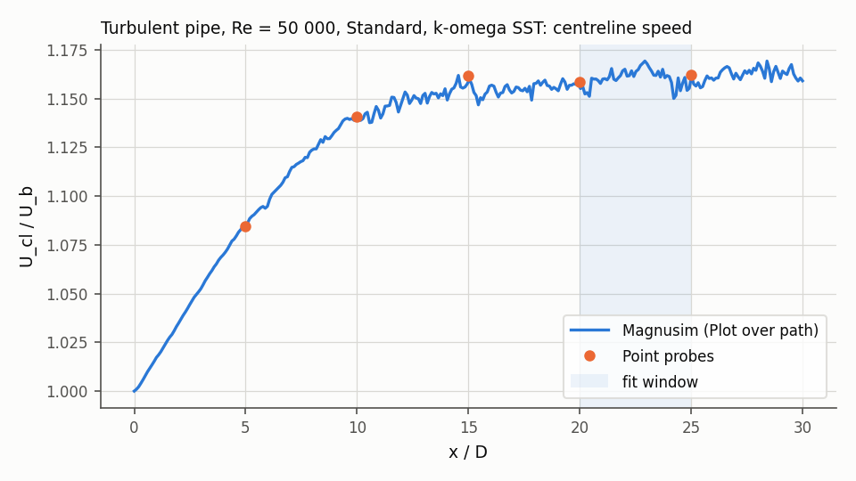
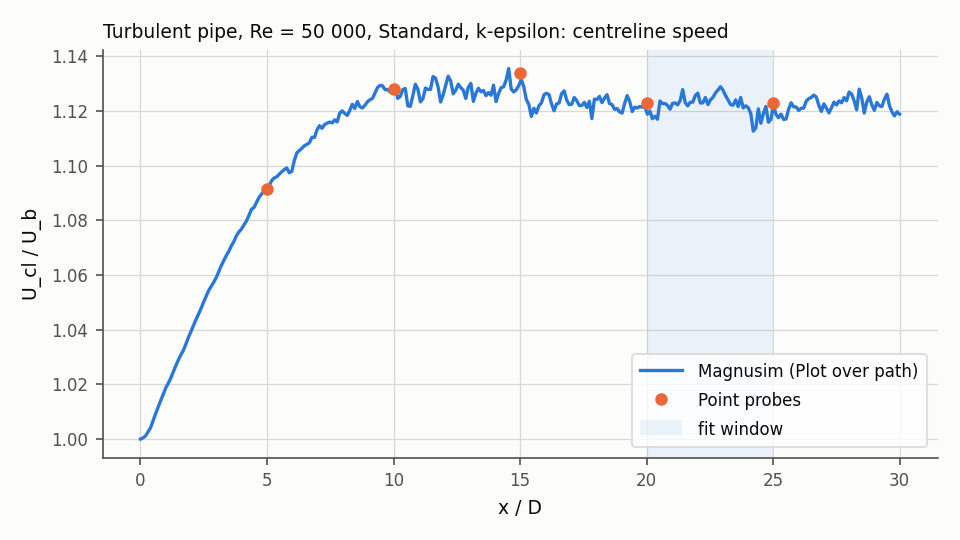
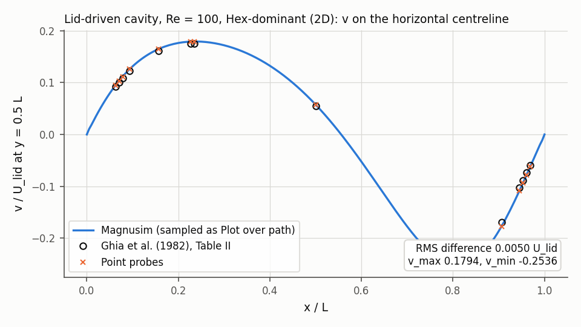
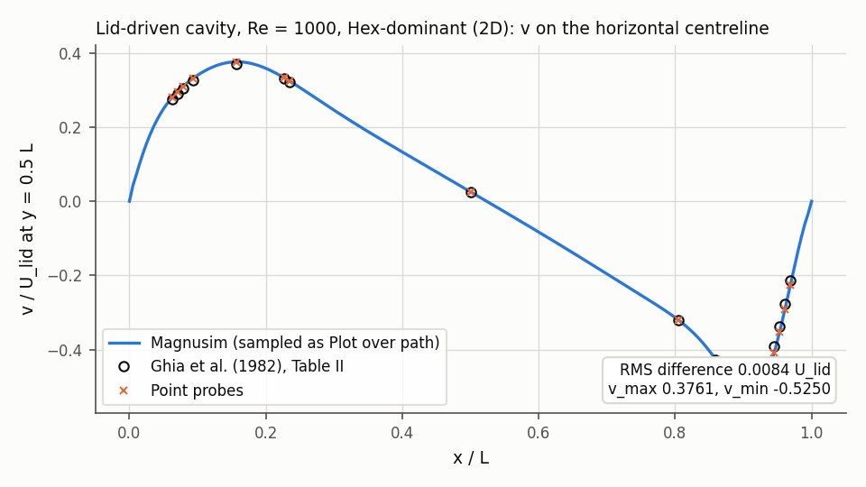

# Validation

Magnusim's validation set: textbook flows with published answers, set up and solved through
the app itself. Each case is a STEP file imported into a project, given its BCs and fluid,
meshed by the app's mesher and solved by Start, through the same routes the page and the
Assistant use; its numbers are then read from the run's own monitors and from Plot over
path, and compared with the reference values below, each with its citation. Nothing is
tuned per case and no number is typed in: a value here is what the app produced.

**Report-only.** These numbers are what this version computes; no case fails on them yet.
After the first full run the tolerances are locked, and from then on a locked quantity
outside its tolerance fails the run and blocks a release. The bands shown are the proposed
ones (from the reference data). A run fails already when it cannot produce its numbers: a
setup the app refuses, a mesh or solve that fails, wall layers asked and not applied.

The set so far: Laminar pipe, Re = 100 (Hex-dominant, Standard); Turbulent pipe, Re = 50 000
(Hex-dominant, k-omega SST, Hex-dominant, k-epsilon, Standard, k-omega SST, Standard,
k-epsilon); Lid-driven cavity (Re = 100, Hex-dominant (2D), Re = 1000, Hex-dominant (2D)).
Then the backward-facing step, the cylinder and the sphere; see `validation/README.md`. Heat
Transfer's own validation set is reported after them.

## Running it

WSL with OpenFOAM v2606, as the app's Setup installs it. From `magnusim-web`:

```bash
npm run test:validation                                   # every case and variant (8 cores each), then this report
npm run test:validation -- --case c1 --variant standard --cores 4
npm run test:validation -- --coarse                       # quick coarse runs (results-coarse/, not reported)
npm run validation:report                                 # this file and the public page from the results
npm run validation:report -- --check                      # exit 1 when they are out of date
```

Each run writes `validation/results/<case>/<variant>/plan.json` (every request it sends)
and `result.json` (the values, their sources, the mesh, the run and its health). The
public page is built into `docs/validation/` at the repository's root; it is published
only when GitHub Pages is turned on for `docs/` and the branch is pushed.

## Results

Environment: 2026-11-04: commit 4816248f16ae, OpenFOAM v2606 (build _481094f-20260618), 4 cores of a 32-thread PC: c1_laminar_pipe/hexdominant (WSL load 2.42 while it solved), c1_laminar_pipe/standard (WSL load 1.49 while it solved); 2026-11-05: commit 5ed573c96eac, OpenFOAM v2606 (build _481094f-20260618), 4 cores of a 32-thread PC: c2_turbulent_pipe/hexdominant_sst (WSL load 2 while it solved), c2_turbulent_pipe/hexdominant_kepsilon (WSL load 2.84 while it solved), c2_turbulent_pipe/standard_sst (WSL load 2.89 while it solved), c2_turbulent_pipe/standard_kepsilon (WSL load 3.06 while it solved), c3_lid_cavity/re100 (WSL load 3.37 while it solved), c3_lid_cavity/re1000 (WSL load 2.99 while it solved).

| Case | Run | Status | Quantity | Reference | Magnusim | Error | Band (report-only) | Cells | Wall layers | Iterations | Solve time | Run health |
| --- | --- | --- | --- | --- | --- | --- | --- | --- | --- | --- | --- | --- |
| Laminar pipe, Re = 100 | Hex-dominant | ok | Darcy friction factor × Re, developed part (x/D 10 to 13) | 64 | 63.268 | -1.14 % | ±2 % (inside) | 128 706 | applied (pipe_wall 3.83 of 4) | 143 | 21 s | healthy |
| Laminar pipe, Re = 100 | Hex-dominant | ok | Centreline speed / bulk speed, developed part (x/D 10 to 13) | 2 | 2.0021 | +0.11 % | ±1.5 % (inside) | 128 706 | applied (pipe_wall 3.83 of 4) | 143 | 21 s | healthy |
| Laminar pipe, Re = 100 | Hex-dominant | ok | Development length L_e / D (to 99 % of the developed centreline speed) | 5.77 | 5.5473 | -3.86 % | ±15 % (inside) | 128 706 | applied (pipe_wall 3.83 of 4) | 143 | 21 s | healthy |
| Laminar pipe, Re = 100 | Standard | ok | Darcy friction factor × Re, developed part (x/D 10 to 13) | 64 | 74.232 | +15.99 % | ±2 % (outside) | 139 228 | applied (pipe_wall 3 of 3) | 316 | 30 s | healthy |
| Laminar pipe, Re = 100 | Standard | ok | Centreline speed / bulk speed, developed part (x/D 10 to 13) | 2 | 2.0026 | +0.13 % | ±1.5 % (inside) | 139 228 | applied (pipe_wall 3 of 3) | 316 | 30 s | healthy |
| Laminar pipe, Re = 100 | Standard | ok | Development length L_e / D (to 99 % of the developed centreline speed) | 5.77 | 5.451 | -5.53 % | ±15 % (inside) | 139 228 | applied (pipe_wall 3 of 3) | 316 | 30 s | healthy |
| Turbulent pipe, Re = 50 000 | Hex-dominant, k-omega SST | ok | Darcy friction factor from the pressure drop, x/D 20 to 25 | 0.0211 | 0.018318 | -13.18 % | ±10 % (outside) | 76 184 | applied (pipe_wall 0.909 of 1) | 2500 | 144 s | healthy |
| Turbulent pipe, Re = 50 000 | Hex-dominant, k-omega SST | ok | Darcy friction factor from the wall shear stress, x/D 20 to 25 | 0.0211 | 0.018396 | -12.82 % | ±10 % (outside) | 76 184 | applied (pipe_wall 0.909 of 1) | 2500 | 144 s | healthy |
| Turbulent pipe, Re = 50 000 | Hex-dominant, k-epsilon | ok | Darcy friction factor from the pressure drop, x/D 20 to 25 | 0.0211 | 0.019448 | -7.83 % | ±10 % (inside) | 76 184 | applied (pipe_wall 0.909 of 1) | 2500 | 130 s | watch |
| Turbulent pipe, Re = 50 000 | Hex-dominant, k-epsilon | ok | Darcy friction factor from the wall shear stress, x/D 20 to 25 | 0.0211 | 0.019573 | -7.24 % | ±10 % (inside) | 76 184 | applied (pipe_wall 0.909 of 1) | 2500 | 130 s | watch |
| Turbulent pipe, Re = 50 000 | Standard, k-omega SST | ok | Darcy friction factor from the pressure drop, x/D 20 to 25 | 0.0211 | 0.015679 | -25.69 % | ±10 % (outside) | 69 568 | applied (pipe_wall 3 of 3) | 2500 | 109 s | healthy |
| Turbulent pipe, Re = 50 000 | Standard, k-omega SST | ok | Darcy friction factor from the wall shear stress, x/D 20 to 25 | 0.0211 | 0.015544 | -26.33 % | ±10 % (outside) | 69 568 | applied (pipe_wall 3 of 3) | 2500 | 109 s | healthy |
| Turbulent pipe, Re = 50 000 | Standard, k-epsilon | ok | Darcy friction factor from the pressure drop, x/D 20 to 25 | 0.0211 | 0.020177 | -4.38 % | ±10 % (inside) | 69 568 | applied (pipe_wall 3 of 3) | 2500 | 109 s | watch |
| Turbulent pipe, Re = 50 000 | Standard, k-epsilon | ok | Darcy friction factor from the wall shear stress, x/D 20 to 25 | 0.0211 | 0.02049 | -2.89 % | ±10 % (inside) | 69 568 | applied (pipe_wall 3 of 3) | 2500 | 109 s | watch |
| Lid-driven cavity | Re = 100, Hex-dominant (2D) | ok | u/U_lid on the vertical centreline, RMS difference from Ghia et al. (Re 100) | 0 | 0.0025117 | +0.00251 U_lid | ±0.01 U_lid (inside) | 34 580 | none asked | 12000 | 364 s | watch |
| Lid-driven cavity | Re = 100, Hex-dominant (2D) | ok | u/U_lid on the vertical centreline, largest difference from Ghia et al. (Re 100) | 0 | 0.0050938 | +0.00509 U_lid | ±0.03 U_lid (inside) | 34 580 | none asked | 12000 | 364 s | watch |
| Lid-driven cavity | Re = 100, Hex-dominant (2D) | ok | v/U_lid on the horizontal centreline, RMS difference from Ghia et al. (Re 100) | 0 | 0.0050013 | +0.005 U_lid | ±0.01 U_lid (inside) | 34 580 | none asked | 12000 | 364 s | watch |
| Lid-driven cavity | Re = 100, Hex-dominant (2D) | ok | v/U_lid on the horizontal centreline, largest difference from Ghia et al. (Re 100) | 0 | 0.0091021 | +0.0091 U_lid | ±0.03 U_lid (inside) | 34 580 | none asked | 12000 | 364 s | watch |
| Lid-driven cavity | Re = 100, Hex-dominant (2D) | ok | u_min / U_lid on the vertical centreline (Re 100) | -0.214 | -0.2139 | +0.06 % | ±3 % (inside) | 34 580 | none asked | 12000 | 364 s | watch |
| Lid-driven cavity | Re = 100, Hex-dominant (2D) | ok | v_max / U_lid on the horizontal centreline (Re 100) | 0.1796 | 0.17944 | -0.07 % | ±3 % (inside) | 34 580 | none asked | 12000 | 364 s | watch |
| Lid-driven cavity | Re = 100, Hex-dominant (2D) | ok | v_min / U_lid on the horizontal centreline (Re 100) | -0.2538 | -0.25364 | +0.07 % | ±3 % (inside) | 34 580 | none asked | 12000 | 364 s | watch |
| Lid-driven cavity | Re = 100, Hex-dominant (2D) | ok | Primary vortex, psi_min / (U_lid L) (Re 100) | -0.1035 | -0.10345 | +0.06 % | ±2 % (inside) | 34 580 | none asked | 12000 | 364 s | watch |
| Lid-driven cavity | Re = 100, Hex-dominant (2D) | ok | Primary vortex centre, x / L (Re 100) | 0.6162 | 0.61549 | -0.12 % | ±0.01 L (inside) | 34 580 | none asked | 12000 | 364 s | watch |
| Lid-driven cavity | Re = 100, Hex-dominant (2D) | ok | Primary vortex centre, y / L (Re 100) | 0.7373 | 0.73729 | -0.00 % | ±0.01 L (inside) | 34 580 | none asked | 12000 | 364 s | watch |
| Lid-driven cavity | Re = 1000, Hex-dominant (2D) | ok | u/U_lid on the vertical centreline, RMS difference from Ghia et al. (Re 1000) | 0 | 0.0042078 | +0.00421 U_lid | ±0.02 U_lid (inside) | 34 580 | none asked | 8000 | 302 s | watch |
| Lid-driven cavity | Re = 1000, Hex-dominant (2D) | ok | u/U_lid on the vertical centreline, largest difference from Ghia et al. (Re 1000) | 0 | 0.0077059 | +0.00771 U_lid | ±0.03 U_lid (inside) | 34 580 | none asked | 8000 | 302 s | watch |
| Lid-driven cavity | Re = 1000, Hex-dominant (2D) | ok | v/U_lid on the horizontal centreline, RMS difference from Ghia et al. (Re 1000) | 0 | 0.0083721 | +0.00837 U_lid | ±0.02 U_lid (inside) | 34 580 | none asked | 8000 | 302 s | watch |
| Lid-driven cavity | Re = 1000, Hex-dominant (2D) | ok | v/U_lid on the horizontal centreline, largest difference from Ghia et al. (Re 1000) | 0 | 0.015649 | +0.0156 U_lid | ±0.03 U_lid (inside) | 34 580 | none asked | 8000 | 302 s | watch |
| Lid-driven cavity | Re = 1000, Hex-dominant (2D) | ok | u_min / U_lid on the vertical centreline (Re 1000) | -0.3886 | -0.3877 | +0.22 % | ±3 % (inside) | 34 580 | none asked | 8000 | 302 s | watch |
| Lid-driven cavity | Re = 1000, Hex-dominant (2D) | ok | v_max / U_lid on the horizontal centreline (Re 1000) | 0.3769 | 0.37612 | -0.22 % | ±3 % (inside) | 34 580 | none asked | 8000 | 302 s | watch |
| Lid-driven cavity | Re = 1000, Hex-dominant (2D) | ok | v_min / U_lid on the horizontal centreline (Re 1000) | -0.5271 | -0.52497 | +0.40 % | ±3 % (inside) | 34 580 | none asked | 8000 | 302 s | watch |
| Lid-driven cavity | Re = 1000, Hex-dominant (2D) | ok | Primary vortex, psi_min / (U_lid L) (Re 1000) | -0.1189 | -0.11866 | +0.24 % | ±2 % (inside) | 34 580 | none asked | 8000 | 302 s | watch |
| Lid-driven cavity | Re = 1000, Hex-dominant (2D) | ok | Primary vortex centre, x / L (Re 1000) | 0.5312 | 0.53111 | -0.03 % | ±0.01 L (inside) | 34 580 | none asked | 8000 | 302 s | watch |
| Lid-driven cavity | Re = 1000, Hex-dominant (2D) | ok | Primary vortex centre, y / L (Re 1000) | 0.5654 | 0.56543 | -0.00 % | ±0.01 L (inside) | 34 580 | none asked | 8000 | 302 s | watch |

## Laminar pipe, Re = 100

A pipe, D = 20 mm, L = 300 mm (15 D) along +x from x = 0 (STEP in mm, built with OCP); a custom fluid with nu = 0.0002 m²/s and rho = 1 kg/m³, so Re = U D / nu = 100; a velocity inlet of 1 m/s normal to the face, a 0 Pa pressure outlet and a no-slip wall; laminar, steady (simpleFoam), Accurate numerics, residual targets 1e-6, at most 3000 iterations.

### Hex-dominant

- Status: ok.
- Mesh settings: Hex-dominant at fineness 6 with an Inflate boundary layer of 4 layers, 1 mm in all, on the wall (automatic boundary layers off); 1 non-orthogonal corrector.
- Mesh: 128 706 cells (the plan's estimate about 163 000), background block 67 × 8 × 12, wall cells 1.49 × 0.831 × 0.554 mm (x × y × z), generated in 20.1 s; checkMesh OK (max non-orthogonality 69.2°, max skewness 1.49, max aspect ratio 12.4); wall layers applied (pipe_wall 3.83 of 4), first layer 0.179 mm.
- Run: 143 iterations, converged at iteration 143; solve 21 s on 4 ranks (Cores 4); run health healthy.
- Pre-run check: info still_start: The run starts from rest; starting from potential flow shortens the start-up.
- Its estimate before Start: 3,000 iterations at most · ~23 minutes on 4 cores · Re ≈ 100.
- **Darcy friction factor × Re, developed part (x/D 10 to 13)**: 63.268 against 64 (-1.14 %, band ±2 % (inside), report-only); ± 0.015 % (the slope's standard error and twice the cross-section's). How: f·Re = 2 D_eff² (−dp/dx) / (mu U_b): dp/dx the least-squares slope of the centreline pressure from Plot over path (0,0,0) to (0.3,0,0) m, 300 subdivisions, over x/D 10 to 13; U_b = Q / A and D_eff = sqrt(4 A / pi), Q the flow through the inlet and A the pipe's meshed cross-section, the mean of the inlet's and the outlet's mesh areas (all three from the run's monitors), since a meshed circle's area is not exactly pi D²/4. Source: `route:/api/plot-over-path`. -dp/dx 15.8252 Pa/m from 60 samples (slope standard error 0.01 %, r² 0.999999); D_eff 19.995 mm, U_b 1.0000 m/s.
- **Centreline speed / bulk speed, developed part (x/D 10 to 13)**: 2.0021 against 2 (+0.11 %, band ±1.5 % (inside), report-only). How: the centre value u_c of a least-squares fit U_x = u_c + b r² (the developed profile's own form) to the cell values, not interpolated, of every cell whose centre lies in x/D 10 to 13 within R/2 of the axis, read from the run's saved U by the app's own volume loader (case_volume.load_volume, the code behind Plot over path), over U_b = Q / A (as for f·Re). Source: `app_sampling (cell values)`. u_c 2.0021 m/s (standard error 0.0011) from 400 cells within 5.00 mm of the axis, over U_b 1.0000 m/s; the cells nearest the axis (r = 1.834 mm) read 1.9358 m/s, the exact profile there 1.9327.
- **Development length L_e / D (to 99 % of the developed centreline speed)**: 5.5473 against 5.77 (-3.86 %, band ±15 % (inside), report-only). How: the first x where the centreline speed from Plot over path (0,0,0) to (0.3,0,0) m, 300 subdivisions, reaches 99 % of the same line's developed value (its mean over x/D 10 to 13), linearly interpolated between samples, over D_eff. Source: `route:/api/plot-over-path`. 99 % of 1.9331 m/s reached at x = 110.9 mm.
- Shown, not compared: the pipe's cross-section as meshed 313.99 mm² (inlet 313.99, outlet 313.99; -0.05 % against pi D²/4), so D_eff 19.995 mm and U_b 1 m/s; -dp/dx 15.825 Pa/m (-1.09 % against 32 mu U / D² = 16 Pa/m with the nominal D); the wall shear stress the run saved, over x/D 10 to 13, 0.07904 Pa (-1.22 % against 8 mu U_b / D_eff = 0.08002 Pa), which balances -dp/dx = 4 tau_w / D_eff = 15.813 Pa/m; the inlet's area-averaged pressure 5.606 Pa (the outlet's 0 Pa), flow out against in -0.001 %; Darcy f 0.6328 at Re_eff 99.973; Plot over path's centreline over x/D 10 to 13 1.9331 U_b (the field averaged to the mesh's points); the centreline probes' mean U_x over x/D 10 to 13 1.9335 U_b (the cell holding each point); the 24000 cells of x/D 10 to 13 within an RMS 0.00795 U_b of 2 U_b (1 - (r/R)²) at their own radii; Plot over path's profile at x = 12 D within an RMS 0.0515 U_b of it.






### Standard

- Status: ok.
- Mesh settings: Standard at fineness 6 with its automatic boundary layers and hex core; 2 non-orthogonal correctors.
- Mesh: 139 228 cells, generated in 15.1 s; checkMesh OK (max non-orthogonality 67.1°, max skewness 0.928, max aspect ratio 8.63); wall layers applied (pipe_wall 3 of 3), first layer 0.136 mm.
- Run: 316 iterations, converged at iteration 316; solve 30 s on 4 ranks (Cores 4); run health healthy.
- Pre-run check: info still_start: The run starts from rest; starting from potential flow shortens the start-up.
- Its estimate before Start: 3,000 iterations at most · ~4 minutes on 4 cores · Re ≈ 100.
- **Darcy friction factor × Re, developed part (x/D 10 to 13)**: 74.232 against 64 (+15.99 %, band ±2 % (outside), report-only); ± 0.041 % (the slope's standard error and twice the cross-section's). How: f·Re = 2 D_eff² (−dp/dx) / (mu U_b): dp/dx the least-squares slope of the centreline pressure from Plot over path (0,0,0) to (0.3,0,0) m, 300 subdivisions, over x/D 10 to 13; U_b = Q / A and D_eff = sqrt(4 A / pi), Q the flow through the inlet and A the pipe's meshed cross-section, the mean of the inlet's and the outlet's mesh areas (all three from the run's monitors), since a meshed circle's area is not exactly pi D²/4. Source: `route:/api/plot-over-path`. -dp/dx 18.5985 Pa/m from 60 samples (slope standard error 0.04 %, r² 0.999990); D_eff 19.978 mm, U_b 1.0000 m/s.
- **Centreline speed / bulk speed, developed part (x/D 10 to 13)**: 2.0026 against 2 (+0.13 %, band ±1.5 % (inside), report-only). How: the centre value u_c of a least-squares fit U_x = u_c + b r² (the developed profile's own form) to the cell values, not interpolated, of every cell whose centre lies in x/D 10 to 13 within R/2 of the axis, read from the run's saved U by the app's own volume loader (case_volume.load_volume, the code behind Plot over path), over U_b = Q / A (as for f·Re). Source: `app_sampling (cell values)`. u_c 2.0026 m/s (standard error 0.0007) from 3887 cells within 4.99 mm of the axis, over U_b 1.0000 m/s; the cells nearest the axis (r = 0.001 mm) read 2.0068 m/s, the exact profile there 2.0000.
- **Development length L_e / D (to 99 % of the developed centreline speed)**: 5.451 against 5.77 (-5.53 %, band ±15 % (inside), report-only). How: the first x where the centreline speed from Plot over path (0,0,0) to (0.3,0,0) m, 300 subdivisions, reaches 99 % of the same line's developed value (its mean over x/D 10 to 13), linearly interpolated between samples, over D_eff. Source: `route:/api/plot-over-path`. 99 % of 1.9513 m/s reached at x = 108.9 mm.
- Shown, not compared: the pipe's cross-section as meshed 313.48 mm² (inlet 313.48, outlet 313.48; -0.22 % against pi D²/4), so D_eff 19.978 mm and U_b 1 m/s; -dp/dx 18.598 Pa/m (+16.24 % against 32 mu U / D² = 16 Pa/m with the nominal D); the wall shear stress the run saved, over x/D 10 to 13, 0.09294 Pa (+16.05 % against 8 mu U_b / D_eff = 0.08009 Pa), which balances -dp/dx = 4 tau_w / D_eff = 18.608 Pa/m; the inlet's area-averaged pressure 6.349 Pa (the outlet's 0 Pa), flow out against in 0 %; Darcy f 0.7431 at Re_eff 99.891; Plot over path's centreline over x/D 10 to 13 1.9513 U_b (the field averaged to the mesh's points); the centreline probes' mean U_x over x/D 10 to 13 2.0071 U_b (the cell holding each point); the 27441 cells of x/D 10 to 13 within an RMS 0.0438 U_b of 2 U_b (1 - (r/R)²) at their own radii; Plot over path's profile at x = 12 D within an RMS 0.0723 U_b of it.





### References

- **Darcy friction factor × Re, developed part (x/D 10 to 13)**: 64 (exact, CONFIRMED). G. Hagen (1839), "Ueber die Bewegung des Wassers in engen cylindrischen Röhren", Ann. Phys. Chem. 46:423-442; J. L. M. Poiseuille (1840), C. R. Acad. Sci. Paris 11:961-967, 1041-1048: the exact (Hagen-Poiseuille) solution of the Navier-Stokes equations for fully developed laminar pipe flow; Darcy f = 64/Re (f = 0.640 at Re 100), i.e. -dp/dx = 32 mu U / D² = 16 Pa/m here. Conditions: fully developed, steady, Newtonian; Re = rho U D / mu with U the bulk (mean) speed; Re = 100.
- **Centreline speed / bulk speed, developed part (x/D 10 to 13)**: 2 (exact, CONFIRMED). G. Hagen (1839), "Ueber die Bewegung des Wassers in engen cylindrischen Röhren", Ann. Phys. Chem. 46:423-442; J. L. M. Poiseuille (1840), C. R. Acad. Sci. Paris 11:961-967, 1041-1048: the exact (Hagen-Poiseuille) solution of the Navier-Stokes equations for fully developed laminar pipe flow; u(r) = 2 U (1 - (r/R)²), so u_c = 2.000 U. Conditions: fully developed, steady, Newtonian; Re = rho U D / mu with U the bulk (mean) speed; Re = 100.
- **Development length L_e / D (to 99 % of the developed centreline speed)**: 5.77 (correlation, SECONDARY). F. Durst, S. Ray, B. Ünsal, O. A. Bayoumi (2005), "The development lengths of laminar pipe and channel flows", J. Fluids Eng. 127:1154-1160; the pipe correlation L/D = [0.619^1.6 + (0.0567 Re)^1.6]^(1/1.6) (constants as quoted from the abstract by citing papers; error under 3 % for all laminar Re), 5.77 at Re 100. Conditions: laminar, uniform inlet; the distance to 99 % of the developed centreline velocity; Re = 100. Depends on the 99 % definition and on the inlet profile; the 0.05 Re rule (5.0) is about 13 % short.

### Notes

- Where the design and the reference data differ, the reference data win: the bands are ±2 % on f·Re and ±1.5 % on U_cl/U_b on both meshers (the design proposed ±2 % / ±5 % and ±2 % / ±3 %), and the developed part read is x/D 10 to 13 (the design's 8 to 13: the reference data ask for stations more than about 10 D from a uniform inlet).
- The bulk speed and D_eff use the pipe's cross-section as meshed (the mean of the inlet's and the outlet's mesh areas, from the run's monitors), not pi D²/4: f·Re goes as the area squared.
- The compared centreline speed comes from the cell values themselves (a fit of U_x = u_c + b r² over the window's cells within R/2 of the axis). Plot over path samples the field averaged to the mesh's points, which reads a peak low where the cells are coarse, and on a mesh whose axis runs along cell edges no cell centre lies on the axis at all; what the line reads on the axis is shown beside the fit, with the profile's RMS difference from the exact parabola at the cells' own radii.
- In these runs (made before the probes read the value at the point: gap G3, fixed since) the centreline Point probes took the value of the cell that holds each point. Where the axis runs along cell edges (Hex-dominant) that is one of the off-axis cells around it, the same cells the fit uses, so the probes are shown, not used as an independent check.
- The development length is read on Plot over path's centreline, against the same line's developed value, so the line's averaging enters both nearly alike. The 99 % point lies where the centreline speed is nearly flat: a change in the fourth digit of the solution moves it by millimetres, and repeated runs of the same plan can read a few per cent apart. Its band is wide (±15 %) for that reason and for the 99 % definition.
- On Standard the friction factor reads well above the exact value. The wall shear stress the run itself saved (shown with each run) carries the same excess, and the cell values run faster than the parabola near the wall and slower at mid-radius, so the pressure drop is the solution's, not an artefact of reading it. It is under investigation (an app gap); the turbulent pipe's Standard runs are read the same way. Probes that change one setting at a time point at the momentum convection scheme on Standard's cells, which are not aligned with the flow: first-order convection raises the friction much further, a finer mesh lowers it only slowly, and neither the gradient limiter, the hex core nor the wall layers account for it.

## Turbulent pipe, Re = 50 000

A pipe  D = 20 mm  L = 600 mm (30 D) along +x from x = 0 (STEP in mm  built with OCP); a custom fluid with nu = 4e-07 m²/s and rho = 1 kg/m³  so Re = U D / nu = 50 000; a velocity inlet of 1 m/s normal to the face (its turbulence Auto: 5 % intensity, 0.07 D), a 0 Pa pressure outlet and a no-slip wall; steady (simpleFoam), k-omega SST with wall functions, Accurate numerics, residual targets 1e-5, at most 2500 iterations.

### Hex-dominant, k-omega SST

- Status: ok.
- Mesh settings: Hex-dominant at fineness 6 with an Inflate boundary layer of 1 layers, 0.6 mm in all, on the wall (automatic boundary layers off); 1 non-orthogonal corrector.
- Mesh: 76 184 cells (the plan's estimate about 105 000), background block 67 × 8 × 12, wall cells 2.98 × 0.831 × 0.554 mm (x × y × z), generated in 15.6 s; checkMesh OK (max non-orthogonality 65°, max skewness 2.37, max aspect ratio 43.8); wall layers applied (pipe_wall 0.909 of 1), first layer 0.529 mm.
- Run: 2500 iterations, did not reach its residual targets within 2500 iterations (over its last 10 % of iterations: the inlet's area-averaged pressure moved 0.00059 %, U_x at the centreline probe at x = 20 D moved 8.5 × 10^-6 %); solve 144 s on 4 ranks (Cores 4); run health healthy: omega was negative from the first iteration (lowest -833 against a mean of 642): check the inlet values or the mesh; It ended without its residuals meeting their targets: its results may not have settled.
- The solver's last initial residuals: Ux 2.9 × 10^-5, Uy 0.00022, Uz 0.00025, p 0.00015, omega 0.00086, k 0.00059.
- Pre-run check: info still_start: The run starts from rest; starting from potential flow shortens the start-up.
- Its estimate before Start: 2,500 iterations at most · ~11 minutes on 4 cores · Re ≈ 50,000 · y+ ≈ 27.
- **Darcy friction factor from the pressure drop, x/D 20 to 25**: 0.018318 against 0.0211 (-13.18 %, band ±10 % (outside), report-only); ± 0.036 % (the slope's standard error and 2.5 times the cross-section's). How: f = (−dp/dx) D_eff / (rho U_b² / 2): dp/dx the least-squares slope of the centreline pressure from Plot over path (0,0,0) to (0.6,0,0) m, 300 subdivisions, over x/D 20 to 25; U_b = Q / A and D_eff = sqrt(4 A / pi), Q the flow through the inlet and A the pipe's meshed cross-section, the mean of the inlet's and the outlet's mesh areas (all three from the run's monitors). Source: `route:/api/plot-over-path`. -dp/dx 0.45808 Pa/m from 50 samples (slope standard error 0.04 %, r² 0.99999); D_eff 19.995 mm, U_b 1.0000 m/s.
- **Darcy friction factor from the wall shear stress, x/D 20 to 25**: 0.018396 against 0.0211 (-12.82 %, band ±10 % (outside), report-only). How: f_tau = 8 tau_w / (rho U_b²): tau_w the area-weighted mean of the axial wall shear stress the run saved (wallShearStress, kinematic, times rho) on the wall's faces between x/D 20 and 25; U_b as for f. Source: `case_file:<latest>/wallShearStress`. tau_w 0.0022995 Pa over 2772 wall faces, U_b 1.0000 m/s.
- Shown, not compared: the pipe's cross-section as meshed 314 mm² (-0.05 % against pi D²/4), so D_eff 19.995 mm, U_b 1 m/s and Re_eff 49987; f from the pressure over x/D 15 to 20 0.01872 (+2.21 % against x/D 20 to 25: a developed flow reads the same); f from the wall shear stress +0.42 % against f from the pressure drop; the wall's y+ over x/D 20 to 25 from 34.5 to 35.7, area-weighted mean 35.2 (2772 faces; the wall functions assume about 30 to 100); the centreline speed over x/D 20 to 25 1.179 U_b (Plot over path); the inlet's area-averaged pressure 0.3095 Pa, flow out against in -0.0091 %.
- Warning: the run stopped at its iteration limit without reaching its residual targets; its monitors moved less than 0.1 % over the last 10 % of iterations.





### Hex-dominant, k-epsilon

- Setup: A pipe  D = 20 mm  L = 600 mm (30 D) along +x from x = 0 (STEP in mm  built with OCP); a custom fluid with nu = 4e-07 m²/s and rho = 1 kg/m³  so Re = U D / nu = 50 000; a velocity inlet of 1 m/s normal to the face (its turbulence Auto: 5 % intensity, 0.07 D), a 0 Pa pressure outlet and a no-slip wall; steady (simpleFoam), k-epsilon with wall functions, Accurate numerics, residual targets 1e-5, at most 2500 iterations.
- Status: ok.
- Mesh settings: Hex-dominant at fineness 6 with an Inflate boundary layer of 1 layers, 0.6 mm in all, on the wall (automatic boundary layers off); 1 non-orthogonal corrector.
- Mesh: the same mesh as the Hex-dominant, k-omega SST run's (the same geometry, fluid, BCs and mesh settings; only the study's settings and the run differ).
- Mesh: 76 184 cells (the plan's estimate about 105 000), background block 67 × 8 × 12, wall cells 2.98 × 0.831 × 0.554 mm (x × y × z); checkMesh OK (max non-orthogonality 65°, max skewness 2.37, max aspect ratio 43.8); wall layers applied (pipe_wall 0.909 of 1), first layer 0.529 mm.
- Run: 2500 iterations, did not reach its residual targets within 2500 iterations (over its last 10 % of iterations: the inlet's area-averaged pressure moved 0.0082 %, U_x at the centreline probe at x = 20 D moved 0.00036 %); solve 130 s on 4 ranks (Cores 4); run health watch: The U residual has stopped falling at 0.0026; a steady run's residuals should keep falling; It ended without its residuals meeting their targets: its results may not have settled.
- The solver's last initial residuals: Ux 8 × 10^-5, Uy 0.0026, Uz 0.0022, p 0.0013, epsilon 0.00043, k 0.00027.
- Pre-run check: info still_start: The run starts from rest; starting from potential flow shortens the start-up.
- Its estimate before Start: 2,500 iterations at most · ~2 minutes on 4 cores · Re ≈ 50,000 · y+ ≈ 27.
- **Darcy friction factor from the pressure drop, x/D 20 to 25**: 0.019448 against 0.0211 (-7.83 %, band ±10 % (inside), report-only); ± 0.034 % (the slope's standard error and 2.5 times the cross-section's). How: f = (−dp/dx) D_eff / (rho U_b² / 2): dp/dx the least-squares slope of the centreline pressure from Plot over path (0,0,0) to (0.6,0,0) m, 300 subdivisions, over x/D 20 to 25; U_b = Q / A and D_eff = sqrt(4 A / pi), Q the flow through the inlet and A the pipe's meshed cross-section, the mean of the inlet's and the outlet's mesh areas (all three from the run's monitors). Source: `route:/api/plot-over-path`. -dp/dx 0.48632 Pa/m from 50 samples (slope standard error 0.03 %, r² 0.99999); D_eff 19.995 mm, U_b 1.0000 m/s.
- **Darcy friction factor from the wall shear stress, x/D 20 to 25**: 0.019573 against 0.0211 (-7.24 %, band ±10 % (inside), report-only). How: f_tau = 8 tau_w / (rho U_b²): tau_w the area-weighted mean of the axial wall shear stress the run saved (wallShearStress, kinematic, times rho) on the wall's faces between x/D 20 and 25; U_b as for f. Source: `case_file:<latest>/wallShearStress`. tau_w 0.0024466 Pa over 2772 wall faces, U_b 1.0000 m/s.
- Shown, not compared: the pipe's cross-section as meshed 314 mm² (-0.05 % against pi D²/4), so D_eff 19.995 mm, U_b 1 m/s and Re_eff 49987; f from the pressure over x/D 15 to 20 0.01979 (+1.75 % against x/D 20 to 25: a developed flow reads the same); f from the wall shear stress +0.64 % against f from the pressure drop; the wall's y+ over x/D 20 to 25 from 36.2 to 36.9, area-weighted mean 36.6 (2772 faces; the wall functions assume about 30 to 100); the centreline speed over x/D 20 to 25 1.192 U_b (Plot over path); the inlet's area-averaged pressure 0.3291 Pa, flow out against in 0.0071 %.
- Warning: the run stopped at its iteration limit without reaching its residual targets; its monitors moved less than 0.1 % over the last 10 % of iterations.





### Standard, k-omega SST

- Status: ok.
- Mesh settings: Standard at fineness 6 with its automatic boundary layers and hex core; 2 non-orthogonal correctors.
- Mesh: 69 568 cells, generated in 10.1 s; checkMesh OK (max non-orthogonality 65.9°, max skewness 0.876, max aspect ratio 7.97); wall layers applied (pipe_wall 3 of 3), first layer 0.189 mm.
- Run: 2500 iterations, did not reach its residual targets within 2500 iterations (over its last 10 % of iterations: the inlet's area-averaged pressure moved 3.1 × 10^-5 %, U_x at the centreline probe at x = 20 D moved 0 %); solve 109 s on 4 ranks (Cores 4); run health healthy: It ended without its residuals meeting their targets: its results may not have settled.
- The solver's last initial residuals: Ux 1.1 × 10^-6, Uy 1.5 × 10^-5, Uz 1.5 × 10^-5, p 8.6 × 10^-6, omega 6.8 × 10^-5, k 0.00025.
- Pre-run check: info still_start: The run starts from rest; starting from potential flow shortens the start-up.
- Its estimate before Start: 2,500 iterations at most · ~2 minutes on 4 cores · Re ≈ 50,000 · y+ ≈ 9.7.
- **Darcy friction factor from the pressure drop, x/D 20 to 25**: 0.015679 against 0.0211 (-25.69 %, band ±10 % (outside), report-only); ± 0.62 % (the slope's standard error and 2.5 times the cross-section's). How: f = (−dp/dx) D_eff / (rho U_b² / 2): dp/dx the least-squares slope of the centreline pressure from Plot over path (0,0,0) to (0.6,0,0) m, 300 subdivisions, over x/D 20 to 25; U_b = Q / A and D_eff = sqrt(4 A / pi), Q the flow through the inlet and A the pipe's meshed cross-section, the mean of the inlet's and the outlet's mesh areas (all three from the run's monitors). Source: `route:/api/plot-over-path`. -dp/dx 0.39352 Pa/m from 50 samples (slope standard error 0.62 %, r² 0.99815); D_eff 19.922 mm, U_b 1.0000 m/s.
- **Darcy friction factor from the wall shear stress, x/D 20 to 25**: 0.015544 against 0.0211 (-26.33 %, band ±10 % (outside), report-only). How: f_tau = 8 tau_w / (rho U_b²): tau_w the area-weighted mean of the axial wall shear stress the run saved (wallShearStress, kinematic, times rho) on the wall's faces between x/D 20 and 25; U_b as for f. Source: `case_file:<latest>/wallShearStress`. tau_w 0.001943 Pa over 2132 wall faces, U_b 1.0000 m/s.
- Shown, not compared: the pipe's cross-section as meshed 311.71 mm² (-0.78 % against pi D²/4), so D_eff 19.922 mm, U_b 1 m/s and Re_eff 49804; f from the pressure over x/D 15 to 20 0.01629 (+3.90 % against x/D 20 to 25: a developed flow reads the same); f from the wall shear stress -0.86 % against f from the pressure drop; the wall's y+ over x/D 20 to 25 from 9.75 to 10.8, area-weighted mean 10.3 (2132 faces; the wall functions assume about 30 to 100); the centreline speed over x/D 20 to 25 1.16 U_b (Plot over path); the inlet's area-averaged pressure 0.2856 Pa, flow out against in 0.001 %.
- Warning: the run stopped at its iteration limit without reaching its residual targets; its monitors moved less than 0.1 % over the last 10 % of iterations.





### Standard, k-epsilon

- Setup: A pipe  D = 20 mm  L = 600 mm (30 D) along +x from x = 0 (STEP in mm  built with OCP); a custom fluid with nu = 4e-07 m²/s and rho = 1 kg/m³  so Re = U D / nu = 50 000; a velocity inlet of 1 m/s normal to the face (its turbulence Auto: 5 % intensity, 0.07 D), a 0 Pa pressure outlet and a no-slip wall; steady (simpleFoam), k-epsilon with wall functions, Accurate numerics, residual targets 1e-5, at most 2500 iterations.
- Status: ok.
- Mesh settings: Standard at fineness 6 with its automatic boundary layers and hex core; 2 non-orthogonal correctors.
- Mesh: the same mesh as the Standard, k-omega SST run's (the same geometry, fluid, BCs and mesh settings; only the study's settings and the run differ).
- Mesh: 69 568 cells; checkMesh OK (max non-orthogonality 65.9°, max skewness 0.876, max aspect ratio 7.97); wall layers applied (pipe_wall 3 of 3), first layer 0.189 mm.
- Run: 2500 iterations, did not reach its residual targets within 2500 iterations (over its last 10 % of iterations: the inlet's area-averaged pressure moved 0.0042 %, U_x at the centreline probe at x = 20 D moved 1.8 × 10^-5 %); solve 109 s on 4 ranks (Cores 4); run health watch: The k residual has stopped falling at 0.0025; a steady run's residuals should keep falling; It ended without its residuals meeting their targets: its results may not have settled.
- The solver's last initial residuals: Ux 1.6 × 10^-5, Uy 0.00036, Uz 0.00035, p 0.00013, epsilon 7.2 × 10^-5, k 0.0025.
- Pre-run check: warn yplus_model: Estimated y+ ≈ 9.7 (first cell 0.19 mm). k-epsilon's wall functions assume y+ above about 30; k-omega SST handles any y+; info still_start: The run starts from rest; starting from potential flow shortens the start-up.
- Its estimate before Start: 2,500 iterations at most · ~2 minutes on 4 cores · Re ≈ 50,000 · y+ ≈ 9.7.
- **Darcy friction factor from the pressure drop, x/D 20 to 25**: 0.020177 against 0.0211 (-4.38 %, band ±10 % (inside), report-only); ± 0.43 % (the slope's standard error and 2.5 times the cross-section's). How: f = (−dp/dx) D_eff / (rho U_b² / 2): dp/dx the least-squares slope of the centreline pressure from Plot over path (0,0,0) to (0.6,0,0) m, 300 subdivisions, over x/D 20 to 25; U_b = Q / A and D_eff = sqrt(4 A / pi), Q the flow through the inlet and A the pipe's meshed cross-section, the mean of the inlet's and the outlet's mesh areas (all three from the run's monitors). Source: `route:/api/plot-over-path`. -dp/dx 0.5064 Pa/m from 50 samples (slope standard error 0.43 %, r² 0.99910); D_eff 19.922 mm, U_b 1.0000 m/s.
- **Darcy friction factor from the wall shear stress, x/D 20 to 25**: 0.02049 against 0.0211 (-2.89 %, band ±10 % (inside), report-only). How: f_tau = 8 tau_w / (rho U_b²): tau_w the area-weighted mean of the axial wall shear stress the run saved (wallShearStress, kinematic, times rho) on the wall's faces between x/D 20 and 25; U_b as for f. Source: `case_file:<latest>/wallShearStress`. tau_w 0.0025612 Pa over 2132 wall faces, U_b 1.0000 m/s.
- Shown, not compared: the pipe's cross-section as meshed 311.71 mm² (-0.78 % against pi D²/4), so D_eff 19.922 mm, U_b 1 m/s and Re_eff 49804; f from the pressure over x/D 15 to 20 0.02032 (+0.69 % against x/D 20 to 25: a developed flow reads the same); f from the wall shear stress +1.55 % against f from the pressure drop; the wall's y+ over x/D 20 to 25 from 11.4 to 12.4, area-weighted mean 11.9 (2132 faces; the wall functions assume about 30 to 100); the centreline speed over x/D 20 to 25 1.122 U_b (Plot over path); the inlet's area-averaged pressure 0.3292 Pa, flow out against in 0.0021 %.
- Warning: the run stopped at its iteration limit without reaching its residual targets; its monitors moved less than 0.1 % over the last 10 % of iterations.





### References

- **Darcy friction factor from the pressure drop, x/D 20 to 25**: 0.0211 (correlation, CONFIRMED). B. J. McKeon, M. V. Zagarola, A. J. Smits (2005), "A new friction factor relationship for fully developed pipe flow", J. Fluid Mech. 538:429-443; eq. (3.5), p. 441: 1/sqrt f = 1.920 log10(Re sqrt f) - 0.475 - 7.04/(Re sqrt f)^0.55, within 1.4 % of the Princeton Superpipe data and within 2.0 % of Blasius for 10e3 < Re <= 90e3; 0.02109 at Re 5e4. Conditions: fully developed flow in a hydraulically smooth pipe; Darcy f = (dp/L) D / (rho U_b² / 2); Re = U_b D / nu = 50 000. Blasius (1913), f = 0.3164 Re^-0.25 (as given in McKeon et al. 2005 eq. 1.3), gives 0.02116; Colebrook (1939), J. ICE 11(4):133-156, smooth, 0.02089 (as reproduced in standard texts); the correlations span 0.0207 to 0.0212, and the data scatter about ±1.5 %.
- **Darcy friction factor from the wall shear stress, x/D 20 to 25**: 0.0211 (correlation, CONFIRMED). B. J. McKeon, M. V. Zagarola, A. J. Smits (2005), "A new friction factor relationship for fully developed pipe flow", J. Fluid Mech. 538:429-443; eq. (3.5), p. 441: 1/sqrt f = 1.920 log10(Re sqrt f) - 0.475 - 7.04/(Re sqrt f)^0.55, within 1.4 % of the Princeton Superpipe data and within 2.0 % of Blasius for 10e3 < Re <= 90e3; 0.02109 at Re 5e4. Conditions: fully developed flow in a hydraulically smooth pipe; Darcy f = (dp/L) D / (rho U_b² / 2); Re = U_b D / nu = 50 000. Blasius (1913), f = 0.3164 Re^-0.25 (as given in McKeon et al. 2005 eq. 1.3), gives 0.02116; Colebrook (1939), J. ICE 11(4):133-156, smooth, 0.02089 (as reproduced in standard texts); the correlations span 0.0207 to 0.0212, and the data scatter about ±1.5 %.

### Notes

- The reference is McKeon et al.'s relation (0.0211 at Re 5e4); the band is ±10 %, the reference data's for RANS with wall functions (the design proposed ±8 % for SST, ±10 % for k-epsilon and ±15 % on Standard). The reference data win.
- The reference data ask for the friction 40 D or more from a uniform inlet, or for two stretches whose slopes agree. The pipe here is 30 D long and the friction is read over x/D 20 to 25, its slope over x/D 15 to 20 shown beside it. It is not longer because Hex-dominant cannot mesh a much longer pipe cleanly (an app gap): its background block keeps at least 8 and 12 cells across the pipe while its cells along the pipe grow with the length, so the cells near the wall get long and flat. On the mesh probes (2026-11-05) a 55 D pipe at fineness 6 had 25 196 faces over 65 degrees non-orthogonal before snapping, and its mesh failed checkMesh (8 cells of negative volume) although Generate finished; a 40 D pipe at fineness 7 kept 0.03 of its 2 wall layers and failed checkMesh too; the 30 D pipe at fineness 6 passes (its worst face 65 degrees).
- Two readings of the same friction: the pressure drop along the axis, and the wall shear stress the run saved. In a settled, developed flow they are equal (the force balance -dp/dx = 4 tau_w / D); a gap between them is a finding about the solution, not about the reading.
- The wall's y+ (OpenFOAM's yPlus, saved by every turbulent run) is shown for the same faces: the wall functions assume y+ of about 30 to 100 at the first cell's centre; below that they misread the wall's friction. Hex-dominant's one wall layer of 0.6 mm is sized for about 35; Standard sizes its own layers, so its y+ is what its layers give, inside that range or not.
- Each mesher's mesh is made once and both turbulence models solve on it (the k-epsilon run on the k-omega SST run's mesh, the same geometry, fluid, BCs and mesh settings).

## Lid-driven cavity

A square cavity 100 × 100 mm in x-y, 10 mm deep in z (one cell across), the lid at y = 100 mm (STEP in mm, built with OCP); a custom fluid with nu = 0.001 m²/s and rho = 1 kg/m³, so Re = U_lid L / nu = 100; the lid a moving wall at 1 m/s along +x, the floor and the two sides no-slip walls, the front and back one Symmetry; nothing flows in or out; laminar, steady (simpleFoam), Accurate numerics, residual targets 1e-6, at most 12000 iterations.

### Re = 100, Hex-dominant (2D)

- Status: ok.
- Mesh settings: Hex-dominant at fineness 7, One cell across (2D) on, a custom size of 0.6 mm on the lid and the three walls with Refine out to 50 mm (the whole cavity), no wall layers; 1 non-orthogonal corrector.
- Mesh: 34 580 cells, one cell across (2D) along z (the plan's estimate about 34 600), background block 60 × 60 × 1, wall cells 0.277 × 0.277 × 10 mm (x × y × z), generated in 20.1 s; checkMesh OK (max non-orthogonality 38.5°, max skewness 0.567, max aspect ratio 3.2); wall layers none asked.
- Run: 12000 iterations, did not reach its residual targets within 12000 iterations (over its last 10 % of iterations: U_x at the vertical centreline's probe at y = 0.5 L moved 0.00082 %, U_y at the horizontal centreline's probe at x = 0.5 L moved 0.0021 %); solve 364 s on 4 ranks (Cores 4); run health watch: The U residual has stopped falling at 0.068; a steady run's residuals should keep falling; It ended without its residuals meeting their targets: its results may not have settled.
- The solver's last initial residuals: Ux 9.3 × 10^-9, Uy 9.5 × 10^-9, Uz 0.068, p 1.3 × 10^-7.
- Pre-run check: nothing found.
- Its estimate before Start: 12,000 iterations at most · ~4 minutes on 4 cores · Re ≈ 100.
- **u/U_lid on the vertical centreline, RMS difference from Ghia et al. (Re 100)**: 0.0025117 against 0 (+0.00251 U_lid, band ±0.01 U_lid (inside), report-only). How: u/U_lid along the vertical centreline (x = 0.5 L, y from 0 to L), sampled as Plot over path samples a line (201 samples, the field averaged to the mesh's points, the wall's own value on the walls) with the velocity's components kept, on the run's saved U, at mid-depth, linearly interpolated at Ghia et al.'s 15 interior stations; the root mean square of the differences. Source: `app_sampling`. over 15 stations, the largest at y = 0.8516 L.
- **u/U_lid on the vertical centreline, largest difference from Ghia et al. (Re 100)**: 0.0050938 against 0 (+0.00509 U_lid, band ±0.03 U_lid (inside), report-only). How: the largest \|difference\| at the same stations, as for the RMS. Source: `app_sampling`. at y = 0.8516 L: +0.2366 against +0.2315.
- **v/U_lid on the horizontal centreline, RMS difference from Ghia et al. (Re 100)**: 0.0050013 against 0 (+0.005 U_lid, band ±0.01 U_lid (inside), report-only). How: v/U_lid along the horizontal centreline (y = 0.5 L, x from 0 to L), sampled as Plot over path samples a line (201 samples, the field averaged to the mesh's points, the wall's own value on the walls) with the velocity's components kept, on the run's saved U, at mid-depth, linearly interpolated at Ghia et al.'s 15 interior stations; the root mean square of the differences. Source: `app_sampling`. over 15 stations, the largest at x = 0.8594 L.
- **v/U_lid on the horizontal centreline, largest difference from Ghia et al. (Re 100)**: 0.0091021 against 0 (+0.0091 U_lid, band ±0.03 U_lid (inside), report-only). How: the largest \|difference\| at the same stations, as for the RMS. Source: `app_sampling`. at x = 0.8594 L: -0.2336 against -0.2245.
- **u_min / U_lid on the vertical centreline (Re 100)**: -0.2139 against -0.214 (+0.06 %, band ±3 % (inside), report-only). How: the lowest sample of u/U_lid along the vertical centreline (sampled as Plot over path samples a line (201 samples, the field averaged to the mesh's points, the wall's own value on the walls) with the velocity's components kept, on the run's saved U, at mid-depth), refined by the parabola through it and its two neighbours. Source: `app_sampling`. at y = 0.4578 L (Botella and Peyret 0.4581 L).
- **v_max / U_lid on the horizontal centreline (Re 100)**: 0.17944 against 0.1796 (-0.07 %, band ±3 % (inside), report-only). How: the highest sample of v/U_lid along the horizontal centreline (sampled as Plot over path samples a line (201 samples, the field averaged to the mesh's points, the wall's own value on the walls) with the velocity's components kept, on the run's saved U, at mid-depth), refined by the parabola through it and its two neighbours. Source: `app_sampling`. at x = 0.2372 L (Botella and Peyret 0.237 L).
- **v_min / U_lid on the horizontal centreline (Re 100)**: -0.25364 against -0.2538 (+0.07 %, band ±3 % (inside), report-only). How: the lowest sample of v/U_lid along the horizontal centreline (sampled as Plot over path samples a line (201 samples, the field averaged to the mesh's points, the wall's own value on the walls) with the velocity's components kept, on the run's saved U, at mid-depth), refined by the parabola through it and its two neighbours. Source: `app_sampling`. at x = 0.8103 L (Botella and Peyret 0.8104 L).
- **Primary vortex, psi_min / (U_lid L) (Re 100)**: -0.10345 against -0.1035 (+0.06 %, band ±2 % (inside), report-only). How: psi = the integral of u dy from the floor, on 99 vertical lines at x = L/100 to 99 L/100 (u sampled as for the centrelines, 201 samples each, trapezoid rule), over U_lid L; its lowest value refined by a quadratic surface through the 3 × 3 samples around it. Source: `app_sampling`. at (0.6155, 0.7373) L; psi at the lid (zero for a closed cavity) within 1.3e-03 on every line.
- **Primary vortex centre, x / L (Re 100)**: 0.61549 against 0.6162 (-0.12 %, band ±0.01 L (inside), report-only). How: where psi is lowest (as for psi_min), its x over L. Source: `app_sampling`.
- **Primary vortex centre, y / L (Re 100)**: 0.73729 against 0.7373 (-0.00 %, band ±0.01 L (inside), report-only). How: where psi is lowest (as for psi_min), its y over L. Source: `app_sampling`.
- Shown, not compared: Plot over path's p along the vertical centreline and app_sampling's agree within 0 Pa (p from -0.0865 to 0.00203 Pa); psi at the lid within 0.0013 U_lid L of zero on every line (the cavity is closed: the flow up and down each line balances); the Point probes' u/U_lid at Ghia et al.'s stations within an RMS 0.0025 of them; the Point probes' v/U_lid at Ghia et al.'s stations within an RMS 0.00501 of them.
- Warning: the run stopped at its iteration limit without reaching its residual targets; its monitors moved less than 0.1 % over the last 10 % of iterations.





### Re = 1000, Hex-dominant (2D)

- Setup: A square cavity 100 × 100 mm in x-y, 10 mm deep in z (one cell across), the lid at y = 100 mm (STEP in mm, built with OCP); a custom fluid with nu = 0.0001 m²/s and rho = 1 kg/m³, so Re = U_lid L / nu = 1000; the lid a moving wall at 1 m/s along +x, the floor and the two sides no-slip walls, the front and back one Symmetry; nothing flows in or out; laminar, steady (simpleFoam), Accurate numerics, residual targets 1e-6, at most 8000 iterations.
- Status: ok.
- Mesh settings: Hex-dominant at fineness 7, One cell across (2D) on, a custom size of 0.6 mm on the lid and the three walls with Refine out to 50 mm (the whole cavity), no wall layers; 1 non-orthogonal corrector.
- Mesh: 34 580 cells, one cell across (2D) along z (the plan's estimate about 34 600), background block 60 × 60 × 1, wall cells 0.277 × 0.277 × 10 mm (x × y × z), generated in 15.2 s; checkMesh OK (max non-orthogonality 38.5°, max skewness 0.567, max aspect ratio 3.2); wall layers none asked.
- Run: 8000 iterations, did not reach its residual targets within 8000 iterations (over its last 10 % of iterations: U_x at the vertical centreline's probe at y = 0.5 L moved 0.039 %, U_y at the horizontal centreline's probe at x = 0.5 L moved 0.028 %); solve 302 s on 4 ranks (Cores 4); run health watch: The U residual has stopped falling at 0.035; a steady run's residuals should keep falling; It ended without its residuals meeting their targets: its results may not have settled.
- The solver's last initial residuals: Ux 4.8 × 10^-8, Uy 5.5 × 10^-8, Uz 0.035, p 2.4 × 10^-7.
- Pre-run check: nothing found.
- Its estimate before Start: 8,000 iterations at most · ~3 minutes on 4 cores · Re ≈ 1,000.
- **u/U_lid on the vertical centreline, RMS difference from Ghia et al. (Re 1000)**: 0.0042078 against 0 (+0.00421 U_lid, band ±0.02 U_lid (inside), report-only). How: u/U_lid along the vertical centreline (x = 0.5 L, y from 0 to L), sampled as Plot over path samples a line (201 samples, the field averaged to the mesh's points, the wall's own value on the walls) with the velocity's components kept, on the run's saved U, at mid-depth, linearly interpolated at Ghia et al.'s 15 interior stations; the root mean square of the differences. Source: `app_sampling`. over 15 stations, the largest at y = 0.9688 L.
- **u/U_lid on the vertical centreline, largest difference from Ghia et al. (Re 1000)**: 0.0077059 against 0 (+0.00771 U_lid, band ±0.03 U_lid (inside), report-only). How: the largest \|difference\| at the same stations, as for the RMS. Source: `app_sampling`. at y = 0.9688 L: +0.5826 against +0.5749.
- **v/U_lid on the horizontal centreline, RMS difference from Ghia et al. (Re 1000)**: 0.0083721 against 0 (+0.00837 U_lid, band ±0.02 U_lid (inside), report-only). How: v/U_lid along the horizontal centreline (y = 0.5 L, x from 0 to L), sampled as Plot over path samples a line (201 samples, the field averaged to the mesh's points, the wall's own value on the walls) with the velocity's components kept, on the run's saved U, at mid-depth, linearly interpolated at Ghia et al.'s 15 interior stations; the root mean square of the differences. Source: `app_sampling`. over 15 stations, the largest at x = 0.9453 L.
- **v/U_lid on the horizontal centreline, largest difference from Ghia et al. (Re 1000)**: 0.015649 against 0 (+0.0156 U_lid, band ±0.03 U_lid (inside), report-only). How: the largest \|difference\| at the same stations, as for the RMS. Source: `app_sampling`. at x = 0.9453 L: -0.4075 against -0.3919.
- **u_min / U_lid on the vertical centreline (Re 1000)**: -0.3877 against -0.3886 (+0.22 %, band ±3 % (inside), report-only). How: the lowest sample of u/U_lid along the vertical centreline (sampled as Plot over path samples a line (201 samples, the field averaged to the mesh's points, the wall's own value on the walls) with the velocity's components kept, on the run's saved U, at mid-depth), refined by the parabola through it and its two neighbours. Source: `app_sampling`. at y = 0.1721 L (Botella and Peyret 0.1717 L).
- **v_max / U_lid on the horizontal centreline (Re 1000)**: 0.37612 against 0.3769 (-0.22 %, band ±3 % (inside), report-only). How: the highest sample of v/U_lid along the horizontal centreline (sampled as Plot over path samples a line (201 samples, the field averaged to the mesh's points, the wall's own value on the walls) with the velocity's components kept, on the run's saved U, at mid-depth), refined by the parabola through it and its two neighbours. Source: `app_sampling`. at x = 0.1576 L (Botella and Peyret 0.1578 L).
- **v_min / U_lid on the horizontal centreline (Re 1000)**: -0.52497 against -0.5271 (+0.40 %, band ±3 % (inside), report-only). How: the lowest sample of v/U_lid along the horizontal centreline (sampled as Plot over path samples a line (201 samples, the field averaged to the mesh's points, the wall's own value on the walls) with the velocity's components kept, on the run's saved U, at mid-depth), refined by the parabola through it and its two neighbours. Source: `app_sampling`. at x = 0.9086 L (Botella and Peyret 0.9092 L).
- **Primary vortex, psi_min / (U_lid L) (Re 1000)**: -0.11866 against -0.1189 (+0.24 %, band ±2 % (inside), report-only). How: psi = the integral of u dy from the floor, on 99 vertical lines at x = L/100 to 99 L/100 (u sampled as for the centrelines, 201 samples each, trapezoid rule), over U_lid L; its lowest value refined by a quadratic surface through the 3 × 3 samples around it. Source: `app_sampling`. at (0.5311, 0.5654) L; psi at the lid (zero for a closed cavity) within 1.4e-03 on every line.
- **Primary vortex centre, x / L (Re 1000)**: 0.53111 against 0.5312 (-0.03 %, band ±0.01 L (inside), report-only). How: where psi is lowest (as for psi_min), its x over L. Source: `app_sampling`.
- **Primary vortex centre, y / L (Re 1000)**: 0.56543 against 0.5654 (-0.00 %, band ±0.01 L (inside), report-only). How: where psi is lowest (as for psi_min), its y over L. Source: `app_sampling`.
- Shown, not compared: Plot over path's p along the vertical centreline and app_sampling's agree within 0 Pa (p from -0.00285 to 0.11 Pa); psi at the lid within 0.0014 U_lid L of zero on every line (the cavity is closed: the flow up and down each line balances); the Point probes' u/U_lid at Ghia et al.'s stations within an RMS 0.00387 of them; the Point probes' v/U_lid at Ghia et al.'s stations within an RMS 0.00846 of them.
- Warning: the run stopped at its iteration limit without reaching its residual targets; its monitors moved less than 0.1 % over the last 10 % of iterations.





### References

- **u/U_lid on the vertical centreline, RMS difference from Ghia et al. (Re 100)**: 0 (numerical, SECONDARY). U. Ghia, K. N. Ghia, C. T. Shin (1982), "High-Re solutions for incompressible flow using the Navier-Stokes equations and a multigrid method", J. Comput. Phys. 48(3):387-411, doi:10.1016/0021-9991(82)90058-4; Table I at its 15 interior stations (the RMS of the differences from them, zero for a perfect match) (validation/refs/ghia_1982_table1_u.csv). Conditions: lid-driven square cavity, steady, two-dimensional; Re = U_lid L / nu (100 and 1000); x and y over L from the bottom-left corner, the lid at y = 1 moving in +x; u over U_lid; their uniform 129 x 129 grid, second-order accurate. the y = 0.9766 row is missing from the CSV transcription and rests on the gist (and a rounded 0.8412 at Re 100 on a second page). Erturk et al. (2005) call Ghia's Re 1000 solution somewhat under-resolved: its extrema read 1 to 3 % below the converged values of Botella & Peyret (1998)
- **u/U_lid on the vertical centreline, largest difference from Ghia et al. (Re 100)**: 0 (numerical, SECONDARY). U. Ghia, K. N. Ghia, C. T. Shin (1982), "High-Re solutions for incompressible flow using the Navier-Stokes equations and a multigrid method", J. Comput. Phys. 48(3):387-411, doi:10.1016/0021-9991(82)90058-4; Table I at its 15 interior stations (the largest difference from them, zero for a perfect match) (validation/refs/ghia_1982_table1_u.csv). Conditions: lid-driven square cavity, steady, two-dimensional; Re = U_lid L / nu (100 and 1000); x and y over L from the bottom-left corner, the lid at y = 1 moving in +x; u over U_lid; their uniform 129 x 129 grid, second-order accurate. the y = 0.9766 row is missing from the CSV transcription and rests on the gist (and a rounded 0.8412 at Re 100 on a second page). Erturk et al. (2005) call Ghia's Re 1000 solution somewhat under-resolved: its extrema read 1 to 3 % below the converged values of Botella & Peyret (1998)
- **v/U_lid on the horizontal centreline, RMS difference from Ghia et al. (Re 100)**: 0 (numerical, SECONDARY). U. Ghia, K. N. Ghia, C. T. Shin (1982), "High-Re solutions for incompressible flow using the Navier-Stokes equations and a multigrid method", J. Comput. Phys. 48(3):387-411, doi:10.1016/0021-9991(82)90058-4; Table II at its 15 interior stations (the RMS of the differences from them, zero for a perfect match) (validation/refs/ghia_1982_table2_v.csv). Conditions: lid-driven square cavity, steady, two-dimensional; Re = U_lid L / nu (100 and 1000); x and y over L from the bottom-left corner, the lid at y = 1 moving in +x; v over U_lid; their uniform 129 x 129 grid, second-order accurate. at x = 0.9063, Re 1000, the gist has -0.51500 and the CSV -0.5155; Marchi et al. (2009) Table 12 quote Ghia's v_min at Re 1000 as -0.51550 at x = 0.9063, so -0.51550 is used here (the gist's value is a typo). Erturk et al. (2005) call Ghia's Re 1000 solution somewhat under-resolved: its extrema read 1 to 3 % below the converged values of Botella & Peyret (1998)
- **v/U_lid on the horizontal centreline, largest difference from Ghia et al. (Re 100)**: 0 (numerical, SECONDARY). U. Ghia, K. N. Ghia, C. T. Shin (1982), "High-Re solutions for incompressible flow using the Navier-Stokes equations and a multigrid method", J. Comput. Phys. 48(3):387-411, doi:10.1016/0021-9991(82)90058-4; Table II at its 15 interior stations (the largest difference from them, zero for a perfect match) (validation/refs/ghia_1982_table2_v.csv). Conditions: lid-driven square cavity, steady, two-dimensional; Re = U_lid L / nu (100 and 1000); x and y over L from the bottom-left corner, the lid at y = 1 moving in +x; v over U_lid; their uniform 129 x 129 grid, second-order accurate. at x = 0.9063, Re 1000, the gist has -0.51500 and the CSV -0.5155; Marchi et al. (2009) Table 12 quote Ghia's v_min at Re 1000 as -0.51550 at x = 0.9063, so -0.51550 is used here (the gist's value is a typo). Erturk et al. (2005) call Ghia's Re 1000 solution somewhat under-resolved: its extrema read 1 to 3 % below the converged values of Botella & Peyret (1998)
- **u_min / U_lid on the vertical centreline (Re 100)**: -0.214 (numerical, SECONDARY). O. Botella, R. Peyret (1998), "Benchmark spectral results on the lid-driven cavity flow", Computers & Fluids 27(4):421-433; the u_min of Re 100, at y = 0.4581 L (validation/refs/botella_peyret_1998_extrema.csv). Conditions: lid-driven square cavity, steady, two-dimensional; Re = U_lid L / nu (100 and 1000); x and y over L from the bottom-left corner, the lid at y = 1 moving in +x; velocities over U_lid; converged to about 1e-6. "at" is where the extremum lies along its line: y for u_min, x for v_max and v_min
- **v_max / U_lid on the horizontal centreline (Re 100)**: 0.1796 (numerical, SECONDARY). O. Botella, R. Peyret (1998), "Benchmark spectral results on the lid-driven cavity flow", Computers & Fluids 27(4):421-433; the v_max of Re 100, at x = 0.237 L (validation/refs/botella_peyret_1998_extrema.csv). Conditions: lid-driven square cavity, steady, two-dimensional; Re = U_lid L / nu (100 and 1000); x and y over L from the bottom-left corner, the lid at y = 1 moving in +x; velocities over U_lid; converged to about 1e-6. "at" is where the extremum lies along its line: y for u_min, x for v_max and v_min
- **v_min / U_lid on the horizontal centreline (Re 100)**: -0.2538 (numerical, SECONDARY). O. Botella, R. Peyret (1998), "Benchmark spectral results on the lid-driven cavity flow", Computers & Fluids 27(4):421-433; the v_min of Re 100, at x = 0.8104 L (validation/refs/botella_peyret_1998_extrema.csv). Conditions: lid-driven square cavity, steady, two-dimensional; Re = U_lid L / nu (100 and 1000); x and y over L from the bottom-left corner, the lid at y = 1 moving in +x; velocities over U_lid; converged to about 1e-6. "at" is where the extremum lies along its line: y for u_min, x for v_max and v_min
- **Primary vortex, psi_min / (U_lid L) (Re 100)**: -0.1035 (numerical, CONFIRMED). C. H. Marchi, R. Suero, L. K. Araki (2009), "The lid-driven square cavity flow: numerical solution with a 1024 x 1024 grid", J. Braz. Soc. Mech. Sci. & Eng. 31(3):186-198; psi_min of Re 100 (validation/refs/marchi_2009_vortex.csv). Conditions: lid-driven square cavity, steady, two-dimensional; Re = U_lid L / nu (100 and 1000); x and y over L from the bottom-left corner, the lid at y = 1 moving in +x; psi over U_lid L, zero on the walls (u = d psi / d y). Ghia et al. (1982) give -0.103423 at (0.6172, 0.7344) for Re 100 and -0.117929 at (0.5313, 0.5625) for Re 1000
- **Primary vortex centre, x / L (Re 100)**: 0.6162 (numerical, CONFIRMED). C. H. Marchi, R. Suero, L. K. Araki (2009), "The lid-driven square cavity flow: numerical solution with a 1024 x 1024 grid", J. Braz. Soc. Mech. Sci. & Eng. 31(3):186-198; the vortex centre's x of Re 100 (validation/refs/marchi_2009_vortex.csv). Conditions: lid-driven square cavity, steady, two-dimensional; Re = U_lid L / nu (100 and 1000); x and y over L from the bottom-left corner, the lid at y = 1 moving in +x; psi over U_lid L, zero on the walls (u = d psi / d y). Ghia et al. (1982) give -0.103423 at (0.6172, 0.7344) for Re 100 and -0.117929 at (0.5313, 0.5625) for Re 1000
- **Primary vortex centre, y / L (Re 100)**: 0.7373 (numerical, CONFIRMED). C. H. Marchi, R. Suero, L. K. Araki (2009), "The lid-driven square cavity flow: numerical solution with a 1024 x 1024 grid", J. Braz. Soc. Mech. Sci. & Eng. 31(3):186-198; the vortex centre's y of Re 100 (validation/refs/marchi_2009_vortex.csv). Conditions: lid-driven square cavity, steady, two-dimensional; Re = U_lid L / nu (100 and 1000); x and y over L from the bottom-left corner, the lid at y = 1 moving in +x; psi over U_lid L, zero on the walls (u = d psi / d y). Ghia et al. (1982) give -0.103423 at (0.6172, 0.7344) for Re 100 and -0.117929 at (0.5313, 0.5625) for Re 1000
- **u/U_lid on the vertical centreline, RMS difference from Ghia et al. (Re 1000)**: 0 (numerical, SECONDARY). U. Ghia, K. N. Ghia, C. T. Shin (1982), "High-Re solutions for incompressible flow using the Navier-Stokes equations and a multigrid method", J. Comput. Phys. 48(3):387-411, doi:10.1016/0021-9991(82)90058-4; Table I at its 15 interior stations (the RMS of the differences from them, zero for a perfect match) (validation/refs/ghia_1982_table1_u.csv). Conditions: lid-driven square cavity, steady, two-dimensional; Re = U_lid L / nu (100 and 1000); x and y over L from the bottom-left corner, the lid at y = 1 moving in +x; u over U_lid; their uniform 129 x 129 grid, second-order accurate. the y = 0.9766 row is missing from the CSV transcription and rests on the gist (and a rounded 0.8412 at Re 100 on a second page). Erturk et al. (2005) call Ghia's Re 1000 solution somewhat under-resolved: its extrema read 1 to 3 % below the converged values of Botella & Peyret (1998)
- **u/U_lid on the vertical centreline, largest difference from Ghia et al. (Re 1000)**: 0 (numerical, SECONDARY). U. Ghia, K. N. Ghia, C. T. Shin (1982), "High-Re solutions for incompressible flow using the Navier-Stokes equations and a multigrid method", J. Comput. Phys. 48(3):387-411, doi:10.1016/0021-9991(82)90058-4; Table I at its 15 interior stations (the largest difference from them, zero for a perfect match) (validation/refs/ghia_1982_table1_u.csv). Conditions: lid-driven square cavity, steady, two-dimensional; Re = U_lid L / nu (100 and 1000); x and y over L from the bottom-left corner, the lid at y = 1 moving in +x; u over U_lid; their uniform 129 x 129 grid, second-order accurate. the y = 0.9766 row is missing from the CSV transcription and rests on the gist (and a rounded 0.8412 at Re 100 on a second page). Erturk et al. (2005) call Ghia's Re 1000 solution somewhat under-resolved: its extrema read 1 to 3 % below the converged values of Botella & Peyret (1998)
- **v/U_lid on the horizontal centreline, RMS difference from Ghia et al. (Re 1000)**: 0 (numerical, SECONDARY). U. Ghia, K. N. Ghia, C. T. Shin (1982), "High-Re solutions for incompressible flow using the Navier-Stokes equations and a multigrid method", J. Comput. Phys. 48(3):387-411, doi:10.1016/0021-9991(82)90058-4; Table II at its 15 interior stations (the RMS of the differences from them, zero for a perfect match) (validation/refs/ghia_1982_table2_v.csv). Conditions: lid-driven square cavity, steady, two-dimensional; Re = U_lid L / nu (100 and 1000); x and y over L from the bottom-left corner, the lid at y = 1 moving in +x; v over U_lid; their uniform 129 x 129 grid, second-order accurate. at x = 0.9063, Re 1000, the gist has -0.51500 and the CSV -0.5155; Marchi et al. (2009) Table 12 quote Ghia's v_min at Re 1000 as -0.51550 at x = 0.9063, so -0.51550 is used here (the gist's value is a typo). Erturk et al. (2005) call Ghia's Re 1000 solution somewhat under-resolved: its extrema read 1 to 3 % below the converged values of Botella & Peyret (1998)
- **v/U_lid on the horizontal centreline, largest difference from Ghia et al. (Re 1000)**: 0 (numerical, SECONDARY). U. Ghia, K. N. Ghia, C. T. Shin (1982), "High-Re solutions for incompressible flow using the Navier-Stokes equations and a multigrid method", J. Comput. Phys. 48(3):387-411, doi:10.1016/0021-9991(82)90058-4; Table II at its 15 interior stations (the largest difference from them, zero for a perfect match) (validation/refs/ghia_1982_table2_v.csv). Conditions: lid-driven square cavity, steady, two-dimensional; Re = U_lid L / nu (100 and 1000); x and y over L from the bottom-left corner, the lid at y = 1 moving in +x; v over U_lid; their uniform 129 x 129 grid, second-order accurate. at x = 0.9063, Re 1000, the gist has -0.51500 and the CSV -0.5155; Marchi et al. (2009) Table 12 quote Ghia's v_min at Re 1000 as -0.51550 at x = 0.9063, so -0.51550 is used here (the gist's value is a typo). Erturk et al. (2005) call Ghia's Re 1000 solution somewhat under-resolved: its extrema read 1 to 3 % below the converged values of Botella & Peyret (1998)
- **u_min / U_lid on the vertical centreline (Re 1000)**: -0.3886 (numerical, SECONDARY). O. Botella, R. Peyret (1998), "Benchmark spectral results on the lid-driven cavity flow", Computers & Fluids 27(4):421-433; the u_min of Re 1000, at y = 0.1717 L (validation/refs/botella_peyret_1998_extrema.csv). Conditions: lid-driven square cavity, steady, two-dimensional; Re = U_lid L / nu (100 and 1000); x and y over L from the bottom-left corner, the lid at y = 1 moving in +x; velocities over U_lid; converged to about 1e-6. "at" is where the extremum lies along its line: y for u_min, x for v_max and v_min
- **v_max / U_lid on the horizontal centreline (Re 1000)**: 0.3769 (numerical, SECONDARY). O. Botella, R. Peyret (1998), "Benchmark spectral results on the lid-driven cavity flow", Computers & Fluids 27(4):421-433; the v_max of Re 1000, at x = 0.1578 L (validation/refs/botella_peyret_1998_extrema.csv). Conditions: lid-driven square cavity, steady, two-dimensional; Re = U_lid L / nu (100 and 1000); x and y over L from the bottom-left corner, the lid at y = 1 moving in +x; velocities over U_lid; converged to about 1e-6. "at" is where the extremum lies along its line: y for u_min, x for v_max and v_min
- **v_min / U_lid on the horizontal centreline (Re 1000)**: -0.5271 (numerical, SECONDARY). O. Botella, R. Peyret (1998), "Benchmark spectral results on the lid-driven cavity flow", Computers & Fluids 27(4):421-433; the v_min of Re 1000, at x = 0.9092 L (validation/refs/botella_peyret_1998_extrema.csv). Conditions: lid-driven square cavity, steady, two-dimensional; Re = U_lid L / nu (100 and 1000); x and y over L from the bottom-left corner, the lid at y = 1 moving in +x; velocities over U_lid; converged to about 1e-6. "at" is where the extremum lies along its line: y for u_min, x for v_max and v_min
- **Primary vortex, psi_min / (U_lid L) (Re 1000)**: -0.1189 (numerical, CONFIRMED). C. H. Marchi, R. Suero, L. K. Araki (2009), "The lid-driven square cavity flow: numerical solution with a 1024 x 1024 grid", J. Braz. Soc. Mech. Sci. & Eng. 31(3):186-198; psi_min of Re 1000 (validation/refs/marchi_2009_vortex.csv). Conditions: lid-driven square cavity, steady, two-dimensional; Re = U_lid L / nu (100 and 1000); x and y over L from the bottom-left corner, the lid at y = 1 moving in +x; psi over U_lid L, zero on the walls (u = d psi / d y). Ghia et al. (1982) give -0.103423 at (0.6172, 0.7344) for Re 100 and -0.117929 at (0.5313, 0.5625) for Re 1000
- **Primary vortex centre, x / L (Re 1000)**: 0.5312 (numerical, CONFIRMED). C. H. Marchi, R. Suero, L. K. Araki (2009), "The lid-driven square cavity flow: numerical solution with a 1024 x 1024 grid", J. Braz. Soc. Mech. Sci. & Eng. 31(3):186-198; the vortex centre's x of Re 1000 (validation/refs/marchi_2009_vortex.csv). Conditions: lid-driven square cavity, steady, two-dimensional; Re = U_lid L / nu (100 and 1000); x and y over L from the bottom-left corner, the lid at y = 1 moving in +x; psi over U_lid L, zero on the walls (u = d psi / d y). Ghia et al. (1982) give -0.103423 at (0.6172, 0.7344) for Re 100 and -0.117929 at (0.5313, 0.5625) for Re 1000
- **Primary vortex centre, y / L (Re 1000)**: 0.5654 (numerical, CONFIRMED). C. H. Marchi, R. Suero, L. K. Araki (2009), "The lid-driven square cavity flow: numerical solution with a 1024 x 1024 grid", J. Braz. Soc. Mech. Sci. & Eng. 31(3):186-198; the vortex centre's y of Re 1000 (validation/refs/marchi_2009_vortex.csv). Conditions: lid-driven square cavity, steady, two-dimensional; Re = U_lid L / nu (100 and 1000); x and y over L from the bottom-left corner, the lid at y = 1 moving in +x; psi over U_lid L, zero on the walls (u = d psi / d y). Ghia et al. (1982) give -0.103423 at (0.6172, 0.7344) for Re 100 and -0.117929 at (0.5313, 0.5625) for Re 1000

### Notes

- One cell across (2D): the cavity is meshed one cell deep between its front and back, both on one Symmetry, so the solution is exactly 2D. The design's 40 mm slab is not needed (it cost several hundred times the cells and its middle was coarser than its ends), and there is nothing to measure between mid-depth and the symmetry planes: the design's second pair of lines at a quarter of the depth is left out.
- The mesh is one Hex-dominant custom size of 0.6 mm on all four walls with Refine out to 50 mm (half the cavity), so the whole cavity is meshed at that size's level (about 0.55 mm, L/181), and a band a few cells deep along the walls at the walls' own level of fineness 7 (about 0.28 mm): finer than Ghia et al.'s uniform 129 × 129 grid. No wall layers: the cells are that fine up to the walls.
- The profiles are read as Plot over path reads a line, with the velocity's components kept (the route gives a vector's magnitude only). A Plot over path of the pressure along the vertical centreline is compared with the same samples of the pressure here: they must agree (shown with each run).
- Ghia et al.'s profile values are the community's reference at fixed stations; at Re 1000 their own solution is under-resolved, 1 to 3 % below the converged extrema of Botella and Peyret (1998), so the extrema are compared with those, and the primary vortex with Marchi et al. (2009).
- The Point probes at Ghia et al.'s stations are a cross-check (shown): they read the value at each point (OpenFOAM's cellPoint interpolation, gap G3, fixed).
- Neither run stops on its residual targets: on a mesh one cell across whose two ends carry a Symmetry, OpenFOAM still solves the velocity's z component, which is zero to round-off, and its normalised residual stays near 0.01 (the solver's last residuals are listed with each run: Ux, Uy and p fall far below it). The run's U residual is its largest component, so Run health reads it as stalled (an app bug of One cell across, reported). Each run goes to its iteration limit and counts only if it settled there: its centre probes moved less than 0.1 % over its last 10 % of iterations.

## Heat Transfer

Heat Transfer's own validation set: natural convection in a square cavity (de Vahl Davis), forced convection in a pipe (laminar and turbulent) and conduction through solids, each against its published value. Its runs go another way than the cases above: each case is a study set up in Python, meshed by the app's mesher and solved by the plugin's prepare job and solve.sh in WSL (the relay Start uses), not sent over the app's HTTP routes, so the two sets exercise different parts of the app. Report-only, as above. Its rows are the ones it committed (bundled-plugins/heat_transfer/validation/results.json, from pytest -m validation there); they were not run again for this report. Its own report: `bundled-plugins/heat_transfer/VALIDATION.md`.

Results of 2026-10-15 (Heat Transfer 0.1.0, OpenFOAM v2606 (build _481094f-20260618)).

| Case | Quantity | Reference | Magnusim | Error | Mesher | Cells | Iterations |
| --- | --- | --- | --- | --- | --- | --- | --- |
| de Vahl Davis cavity, Ra = 1e3 | Nu-bar (mean of the hot and cold walls) | 1.118 | 1.118 ± 0.00 % | +0.00 % | Hex-dominant | 105 518 | 1500 |
| de Vahl Davis cavity, Ra = 1e3 | Nu_max (hot wall) | 1.505 | 1.507 | +0.13 % | Hex-dominant | 105 518 | 1500 |
| de Vahl Davis cavity, Ra = 1e4 | Nu-bar (mean of the hot and cold walls) | 2.243 | 2.245 ± 0.00 % | +0.09 % | Hex-dominant | 105 518 | 2000 |
| de Vahl Davis cavity, Ra = 1e4 | Nu_max (hot wall) | 3.528 | 3.522 | -0.17 % | Hex-dominant | 105 518 | 2000 |
| de Vahl Davis cavity, Ra = 1e5 | Nu-bar (mean of the hot and cold walls) | 4.519 | 4.494 ± 0.00 % | -0.55 % | Hex-dominant | 105 518 | 2500 |
| de Vahl Davis cavity, Ra = 1e5 | Nu_max (hot wall) | 7.717 | 7.611 | -1.37 % | Hex-dominant | 105 518 | 2500 |
| de Vahl Davis cavity, Ra = 1e6 | Nu-bar (mean of the hot and cold walls) | 8.800 | 8.745 ± 0.89 % | -0.63 % | Hex-dominant | 196 640 | 4000 |
| de Vahl Davis cavity, Ra = 1e6 | Nu_max (hot wall) | 17.93 | 17.06 | -4.83 % | Hex-dominant | 196 640 | 4000 |
| Laminar pipe, fixed wall heat flux (10 W/m²) | Nu (fully developed) | 4.364 | 4.360 ± 1.44 % | -0.09 % | Hex-dominant | 124 242 | 3000 |
| Laminar pipe, fixed wall heat flux (10 W/m²) | Nu (fully developed) | 4.364 | 4.967 ± 0.18 % | +13.81 % | Standard | 139 169 | 3000 |
| Laminar pipe, fixed wall temperature (30 °C, inlet 20 °C) | Nu (fully developed) | 3.657 | 3.644 ± 1.77 % | -0.35 % | Hex-dominant | 124 662 | 3000 |
| Laminar pipe, fixed wall temperature (30 °C, inlet 20 °C) | Nu (fully developed) | 3.657 | 4.135 ± 0.35 % | +13.07 % | Standard | 139 200 | 3000 |
| Turbulent pipe, fixed wall heat flux (1000 W/m²) | Nu (17.5 to 22.5 D from the inlet) | 106.9 | 96.63 ± 0.13 % | -9.64 % | Hex-dominant | 59 736 | 2000 |
| Turbulent pipe, fixed wall heat flux (1000 W/m²) | Nu (17.5 to 22.5 D from the inlet) | 106.9 | 85.03 ± 0.39 % | -20.48 % | Standard | 36 219 | 2000 |
| Composite wall (steel 10 mm, stainless steel 20 mm) | Heat through the wall (W) | 5.338 | 5.343 | +0.11 % | Hex-dominant | 13 634 | 600 |
| Heated block (stainless steel, 10 W, h = 500 W/(m²·K)) | Heat out (W) | 10.00 | 10.00 | +0.00 % | Hex-dominant | 12 576 | 800 |
| Heated block (stainless steel, 10 W, h = 500 W/(m²·K)) | Highest temperature rise (K) | 14.60 | 14.60 | +0.03 % | Hex-dominant | 12 576 | 800 |

### Natural convection

**de Vahl Davis cavity, Ra = 1e3.**
square cavity L = 0.1 m as a 40 mm slab (symmetry on both faces), ΔT = 10 K, Pr = 0.71, β ΔT = 0.01 (Boussinesq), laminar, buoyantSimpleFoam, Accurate numerics.
Reference: G. de Vahl Davis, Natural convection of air in a square cavity: a bench mark numerical solution, Int. J. Numer. Methods Fluids 3 (1983) 249-264, Table IV.

- Nu-bar (mean of the hot and cold walls) on Hex-dominant: 1.118 ± 0.00 % against 1.118 (+0.00 %); mesh: Hex-dominant fineness 4, 4 layers on the hot and cold walls; hot wall 1.1180 (de Vahl Davis's hot-wall Nu_0 1.117), cold wall 1.1180: 0.00 % apart, half of it the ± here; the mean moved 0.001 % over the last fifth of the iterations; layers: cold 4 of 4 layers, 100 % of the thickness; hot 4 of 4 layers, 100 % of the thickness.
- Nu_max (hot wall) on Hex-dominant: 1.507 against 1.505 (+0.13 %); mesh: Hex-dominant fineness 4, 4 layers on the hot and cold walls; at y/L = 0.0930 (reference 0.092, 0.0010 off), read on the faces of the slab's middle half between y/L 0.01 and 0.99 (not the corner faces); layers: cold 4 of 4 layers, 100 % of the thickness; hot 4 of 4 layers, 100 % of the thickness.

**de Vahl Davis cavity, Ra = 1e4.**
square cavity L = 0.1 m as a 40 mm slab (symmetry on both faces), ΔT = 10 K, Pr = 0.71, β ΔT = 0.01 (Boussinesq), laminar, buoyantSimpleFoam, Accurate numerics.
Reference: G. de Vahl Davis, Natural convection of air in a square cavity: a bench mark numerical solution, Int. J. Numer. Methods Fluids 3 (1983) 249-264, Table IV.

- Nu-bar (mean of the hot and cold walls) on Hex-dominant: 2.245 ± 0.00 % against 2.243 (+0.09 %); mesh: Hex-dominant fineness 4, 4 layers on the hot and cold walls; hot wall 2.2449 (de Vahl Davis's hot-wall Nu_0 2.238), cold wall 2.2449: 0.00 % apart, half of it the ± here; the mean moved 0.000 % over the last fifth of the iterations; layers: cold 4 of 4 layers, 100 % of the thickness; hot 4 of 4 layers, 100 % of the thickness.
- Nu_max (hot wall) on Hex-dominant: 3.522 against 3.528 (-0.17 %); mesh: Hex-dominant fineness 4, 4 layers on the hot and cold walls; at y/L = 0.1388 (reference 0.143, 0.0042 off), read on the faces of the slab's middle half between y/L 0.01 and 0.99 (not the corner faces); layers: cold 4 of 4 layers, 100 % of the thickness; hot 4 of 4 layers, 100 % of the thickness.

**de Vahl Davis cavity, Ra = 1e5.**
square cavity L = 0.1 m as a 40 mm slab (symmetry on both faces), ΔT = 10 K, Pr = 0.71, β ΔT = 0.01 (Boussinesq), laminar, buoyantSimpleFoam, Accurate numerics.
Reference: G. de Vahl Davis, Natural convection of air in a square cavity: a bench mark numerical solution, Int. J. Numer. Methods Fluids 3 (1983) 249-264, Table IV.

- Nu-bar (mean of the hot and cold walls) on Hex-dominant: 4.494 ± 0.00 % against 4.519 (-0.55 %); mesh: Hex-dominant fineness 4, 4 layers on the hot and cold walls; hot wall 4.4940 (de Vahl Davis's hot-wall Nu_0 4.509), cold wall 4.4940: 0.00 % apart, half of it the ± here; the mean moved 0.000 % over the last fifth of the iterations; layers: cold 4 of 4 layers, 100 % of the thickness; hot 4 of 4 layers, 100 % of the thickness.
- Nu_max (hot wall) on Hex-dominant: 7.611 against 7.717 (-1.37 %); mesh: Hex-dominant fineness 4, 4 layers on the hot and cold walls; at y/L = 0.0815 (reference 0.081, 0.0005 off), read on the faces of the slab's middle half between y/L 0.01 and 0.99 (not the corner faces); layers: cold 4 of 4 layers, 100 % of the thickness; hot 4 of 4 layers, 100 % of the thickness.

**de Vahl Davis cavity, Ra = 1e6.**
square cavity L = 0.1 m as a 40 mm slab (symmetry on both faces), ΔT = 10 K, Pr = 0.71, β ΔT = 0.01 (Boussinesq), laminar, buoyantSimpleFoam, Accurate numerics.
Reference: G. de Vahl Davis, Natural convection of air in a square cavity: a bench mark numerical solution, Int. J. Numer. Methods Fluids 3 (1983) 249-264, Table IV.

- Nu-bar (mean of the hot and cold walls) on Hex-dominant: 8.745 ± 0.89 % against 8.800 (-0.63 %); mesh: Hex-dominant fineness 5, 5 layers on the hot and cold walls; hot wall 8.8219 (de Vahl Davis's hot-wall Nu_0 8.817), cold wall 8.6672: 1.77 % apart, half of it the ± here; the mean moved 0.051 % over the last fifth of the iterations; layers: cold 5 of 5 layers, 100 % of the thickness; hot 5 of 5 layers, 100 % of the thickness.
- Nu_max (hot wall) on Hex-dominant: 17.06 against 17.93 (-4.83 %); mesh: Hex-dominant fineness 5, 5 layers on the hot and cold walls; at y/L = 0.0330 (reference 0.0378, 0.0048 off), read on the faces of the slab's middle half between y/L 0.01 and 0.99 (not the corner faces); layers: cold 5 of 5 layers, 100 % of the thickness; hot 5 of 5 layers, 100 % of the thickness.

### Forced convection

**Laminar pipe, fixed wall heat flux (10 W/m²).**
pipe D = 20 mm, L = 300 mm, air with constant properties (Pr = 0.731), Re = 100 (uniform inlet 0.0758 m/s at 20 °C), gravity off, laminar, buoyantSimpleFoam; Nu the mean of ten 10 mm slices from x = 150 to 250 mm (x / (D Re Pr) from 0.10), its ± the standard error of that mean.
Reference: R. K. Shah and A. L. London, Laminar Flow Forced Convection in Ducts, Academic Press (1978), circular duct, fully developed.

- Nu (fully developed) on Hex-dominant: 4.360 ± 1.44 % against 4.364 (-0.09 %); mesh: Hex-dominant fineness 6, 4 layers on the wall; slices 155 mm: 4.407, 165 mm: 4.186, 175 mm: 4.295, 185 mm: 4.650, 195 mm: 4.223, 205 mm: 4.174, 215 mm: 4.614, 225 mm: 4.255, 235 mm: 4.171, 245 mm: 4.626 (lowest 4.171, highest 4.650); at 205 mm T_wall 299.457 K, T_bulk 297.551 K (mixing cup), q 10.000 W/m²; layers: heated 3.58 of 4 layers, 89.9 % of the thickness.
- Nu (fully developed) on Standard: 4.967 ± 0.18 % against 4.364 (+13.81 %); mesh: Standard fineness 6, layers on; slices 155 mm: 4.896, 165 mm: 4.992, 175 mm: 4.979, 185 mm: 4.973, 195 mm: 4.996, 205 mm: 4.972, 215 mm: 4.963, 225 mm: 4.965, 235 mm: 4.961, 245 mm: 4.973 (lowest 4.896, highest 4.996); at 205 mm T_wall 299.219 K, T_bulk 297.619 K (mixing cup), q 10.000 W/m²; layers applied: yes.

**Laminar pipe, fixed wall temperature (30 °C, inlet 20 °C).**
pipe D = 20 mm, L = 300 mm, air with constant properties (Pr = 0.731), Re = 100 (uniform inlet 0.0758 m/s at 20 °C), gravity off, laminar, buoyantSimpleFoam; Nu the mean of ten 10 mm slices from x = 150 to 250 mm (x / (D Re Pr) from 0.10), its ± the standard error of that mean.
Reference: R. K. Shah and A. L. London, Laminar Flow Forced Convection in Ducts, Academic Press (1978), circular duct, fully developed.

- Nu (fully developed) on Hex-dominant: 3.644 ± 1.77 % against 3.657 (-0.35 %); mesh: Hex-dominant fineness 6, 4 layers on the wall; slices 155 mm: 3.642, 165 mm: 3.479, 175 mm: 3.567, 185 mm: 3.937, 195 mm: 3.518, 205 mm: 3.464, 215 mm: 3.926, 225 mm: 3.524, 235 mm: 3.463, 245 mm: 3.925 (lowest 3.463, highest 3.937); at 205 mm T_wall 303.150 K, T_bulk 302.147 K (mixing cup), q 4.366 W/m²; layers: heated 3.6 of 4 layers, 90.4 % of the thickness.
- Nu (fully developed) on Standard: 4.135 ± 0.35 % against 3.657 (+13.07 %); mesh: Standard fineness 6, layers on; slices 155 mm: 4.046, 165 mm: 4.156, 175 mm: 4.171, 185 mm: 4.134, 195 mm: 4.193, 205 mm: 4.113, 215 mm: 4.107, 225 mm: 4.131, 235 mm: 4.194, 245 mm: 4.105 (lowest 4.046, highest 4.194); at 205 mm T_wall 303.150 K, T_bulk 302.439 K (mixing cup), q 3.675 W/m²; layers applied: yes.

**Turbulent pipe, fixed wall heat flux (1000 W/m²).**
pipe D = 20 mm, L = 500 mm, air with constant properties (Pr = 0.731), Re = 50 000 (uniform inlet 37.89 m/s at 20 °C, the inlet's default turbulence), gravity off, k-omega SST with wall functions (no layers), buoyantSimpleFoam; Nu the mean of five 20 mm slices from x = 350 to 450 mm (17.5 to 22.5 D after the uniform inlet: the flow is still developing there, and a developing flow's Nu is above the developed one, so the developed value would read lower still).
Reference: V. Gnielinski, New equations for heat and mass transfer in turbulent pipe and channel flow, Int. Chem. Eng. 16 (1976) 359-368, with Petukhov's friction factor.

- Nu (17.5 to 22.5 D from the inlet) on Hex-dominant: 96.63 ± 0.13 % against 106.9 (-9.64 %); mesh: Hex-dominant fineness 6, no layers; wall y+ in the slices 12.4 to 55.72 (mean 25.47); slices 360 mm: 96.495, 380 mm: 96.489, 400 mm: 96.514, 420 mm: 97.122, 440 mm: 96.548 (lowest 96.489, highest 97.122); at 400 mm T_wall 303.096 K, T_bulk 294.853 K, q 1000.00 W/m². An under-prediction not explained yet (Gnielinski's own scatter is about ±10 %).
- Nu (17.5 to 22.5 D from the inlet) on Standard: 85.03 ± 0.39 % against 106.9 (-20.48 %); mesh: Standard fineness 6, no layers; wall y+ in the slices 46.22 to 108.47 (mean 64.3); slices 360 mm: 84.436, 380 mm: 86.286, 400 mm: 85.039, 420 mm: 84.657, 440 mm: 84.753 (lowest 84.436, highest 86.286); at 400 mm T_wall 304.209 K, T_bulk 294.854 K, q 999.98 W/m². An under-prediction not explained yet (Gnielinski's own scatter is about ±10 %); layers applied: no.

### Conduction (CHT)

**Composite wall (steel 10 mm, stainless steel 20 mm).**
two solids 10 x 10 mm across, steel (k 63.9) 10 mm and stainless steel 304 (k 14.9) 20 mm, 100 °C and 20 °C on their outer faces, every other face adiabatic; chtMultiRegionSimpleFoam.
Reference: 1D conduction through two layers in series, q = ΔT / (L1/k1 + L2/k2).

- Heat through the wall (W) on Hex-dominant: 5.343 against 5.338 (+0.11 %); mesh: Hex-dominant fineness 3; heat out 5.34343 W; every cell within 0.48 % of ΔT of the 1D profile.

**Heated block (stainless steel, 10 W, h = 500 W/(m²·K)).**
stainless steel 304 block 40 x 40 x 10 mm, 10 W spread evenly, its bottom cooled by h = 500 W/(m²·K) to 20 °C, every other face adiabatic; chtMultiRegionSimpleFoam (one region).

- Heat out (W) on Hex-dominant: 10.00 against 10.00 (+0.00 %); reference: energy balance: the source's power; mesh: Hex-dominant fineness 3.
- Highest temperature rise (K) on Hex-dominant: 14.60 against 14.60 (+0.03 %); reference: 1D conduction with a uniform source: Q / (h A) + q''' L² / (2 k); mesh: Hex-dominant fineness 3.
