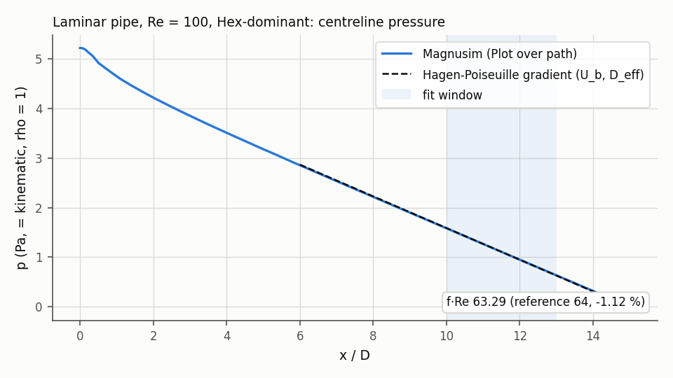
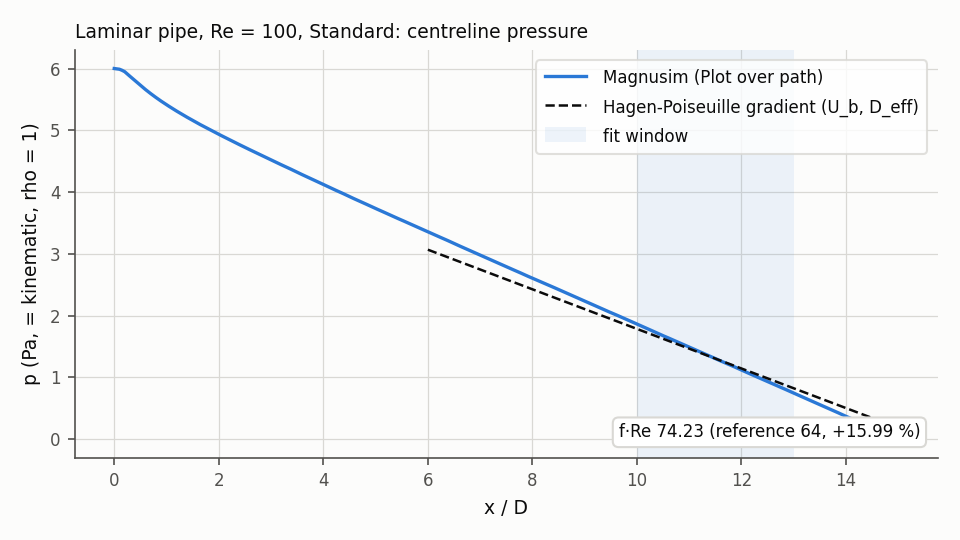

# Validation

Magnusim's validation set: textbook flows with published answers, set up and solved through
the app itself. Each case is a STEP file imported into a project, given its BCs and fluid,
meshed by the app's mesher and solved by Start, through the same routes the page and the
Assistant use; its numbers are then read from the run's own monitors and from Plot over
path, and compared with the reference values below, each with its citation. Nothing is
tuned per case and no number is typed in: a value here is what the app produced.

**Report-only.** These numbers are what this version computes; no case fails on them yet.
After the first full run the tolerances are locked, and from then on a locked quantity
outside its tolerance fails the run and blocks a release. The bands shown are the proposed
ones (from the reference data). A run fails already when it cannot produce its numbers: a
setup the app refuses, a mesh or solve that fails, wall layers asked and not applied.

The set so far: case 1 (laminar pipe, both meshers). Cases 2 to 6 (turbulent pipe,
lid-driven cavity, backward-facing step, cylinder, sphere) follow; see
`validation/README.md`.

## Running it

WSL with OpenFOAM v2606, as the app's Setup installs it. From `magnusim-web`:

```bash
npm run test:validation                                   # every case and variant (8 cores each), then this report
npm run test:validation -- --case c1 --variant standard --cores 4
npm run test:validation -- --coarse                       # quick coarse runs (results-coarse/, not reported)
npm run validation:report                                 # this file and the public page from the results
npm run validation:report -- --check                      # exit 1 when they are out of date
```

Each run writes `validation/results/<case>/<variant>/plan.json` (every request it sends)
and `result.json` (the values, their sources, the mesh, the run and its health). The
public page is built into `docs/validation/` at the repository's root; it is published
only when GitHub Pages is turned on for `docs/` and the branch is pushed.

## Results

Environment: 2026-11-04: commit 73f945bca1cf, OpenFOAM v2606 (build _481094f-20260618), 4 cores of a 32-thread PC: c1_laminar_pipe/hexdominant (WSL load 15.24 while it solved), c1_laminar_pipe/standard (WSL load 10.01 while it solved).

| Case | Mesher | Status | Quantity | Reference | Magnusim | Error | Band (report-only) | Cells | Wall layers | Iterations | Solve time | Run health |
| --- | --- | --- | --- | --- | --- | --- | --- | --- | --- | --- | --- | --- |
| Laminar pipe, Re = 100 | Hex-dominant | ok | Darcy friction factor × Re, developed part (x/D 10 to 13) | 64 | 63.286 | -1.12 % | ±2 % (inside) | 128 706 | applied (pipe_wall 3.83 of 4) | 144 | 19 s | healthy |
| Laminar pipe, Re = 100 | Hex-dominant | ok | Centreline speed / bulk speed, developed part (x/D 10 to 13) | 2 | 1.9328 | -3.36 % | ±1.5 % (outside) | 128 706 | applied (pipe_wall 3.83 of 4) | 144 | 19 s | healthy |
| Laminar pipe, Re = 100 | Hex-dominant | ok | Development length L_e / D (to 99 % of the developed centreline speed) | 5.77 | 5.5369 | -4.04 % | ±15 % (inside) | 128 706 | applied (pipe_wall 3.83 of 4) | 144 | 19 s | healthy |
| Laminar pipe, Re = 100 | Standard | ok | Darcy friction factor × Re, developed part (x/D 10 to 13) | 64 | 74.177 | +15.90 % | ±2 % (outside) | 139 146 | applied (pipe_wall 3 of 3) | 318 | 30 s | healthy |
| Laminar pipe, Re = 100 | Standard | ok | Centreline speed / bulk speed, developed part (x/D 10 to 13) | 2 | 1.9511 | -2.44 % | ±1.5 % (outside) | 139 146 | applied (pipe_wall 3 of 3) | 318 | 30 s | healthy |
| Laminar pipe, Re = 100 | Standard | ok | Development length L_e / D (to 99 % of the developed centreline speed) | 5.77 | 5.444 | -5.65 % | ±15 % (inside) | 139 146 | applied (pipe_wall 3 of 3) | 318 | 30 s | healthy |

## Laminar pipe, Re = 100

A pipe, D = 20 mm, L = 300 mm (15 D) along +x from x = 0 (STEP in mm, built with OCP); a custom fluid with nu = 0.0002 m²/s and rho = 1 kg/m³, so Re = U D / nu = 100; a velocity inlet of 1 m/s normal to the face, a 0 Pa pressure outlet and a no-slip wall; laminar, steady (simpleFoam), Accurate numerics, residual targets 1e-6, at most 3000 iterations.

### Hex-dominant

- Status: ok.
- Mesh settings: Hex-dominant at fineness 6 with an Inflate boundary layer of 4 layers, 1 mm in all, on the wall (automatic boundary layers off); 1 non-orthogonal corrector.
- Mesh: 128 706 cells, background block 67 × 8 × 12, generated in 36.9 s; checkMesh OK (max non-orthogonality 69.3°, max skewness 1.49, max aspect ratio 12.4); wall layers applied (pipe_wall 3.83 of 4), first layer 0.179 mm.
- Run: 144 iterations, converged at iteration 144; solve 19 s on 4 ranks (Cores 4); run health healthy.
- Pre-run check: info still_start: The run starts from rest; starting from potential flow shortens the start-up.
- Its estimate before Start: 3,000 iterations at most · ~23 minutes on 4 cores · Re ≈ 100.
- **Darcy friction factor × Re, developed part (x/D 10 to 13)**: 63.286 against 64 (-1.12 %, band ±2 % (inside), report-only); ± 0.016 % (the slope's standard error and twice the cross-section's). How: f·Re = 2 D_eff² (−dp/dx) / (mu U_b): dp/dx the least-squares slope of the centreline pressure from Plot over path (0,0,0) to (0.3,0,0) m, 300 subdivisions, over x/D 10 to 13; U_b = Q / A and D_eff = sqrt(4 A / pi), Q the flow through the inlet and A the pipe's meshed cross-section, the mean of the inlet's and the outlet's mesh areas (all three from the run's monitors), since a meshed circle's area is not exactly pi D²/4. Source: `route:/api/plot-over-path`. -dp/dx 15.8298 Pa/m from 60 samples (slope standard error 0.02 %, r² 0.999999); D_eff 19.995 mm, U_b 1.0000 m/s.
- **Centreline speed / bulk speed, developed part (x/D 10 to 13)**: 1.9328 against 2 (-3.36 %, band ±1.5 % (outside), report-only). How: mean of the centreline speed \|U\| (= U_x on the axis) from Plot over path (0,0,0) to (0.3,0,0) m, 300 subdivisions, over x/D 10 to 13, over U_b = Q / A (as for f·Re). Source: `route:/api/plot-over-path`. centreline 1.9328 m/s (from 1.9317 to 1.9333 over 60 samples) over U_b 1.0000 m/s.
- **Development length L_e / D (to 99 % of the developed centreline speed)**: 5.5369 against 5.77 (-4.04 %, band ±15 % (inside), report-only). How: the first x where the centreline speed from Plot over path reaches 99 % of its own developed value (its mean over x/D 10 to 13), linearly interpolated between samples, over D_eff. Source: `route:/api/plot-over-path`. 99 % of 1.9328 m/s reached at x = 110.7 mm.
- Shown, not compared: the pipe's cross-section as meshed 313.99 mm² (inlet 313.99, outlet 313.99; -0.05 % against pi D²/4), so D_eff 19.995 mm and U_b 1 m/s; -dp/dx 15.83 Pa/m (-1.06 % against 32 mu U / D² = 16 Pa/m with the nominal D); the inlet's area-averaged pressure 5.606 Pa (the outlet's 0 Pa), flow out against in -0.002 %; Darcy f 0.633 at Re_eff 99.973; the centreline probes' mean U_x over x/D 10 to 13 1.9349 U_b (the cell holding each point).




### Standard

- Status: ok.
- Mesh settings: Standard at fineness 6 with its automatic boundary layers and hex core; 2 non-orthogonal correctors.
- Mesh: 139 146 cells, generated in 15.1 s; checkMesh OK (max non-orthogonality 67.1°, max skewness 0.928, max aspect ratio 8.63); wall layers applied (pipe_wall 3 of 3), first layer 0.136 mm.
- Run: 318 iterations, converged at iteration 318; solve 30 s on 4 ranks (Cores 4); run health healthy.
- Pre-run check: info still_start: The run starts from rest; starting from potential flow shortens the start-up.
- Its estimate before Start: 3,000 iterations at most · ~4 minutes on 4 cores · Re ≈ 100.
- **Darcy friction factor × Re, developed part (x/D 10 to 13)**: 74.177 against 64 (+15.90 %, band ±2 % (outside), report-only); ± 0.051 % (the slope's standard error and twice the cross-section's). How: f·Re = 2 D_eff² (−dp/dx) / (mu U_b): dp/dx the least-squares slope of the centreline pressure from Plot over path (0,0,0) to (0.3,0,0) m, 300 subdivisions, over x/D 10 to 13; U_b = Q / A and D_eff = sqrt(4 A / pi), Q the flow through the inlet and A the pipe's meshed cross-section, the mean of the inlet's and the outlet's mesh areas (all three from the run's monitors), since a meshed circle's area is not exactly pi D²/4. Source: `route:/api/plot-over-path`. -dp/dx 18.5846 Pa/m from 60 samples (slope standard error 0.05 %, r² 0.999985); D_eff 19.978 mm, U_b 1.0000 m/s.
- **Centreline speed / bulk speed, developed part (x/D 10 to 13)**: 1.9511 against 2 (-2.44 %, band ±1.5 % (outside), report-only). How: mean of the centreline speed \|U\| (= U_x on the axis) from Plot over path (0,0,0) to (0.3,0,0) m, 300 subdivisions, over x/D 10 to 13, over U_b = Q / A (as for f·Re). Source: `route:/api/plot-over-path`. centreline 1.9511 m/s (from 1.9498 to 1.9520 over 60 samples) over U_b 1.0000 m/s.
- **Development length L_e / D (to 99 % of the developed centreline speed)**: 5.444 against 5.77 (-5.65 %, band ±15 % (inside), report-only). How: the first x where the centreline speed from Plot over path reaches 99 % of its own developed value (its mean over x/D 10 to 13), linearly interpolated between samples, over D_eff. Source: `route:/api/plot-over-path`. 99 % of 1.9511 m/s reached at x = 108.8 mm.
- Shown, not compared: the pipe's cross-section as meshed 313.48 mm² (inlet 313.48, outlet 313.48; -0.22 % against pi D²/4), so D_eff 19.978 mm and U_b 1 m/s; -dp/dx 18.585 Pa/m (+16.15 % against 32 mu U / D² = 16 Pa/m with the nominal D); the inlet's area-averaged pressure 6.35 Pa (the outlet's 0 Pa), flow out against in 0 %; Darcy f 0.7426 at Re_eff 99.891; the centreline probes' mean U_x over x/D 10 to 13 2.0071 U_b (the cell holding each point).




### References

- **Darcy friction factor × Re, developed part (x/D 10 to 13)**: 64 (exact, CONFIRMED). G. Hagen (1839), "Ueber die Bewegung des Wassers in engen cylindrischen Röhren", Ann. Phys. Chem. 46:423-442; J. L. M. Poiseuille (1840), C. R. Acad. Sci. Paris 11:961-967, 1041-1048: the exact (Hagen-Poiseuille) solution of the Navier-Stokes equations for fully developed laminar pipe flow; Darcy f = 64/Re (f = 0.640 at Re 100), i.e. -dp/dx = 32 mu U / D² = 16 Pa/m here. Conditions: fully developed, steady, Newtonian; Re = rho U D / mu with U the bulk (mean) speed; Re = 100.
- **Centreline speed / bulk speed, developed part (x/D 10 to 13)**: 2 (exact, CONFIRMED). G. Hagen (1839), "Ueber die Bewegung des Wassers in engen cylindrischen Röhren", Ann. Phys. Chem. 46:423-442; J. L. M. Poiseuille (1840), C. R. Acad. Sci. Paris 11:961-967, 1041-1048: the exact (Hagen-Poiseuille) solution of the Navier-Stokes equations for fully developed laminar pipe flow; u(r) = 2 U (1 - (r/R)²), so u_c = 2.000 U. Conditions: fully developed, steady, Newtonian; Re = rho U D / mu with U the bulk (mean) speed; Re = 100.
- **Development length L_e / D (to 99 % of the developed centreline speed)**: 5.77 (correlation, SECONDARY). F. Durst, S. Ray, B. Ünsal, O. A. Bayoumi (2005), "The development lengths of laminar pipe and channel flows", J. Fluids Eng. 127:1154-1160; the pipe correlation L/D = [0.619^1.6 + (0.0567 Re)^1.6]^(1/1.6) (constants as quoted from the abstract by citing papers; error under 3 % for all laminar Re), 5.77 at Re 100. Conditions: laminar, uniform inlet; the distance to 99 % of the developed centreline velocity; Re = 100. Depends on the 99 % definition and on the inlet profile; the 0.05 Re rule (5.0) is about 13 % short.

### Notes

- Where the design and the reference data differ, the reference data win: the bands are ±2 % on f·Re and ±1.5 % on U_cl/U_b on both meshers (the design proposed ±2 % / ±5 % and ±2 % / ±3 %), and the developed part read is x/D 10 to 13 (the design's 8 to 13: the reference data ask for stations more than about 10 D from a uniform inlet).
- The bulk speed and D_eff use the pipe's cross-section as meshed (the mean of the inlet's and the outlet's mesh areas, from the run's monitors), not pi D²/4: f·Re goes as the area squared.
- The compared centreline speed comes from the cell values themselves (a fit of U_x = u_c + b r² over the window's cells within R/2 of the axis). Plot over path samples the field averaged to the mesh's points, which reads a peak low where the cells are coarse, and on a mesh whose axis runs along cell edges no cell centre lies on the axis at all; what the line reads on the axis is shown beside the fit, with the profile's RMS difference from the exact parabola at the cells' own radii.
- The centreline Point probes take the value of the cell that holds each point. Where the axis runs along cell edges (Hex-dominant) that is one of the off-axis cells around it, the same cells the fit uses, so the probes are shown, not used as an independent check.
- The development length is read on Plot over path's centreline, against the same line's developed value, so the line's averaging enters both nearly alike. The 99 % point lies where the centreline speed is nearly flat: a change in the fourth digit of the solution moves it by millimetres, and repeated runs of the same plan can read a few per cent apart. Its band is wide (±15 %) for that reason and for the 99 % definition.
- On Standard the friction factor reads well above the exact value. The wall shear stress the run itself saved (shown with each run) carries the same excess, and the cell values run faster than the parabola near the wall and slower at mid-radius, so the pressure drop is the solution's, not an artefact of reading it. The cause in Standard's mesh is under investigation (an app gap), and the turbulent pipe's Standard runs wait for it.
