# Validation

Magnusim's validation set: textbook flows with published answers, set up and solved through
the app itself. Each case is a STEP file imported into a project, given its BCs and fluid,
meshed by the app's mesher and solved by Start, through the same routes the page and the
Assistant use; its numbers are then read from the run's own monitors and from Plot over
path, and compared with the reference values below, each with its citation. Nothing is
tuned per case and no number is typed in: a value here is what the app produced.

**Report-only.** These numbers are what this version computes; no case fails on them yet.
The tolerances are locked once Daniel has reviewed a full run of the whole set, and from then
on a locked quantity outside its tolerance fails the run and blocks a release. The bands
shown are the proposed ones (from the reference data). A run fails already when it cannot produce its numbers: a
setup the app refuses, a mesh or solve that fails, wall layers asked and not applied.

The set so far: Laminar pipe, Re = 100 (Hex-dominant, Standard); Turbulent pipe, Re = 50 000
(Hex-dominant, k-omega SST, Hex-dominant, k-epsilon, Standard, k-omega SST, Standard,
k-epsilon); Lid-driven cavity (Re = 100, Hex-dominant (2D), Re = 1000, Hex-dominant (2D));
Backward-facing step (Re_D = 100 (Armaly et al.), Hex-dominant (2D), Re_D = 800 (Gartling),
Hex-dominant (2D)); Circular cylinder (Re = 20, steady, Hex-dominant (2D), Re = 40, steady,
Hex-dominant (2D), Re = 100, transient (shedding), Hex-dominant (2D)); Sphere (Re = 100,
steady, Hex-dominant). Heat Transfer's own validation set is reported after them.

## Running it

WSL with OpenFOAM v2606, as the app's Setup installs it. From `magnusim-web`:

```bash
npm run test:validation                                   # every case and variant (8 cores each), then this report
npm run test:validation -- --case c1 --variant standard --cores 4
npm run test:validation -- --coarse                       # quick coarse runs (results-coarse/, not reported)
npm run validation:report                                 # this file and the public page from the results
npm run validation:report -- --check                      # exit 1 when they are out of date
```

Each run writes `validation/results/<case>/<variant>/plan.json` (every request it sends)
and `result.json` (the values, their sources, the mesh, the run and its health). The
public page is built into `docs/validation/` at the repository's root; it is published
only when GitHub Pages is turned on for `docs/` and the branch is pushed.

## Results

Environment: 2026-11-06: commit aaabb53150c1, OpenFOAM v2606 (build _481094f-20260618), 8 cores of a 32-thread PC: c1_laminar_pipe/hexdominant (WSL load 1.08 while it solved), c1_laminar_pipe/standard (WSL load 0.98 while it solved), c2_turbulent_pipe/hexdominant_sst (WSL load 2.66 while it solved), c2_turbulent_pipe/hexdominant_kepsilon (WSL load 5.49 while it solved), c2_turbulent_pipe/standard_sst (WSL load 5.05 while it solved), c2_turbulent_pipe/standard_kepsilon (WSL load 5.84 while it solved), c3_lid_cavity/re100 (WSL load 5.23 while it solved), c3_lid_cavity/re1000 (WSL load 4.64 while it solved), c4_backward_step/re100 (WSL load 7.84 while it solved), c4_backward_step/re800 (WSL load 8.32 while it solved), c5_cylinder/re20 (WSL load 8.8 while it solved), c5_cylinder/re40 (WSL load 8.81 while it solved), c5_cylinder/re100 (WSL load 8.7 while it solved), c6_sphere/re100 (WSL load 7.87 while it solved).

| Case | Run | Status | Quantity | Reference | Magnusim | Error | Band (report-only) | Cells | Wall layers | Iterations / time | Solve time | Run health |
| --- | --- | --- | --- | --- | --- | --- | --- | --- | --- | --- | --- | --- |
| Laminar pipe, Re = 100 | Hex-dominant | ok | Darcy friction factor × Re, developed part (x/D 10 to 13) | 64 | 63.292 | -1.11 % | ±2 % (inside) | 128 704 | applied (pipe_wall 3.83 of 4) | 140 | 16 s | healthy |
| Laminar pipe, Re = 100 | Hex-dominant | ok | Centreline speed / bulk speed, developed part (x/D 10 to 13) | 2 | 2.0021 | +0.10 % | ±1.5 % (inside) | 128 704 | applied (pipe_wall 3.83 of 4) | 140 | 16 s | healthy |
| Laminar pipe, Re = 100 | Hex-dominant | ok | Development length L_e / D (to 99 % of the developed centreline speed) | 5.77 | 5.6019 | -2.91 % | ±15 % (inside) | 128 704 | applied (pipe_wall 3.83 of 4) | 140 | 16 s | healthy |
| Laminar pipe, Re = 100 | Standard | ok | Darcy friction factor × Re, developed part (x/D 10 to 13) | 64 | 74.232 | +15.99 % | ±2 % (outside) | 139 228 | applied (pipe_wall 3 of 3) | 317 | 21 s | healthy |
| Laminar pipe, Re = 100 | Standard | ok | Centreline speed / bulk speed, developed part (x/D 10 to 13) | 2 | 2.0026 | +0.13 % | ±1.5 % (inside) | 139 228 | applied (pipe_wall 3 of 3) | 317 | 21 s | healthy |
| Laminar pipe, Re = 100 | Standard | ok | Development length L_e / D (to 99 % of the developed centreline speed) | 5.77 | 5.451 | -5.53 % | ±15 % (inside) | 139 228 | applied (pipe_wall 3 of 3) | 317 | 21 s | healthy |
| Turbulent pipe, Re = 50 000 | Hex-dominant, k-omega SST | ok | Darcy friction factor from the pressure drop, x/D 20 to 25 | 0.0211 | 0.018321 | -13.17 % | ±10 % (outside) | 76 184 | applied (pipe_wall 0.909 of 1) | 2500 | 105 s | healthy |
| Turbulent pipe, Re = 50 000 | Hex-dominant, k-omega SST | ok | Darcy friction factor from the wall shear stress, x/D 20 to 25 | 0.0211 | 0.018401 | -12.79 % | ±10 % (outside) | 76 184 | applied (pipe_wall 0.909 of 1) | 2500 | 105 s | healthy |
| Turbulent pipe, Re = 50 000 | Hex-dominant, k-epsilon | ok | Darcy friction factor from the pressure drop, x/D 20 to 25 | 0.0211 | 0.019474 | -7.71 % | ±10 % (inside) | 76 184 | applied (pipe_wall 0.909 of 1) | 2500 | 97 s | watch |
| Turbulent pipe, Re = 50 000 | Hex-dominant, k-epsilon | ok | Darcy friction factor from the wall shear stress, x/D 20 to 25 | 0.0211 | 0.019581 | -7.20 % | ±10 % (inside) | 76 184 | applied (pipe_wall 0.909 of 1) | 2500 | 97 s | watch |
| Turbulent pipe, Re = 50 000 | Standard, k-omega SST | ok | Darcy friction factor from the pressure drop, x/D 20 to 25 | 0.0211 | 0.015798 | -25.13 % | ±10 % (outside) | 69 436 | applied (pipe_wall 3 of 3) | 2500 | 79 s | healthy |
| Turbulent pipe, Re = 50 000 | Standard, k-omega SST | ok | Darcy friction factor from the wall shear stress, x/D 20 to 25 | 0.0211 | 0.015517 | -26.46 % | ±10 % (outside) | 69 436 | applied (pipe_wall 3 of 3) | 2500 | 79 s | healthy |
| Turbulent pipe, Re = 50 000 | Standard, k-epsilon | ok | Darcy friction factor from the pressure drop, x/D 20 to 25 | 0.0211 | 0.020301 | -3.79 % | ±10 % (inside) | 69 436 | applied (pipe_wall 3 of 3) | 2500 | 80 s | watch |
| Turbulent pipe, Re = 50 000 | Standard, k-epsilon | ok | Darcy friction factor from the wall shear stress, x/D 20 to 25 | 0.0211 | 0.020472 | -2.98 % | ±10 % (inside) | 69 436 | applied (pipe_wall 3 of 3) | 2500 | 80 s | watch |
| Lid-driven cavity | Re = 100, Hex-dominant (2D) | ok | u/U_lid on the vertical centreline, RMS difference from Ghia et al. (Re 100) | 0 | 0.0023354 | +0.00234 U_lid | ±0.01 U_lid (inside) | 34 580 | none asked | 6507 | 82 s | healthy |
| Lid-driven cavity | Re = 100, Hex-dominant (2D) | ok | u/U_lid on the vertical centreline, largest difference from Ghia et al. (Re 100) | 0 | 0.0044695 | +0.00447 U_lid | ±0.03 U_lid (inside) | 34 580 | none asked | 6507 | 82 s | healthy |
| Lid-driven cavity | Re = 100, Hex-dominant (2D) | ok | v/U_lid on the horizontal centreline, RMS difference from Ghia et al. (Re 100) | 0 | 0.0045779 | +0.00458 U_lid | ±0.01 U_lid (inside) | 34 580 | none asked | 6507 | 82 s | healthy |
| Lid-driven cavity | Re = 100, Hex-dominant (2D) | ok | v/U_lid on the horizontal centreline, largest difference from Ghia et al. (Re 100) | 0 | 0.0085014 | +0.0085 U_lid | ±0.03 U_lid (inside) | 34 580 | none asked | 6507 | 82 s | healthy |
| Lid-driven cavity | Re = 100, Hex-dominant (2D) | ok | u_min / U_lid on the vertical centreline (Re 100) | -0.214 | -0.21358 | +0.21 % | ±3 % (inside) | 34 580 | none asked | 6507 | 82 s | healthy |
| Lid-driven cavity | Re = 100, Hex-dominant (2D) | ok | v_max / U_lid on the horizontal centreline (Re 100) | 0.1796 | 0.17874 | -0.46 % | ±3 % (inside) | 34 580 | none asked | 6507 | 82 s | healthy |
| Lid-driven cavity | Re = 100, Hex-dominant (2D) | ok | v_min / U_lid on the horizontal centreline (Re 100) | -0.2538 | -0.25296 | +0.33 % | ±3 % (inside) | 34 580 | none asked | 6507 | 82 s | healthy |
| Lid-driven cavity | Re = 100, Hex-dominant (2D) | ok | Primary vortex, psi_min / (U_lid L) (Re 100) | -0.1035 | -0.10335 | +0.17 % | ±2 % (inside) | 34 580 | none asked | 6507 | 82 s | healthy |
| Lid-driven cavity | Re = 100, Hex-dominant (2D) | ok | Primary vortex centre, x / L (Re 100) | 0.6162 | 0.6158 | -0.07 % | ±0.01 L (inside) | 34 580 | none asked | 6507 | 82 s | healthy |
| Lid-driven cavity | Re = 100, Hex-dominant (2D) | ok | Primary vortex centre, y / L (Re 100) | 0.7373 | 0.73766 | +0.05 % | ±0.01 L (inside) | 34 580 | none asked | 6507 | 82 s | healthy |
| Lid-driven cavity | Re = 1000, Hex-dominant (2D) | ok | u/U_lid on the vertical centreline, RMS difference from Ghia et al. (Re 1000) | 0 | 0.004111 | +0.00411 U_lid | ±0.02 U_lid (inside) | 34 580 | none asked | 6055 | 86 s | healthy |
| Lid-driven cavity | Re = 1000, Hex-dominant (2D) | ok | u/U_lid on the vertical centreline, largest difference from Ghia et al. (Re 1000) | 0 | 0.0075993 | +0.0076 U_lid | ±0.03 U_lid (inside) | 34 580 | none asked | 6055 | 86 s | healthy |
| Lid-driven cavity | Re = 1000, Hex-dominant (2D) | ok | v/U_lid on the horizontal centreline, RMS difference from Ghia et al. (Re 1000) | 0 | 0.0082806 | +0.00828 U_lid | ±0.02 U_lid (inside) | 34 580 | none asked | 6055 | 86 s | healthy |
| Lid-driven cavity | Re = 1000, Hex-dominant (2D) | ok | v/U_lid on the horizontal centreline, largest difference from Ghia et al. (Re 1000) | 0 | 0.015516 | +0.0155 U_lid | ±0.03 U_lid (inside) | 34 580 | none asked | 6055 | 86 s | healthy |
| Lid-driven cavity | Re = 1000, Hex-dominant (2D) | ok | u_min / U_lid on the vertical centreline (Re 1000) | -0.3886 | -0.38757 | +0.26 % | ±3 % (inside) | 34 580 | none asked | 6055 | 86 s | healthy |
| Lid-driven cavity | Re = 1000, Hex-dominant (2D) | ok | v_max / U_lid on the horizontal centreline (Re 1000) | 0.3769 | 0.37597 | -0.26 % | ±3 % (inside) | 34 580 | none asked | 6055 | 86 s | healthy |
| Lid-driven cavity | Re = 1000, Hex-dominant (2D) | ok | v_min / U_lid on the horizontal centreline (Re 1000) | -0.5271 | -0.52485 | +0.42 % | ±3 % (inside) | 34 580 | none asked | 6055 | 86 s | healthy |
| Lid-driven cavity | Re = 1000, Hex-dominant (2D) | ok | Primary vortex, psi_min / (U_lid L) (Re 1000) | -0.1189 | -0.11858 | +0.30 % | ±2 % (inside) | 34 580 | none asked | 6055 | 86 s | healthy |
| Lid-driven cavity | Re = 1000, Hex-dominant (2D) | ok | Primary vortex centre, x / L (Re 1000) | 0.5312 | 0.53112 | -0.02 % | ±0.01 L (inside) | 34 580 | none asked | 6055 | 86 s | healthy |
| Lid-driven cavity | Re = 1000, Hex-dominant (2D) | ok | Primary vortex centre, y / L (Re 1000) | 0.5654 | 0.56543 | -0.00 % | ±0.01 L (inside) | 34 580 | none asked | 6055 | 86 s | healthy |
| Backward-facing step | Re_D = 100 (Armaly et al.), Hex-dominant (2D) | ok | Primary reattachment on the floor, x1/S (Re_D 100) | 3 | 2.8543 | -4.86 % | ±10 % (inside) | 182 316 | none asked | 2665 | 115 s | healthy |
| Backward-facing step | Re_D = 800 (Gartling), Hex-dominant (2D) | ok | Primary reattachment on the floor, x_r/S (Re_D 800) | 12.2 | 11.683 | -4.24 % | ±7 % (inside) | 171 840 | none asked | 6000 | 258 s | healthy |
| Backward-facing step | Re_D = 800 (Gartling), Hex-dominant (2D) | ok | Top wall's bubble, separation x_s/S (Re_D 800) | 9.7 | 9.2206 | -4.94 % | ±10 % (inside) | 171 840 | none asked | 6000 | 258 s | healthy |
| Backward-facing step | Re_D = 800 (Gartling), Hex-dominant (2D) | ok | Top wall's bubble, reattachment x_r2/S (Re_D 800) | 20.96 | 20.385 | -2.75 % | ±10 % (inside) | 171 840 | none asked | 6000 | 258 s | healthy |
| Circular cylinder | Re = 20, steady, Hex-dominant (2D) | ok | Drag coefficient Cd (Re 20) | 2.02 | 2.0764 | +2.79 % | ±5 % (inside) | 70 793 | none asked | 2666 | 58 s | healthy |
| Circular cylinder | Re = 20, steady, Hex-dominant (2D) | ok | Recirculation length L/D (Re 20) | 0.93 | 0.92907 | -0.10 % | ±5 % (inside) | 70 793 | none asked | 2666 | 58 s | healthy |
| Circular cylinder | Re = 40, steady, Hex-dominant (2D) | ok | Drag coefficient Cd (Re 40) | 1.5 | 1.5481 | +3.21 % | ±5 % (inside) | 70 793 | none asked | 1855 | 39 s | healthy |
| Circular cylinder | Re = 40, steady, Hex-dominant (2D) | ok | Recirculation length L/D (Re 40) | 2.24 | 2.2818 | +1.87 % | ±5 % (inside) | 70 793 | none asked | 1855 | 39 s | healthy |
| Circular cylinder | Re = 100, transient (shedding), Hex-dominant (2D) | ok | Strouhal number St = f D / U (Re 100) | 0.164 | 0.16568 | +1.03 % | ±3 % (inside) | 70 793 | none asked | t = 3 s (27 153 steps) | 936 s | healthy |
| Circular cylinder | Re = 100, transient (shedding), Hex-dominant (2D) | ok | Mean drag coefficient (Re 100) | 1.33 | 1.3568 | +2.01 % | ±5 % (inside) | 70 793 | none asked | t = 3 s (27 153 steps) | 936 s | healthy |
| Circular cylinder | Re = 100, transient (shedding), Hex-dominant (2D) | ok | Lift coefficient rms (Re 100) | 0.23 | 0.24939 | +8.43 % | ±15 % (inside) | 70 793 | none asked | t = 3 s (27 153 steps) | 936 s | healthy |
| Circular cylinder | Re = 100, transient (shedding), Hex-dominant (2D) | ok | Mean recirculation length L/D (Re 100, information) | 1.41 | 1.3584 | -3.66 % | ±10 % (inside) | 70 793 | none asked | t = 3 s (27 153 steps) | 936 s | healthy |
| Sphere | Re = 100, steady, Hex-dominant | ok | Drag coefficient Cd (Re 100) | 1.09 | 1.0925 | +0.23 % | ±5 % (inside) | 669 786 | applied (sphere 4 of 4) | 549 | 254 s | healthy |
| Sphere | Re = 100, steady, Hex-dominant | ok | Recirculation length L/D (Re 100) | 0.88 | 0.85726 | -2.58 % | ±7 % (inside) | 669 786 | applied (sphere 4 of 4) | 549 | 254 s | healthy |

## Laminar pipe, Re = 100

A pipe, D = 20 mm, L = 300 mm (15 D) along +x from x = 0 (STEP in mm, built with OCP); a custom fluid with nu = 0.0002 m²/s and rho = 1 kg/m³, so Re = U D / nu = 100; a velocity inlet of 1 m/s normal to the face, a 0 Pa pressure outlet and a no-slip wall; laminar, steady (simpleFoam), Accurate numerics, residual targets 1e-6, at most 3000 iterations.

### Hex-dominant

- Status: ok.
- Mesh settings: Hex-dominant at fineness 6 with an Inflate boundary layer of 4 layers, 1 mm in all, on the wall (automatic boundary layers off); 1 non-orthogonal corrector.
- Mesh: 128 704 cells (the plan's estimate about 163 000), background block 67 × 8 × 12, wall cells 1.49 × 0.831 × 0.554 mm (x × y × z), generated in 15.4 s; checkMesh OK (max non-orthogonality 69.3°, max skewness 1.49, max aspect ratio 12.4); wall layers applied (pipe_wall 3.83 of 4), first layer 0.179 mm.
- Run: 140 iterations, converged at iteration 140; solve 16 s on 8 ranks (Cores 8); run health healthy.
- The solver's last initial residuals: Ux 2.4 × 10^-7, Uy 9 × 10^-7, Uz 9.8 × 10^-7, p 2.6 × 10^-7.
- Pre-run check: info still_start: The run starts from rest; starting from potential flow shortens the start-up.
- Its estimate before Start: 3,000 iterations at most · ~11 minutes on 8 cores · Re ≈ 100.
- **Darcy friction factor × Re, developed part (x/D 10 to 13)**: 63.292 against 64 (-1.11 %, band ±2 % (inside), report-only); ± 0.0036 % (the slope's standard error and twice the cross-section's). How: f·Re = 2 D_eff² (−dp/dx) / (mu U_b): dp/dx the least-squares slope of the centreline pressure from Plot over path (0,0,0) to (0.3,0,0) m, 300 subdivisions, over x/D 10 to 13; U_b = Q / A and D_eff = sqrt(4 A / pi), Q the flow through the inlet and A the pipe's meshed cross-section, the mean of the inlet's and the outlet's mesh areas (all three from the run's monitors), since a meshed circle's area is not exactly pi D²/4. Source: `route:/api/plot-over-path`. -dp/dx 15.8313 Pa/m from 60 samples (slope standard error 0.00 %, r² 1.000000); D_eff 19.995 mm, U_b 1.0000 m/s.
- **Centreline speed / bulk speed, developed part (x/D 10 to 13)**: 2.0021 against 2 (+0.10 %, band ±1.5 % (inside), report-only). How: the centre value u_c of a least-squares fit U_x = u_c + b r² (the developed profile's own form) to the cell values, not interpolated, of every cell whose centre lies in x/D 10 to 13 within R/2 of the axis, read from the run's saved U by the app's own volume loader (case_volume.load_volume, the code behind Plot over path), over U_b = Q / A (as for f·Re). Source: `app_sampling (cell values)`. u_c 2.0021 m/s (standard error 0.0011) from 400 cells within 5.00 mm of the axis, over U_b 1.0000 m/s; the cells nearest the axis (r = 1.834 mm) read 1.9354 m/s, the exact profile there 1.9327.
- **Development length L_e / D (to 99 % of the developed centreline speed)**: 5.6019 against 5.77 (-2.91 %, band ±15 % (inside), report-only). How: the first x where the centreline speed from Plot over path (0,0,0) to (0.3,0,0) m, 300 subdivisions, reaches 99 % of the same line's developed value (its mean over x/D 10 to 13), linearly interpolated between samples, over D_eff. Source: `route:/api/plot-over-path`. 99 % of 1.9330 m/s reached at x = 112.0 mm.
- Shown, not compared: the pipe's cross-section as meshed 313.99 mm² (inlet 313.99, outlet 313.99; -0.05 % against pi D²/4), so D_eff 19.995 mm and U_b 1 m/s; -dp/dx 15.831 Pa/m (-1.05 % against 32 mu U / D² = 16 Pa/m with the nominal D); the wall shear stress the run saved, over x/D 10 to 13, 0.07905 Pa (-1.21 % against 8 mu U_b / D_eff = 0.08002 Pa), which balances -dp/dx = 4 tau_w / D_eff = 15.814 Pa/m; the inlet's area-averaged pressure 5.606 Pa (the outlet's 0 Pa), flow out against in 1.6 × 10^-6 %; Darcy f 0.6331 at Re_eff 99.973; Plot over path's centreline over x/D 10 to 13 1.933 U_b (the field averaged to the mesh's points); the centreline probes' mean U_x over x/D 10 to 13 1.9329 U_b (the value at each point); the 24001 cells of x/D 10 to 13 within an RMS 0.00807 U_b of 2 U_b (1 - (r/R)²) at their own radii; Plot over path's profile at x = 12 D within an RMS 0.051 U_b of it.


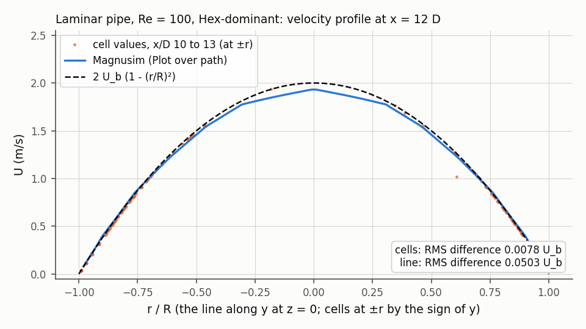


### Standard

- Status: ok.
- Mesh settings: Standard at fineness 6 with its automatic boundary layers and hex core; 2 non-orthogonal correctors.
- Mesh: 139 228 cells, generated in 15.1 s; checkMesh OK (max non-orthogonality 67.1°, max skewness 0.928, max aspect ratio 8.63); wall layers applied (pipe_wall 3 of 3), first layer 0.136 mm.
- Run: 317 iterations, converged at iteration 317; solve 21 s on 8 ranks (Cores 8); run health healthy.
- The solver's last initial residuals: Ux 1.2 × 10^-7, Uy 9.8 × 10^-7, Uz 8.1 × 10^-7, p 6.4 × 10^-7.
- Pre-run check: info still_start: The run starts from rest; starting from potential flow shortens the start-up.
- Its estimate before Start: 3,000 iterations at most · ~3 minutes on 8 cores · Re ≈ 100.
- **Darcy friction factor × Re, developed part (x/D 10 to 13)**: 74.232 against 64 (+15.99 %, band ±2 % (outside), report-only); ± 0.041 % (the slope's standard error and twice the cross-section's). How: f·Re = 2 D_eff² (−dp/dx) / (mu U_b): dp/dx the least-squares slope of the centreline pressure from Plot over path (0,0,0) to (0.3,0,0) m, 300 subdivisions, over x/D 10 to 13; U_b = Q / A and D_eff = sqrt(4 A / pi), Q the flow through the inlet and A the pipe's meshed cross-section, the mean of the inlet's and the outlet's mesh areas (all three from the run's monitors), since a meshed circle's area is not exactly pi D²/4. Source: `route:/api/plot-over-path`. -dp/dx 18.5985 Pa/m from 60 samples (slope standard error 0.04 %, r² 0.999990); D_eff 19.978 mm, U_b 1.0000 m/s.
- **Centreline speed / bulk speed, developed part (x/D 10 to 13)**: 2.0026 against 2 (+0.13 %, band ±1.5 % (inside), report-only). How: the centre value u_c of a least-squares fit U_x = u_c + b r² (the developed profile's own form) to the cell values, not interpolated, of every cell whose centre lies in x/D 10 to 13 within R/2 of the axis, read from the run's saved U by the app's own volume loader (case_volume.load_volume, the code behind Plot over path), over U_b = Q / A (as for f·Re). Source: `app_sampling (cell values)`. u_c 2.0026 m/s (standard error 0.0007) from 3887 cells within 4.99 mm of the axis, over U_b 1.0000 m/s; the cells nearest the axis (r = 0.001 mm) read 2.0068 m/s, the exact profile there 2.0000.
- **Development length L_e / D (to 99 % of the developed centreline speed)**: 5.451 against 5.77 (-5.53 %, band ±15 % (inside), report-only). How: the first x where the centreline speed from Plot over path (0,0,0) to (0.3,0,0) m, 300 subdivisions, reaches 99 % of the same line's developed value (its mean over x/D 10 to 13), linearly interpolated between samples, over D_eff. Source: `route:/api/plot-over-path`. 99 % of 1.9513 m/s reached at x = 108.9 mm.
- Shown, not compared: the pipe's cross-section as meshed 313.48 mm² (inlet 313.48, outlet 313.48; -0.22 % against pi D²/4), so D_eff 19.978 mm and U_b 1 m/s; -dp/dx 18.598 Pa/m (+16.24 % against 32 mu U / D² = 16 Pa/m with the nominal D); the wall shear stress the run saved, over x/D 10 to 13, 0.09294 Pa (+16.05 % against 8 mu U_b / D_eff = 0.08009 Pa), which balances -dp/dx = 4 tau_w / D_eff = 18.608 Pa/m; the inlet's area-averaged pressure 6.349 Pa (the outlet's 0 Pa), flow out against in 0 %; Darcy f 0.7431 at Re_eff 99.891; Plot over path's centreline over x/D 10 to 13 1.9513 U_b (the field averaged to the mesh's points); the centreline probes' mean U_x over x/D 10 to 13 1.9795 U_b (the value at each point); the 27441 cells of x/D 10 to 13 within an RMS 0.0438 U_b of 2 U_b (1 - (r/R)²) at their own radii; Plot over path's profile at x = 12 D within an RMS 0.0723 U_b of it.


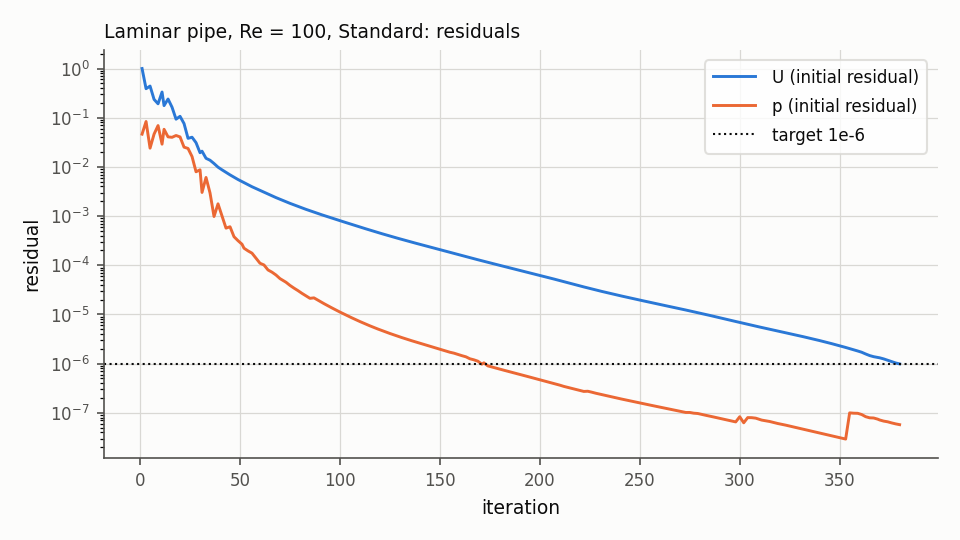

### References

- **Darcy friction factor × Re, developed part (x/D 10 to 13)**: 64 (exact, CONFIRMED). G. Hagen (1839), "Ueber die Bewegung des Wassers in engen cylindrischen Röhren", Ann. Phys. Chem. 46:423-442; J. L. M. Poiseuille (1840), C. R. Acad. Sci. Paris 11:961-967, 1041-1048: the exact (Hagen-Poiseuille) solution of the Navier-Stokes equations for fully developed laminar pipe flow; Darcy f = 64/Re (f = 0.640 at Re 100), i.e. -dp/dx = 32 mu U / D² = 16 Pa/m here. Conditions: fully developed, steady, Newtonian; Re = rho U D / mu with U the bulk (mean) speed; Re = 100.
- **Centreline speed / bulk speed, developed part (x/D 10 to 13)**: 2 (exact, CONFIRMED). G. Hagen (1839), "Ueber die Bewegung des Wassers in engen cylindrischen Röhren", Ann. Phys. Chem. 46:423-442; J. L. M. Poiseuille (1840), C. R. Acad. Sci. Paris 11:961-967, 1041-1048: the exact (Hagen-Poiseuille) solution of the Navier-Stokes equations for fully developed laminar pipe flow; u(r) = 2 U (1 - (r/R)²), so u_c = 2.000 U. Conditions: fully developed, steady, Newtonian; Re = rho U D / mu with U the bulk (mean) speed; Re = 100.
- **Development length L_e / D (to 99 % of the developed centreline speed)**: 5.77 (correlation, SECONDARY). F. Durst, S. Ray, B. Ünsal, O. A. Bayoumi (2005), "The development lengths of laminar pipe and channel flows", J. Fluids Eng. 127:1154-1160; the pipe correlation L/D = [0.619^1.6 + (0.0567 Re)^1.6]^(1/1.6) (constants as quoted from the abstract by citing papers; error under 3 % for all laminar Re), 5.77 at Re 100. Conditions: laminar, uniform inlet; the distance to 99 % of the developed centreline velocity; Re = 100. Depends on the 99 % definition and on the inlet profile; the 0.05 Re rule (5.0) is about 13 % short.

### Notes

- Where the design and the reference data differ, the reference data win: the bands are ±2 % on f·Re and ±1.5 % on U_cl/U_b on both meshers (the design proposed ±2 % / ±5 % and ±2 % / ±3 %), and the developed part read is x/D 10 to 13 (the design's 8 to 13: the reference data ask for stations more than about 10 D from a uniform inlet).
- The bulk speed and D_eff use the pipe's cross-section as meshed (the mean of the inlet's and the outlet's mesh areas, from the run's monitors), not pi D²/4: f·Re goes as the area squared.
- The compared centreline speed comes from the cell values themselves (a fit of U_x = u_c + b r² over the window's cells within R/2 of the axis). Plot over path samples the field averaged to the mesh's points, which reads a peak low where the cells are coarse, and on a mesh whose axis runs along cell edges no cell centre lies on the axis at all; what the line reads on the axis is shown beside the fit, with the profile's RMS difference from the exact parabola at the cells' own radii.
- The centreline Point probes read the value at each point (OpenFOAM's cellPoint interpolation, gap G3, fixed before these runs). Where the axis runs along cell edges (Hex-dominant) that value comes from the off-axis cells around it, the same cells the fit uses, so the probes are shown, not used as an independent check.
- The development length is read on Plot over path's centreline, against the same line's developed value, so the line's averaging enters both nearly alike. The 99 % point lies where the centreline speed is nearly flat: a change in the fourth digit of the solution moves it by millimetres, and repeated runs of the same plan can read a few per cent apart. Its band is wide (±15 %) for that reason and for the 99 % definition.
- On Standard the first full run (commit aaabb531) read the friction factor 16 % above the exact value, and the wall shear stress the run saved carried the same excess: the solution's, not the reading's. The cause was the app's schemes: plain linear interpolation and Gauss linear gradients ignore a cell's skewness, which Standard's tetrahedra (between its hex core and its wall layers) have in every direction, so the mass flux and the velocity gradient the viscous term reads were wrong there, and the flow needed about 17 % more pressure gradient. Both are skew-corrected now (flux(HbyA) and grad(U); the gradient limiter is on the convection gradient only): on the 4-core probes of 2026-11-06 Standard read f·Re 64.13 and Hex-dominant 63.21. Convection's numerical diffusion was not the cause (at Re 1 the excess stayed +11 %), nor the gradient limiter, the non-orthogonal correctors, the hex core, the wall layers or the cross-section's faceting.

## Turbulent pipe, Re = 50 000

A pipe  D = 20 mm  L = 600 mm (30 D) along +x from x = 0 (STEP in mm  built with OCP); a custom fluid with nu = 4e-07 m²/s and rho = 1 kg/m³  so Re = U D / nu = 50 000; a velocity inlet of 1 m/s normal to the face (its turbulence Auto: 5 % intensity, 0.07 D), a 0 Pa pressure outlet and a no-slip wall; steady (simpleFoam), k-omega SST with wall functions, Accurate numerics, residual targets 1e-5, at most 2500 iterations.

### Hex-dominant, k-omega SST

- Status: ok.
- Mesh settings: Hex-dominant at fineness 6 with an Inflate boundary layer of 1 layers, 0.6 mm in all, on the wall (automatic boundary layers off); 1 non-orthogonal corrector.
- Mesh: 76 184 cells (the plan's estimate about 105 000), background block 67 × 8 × 12, wall cells 2.98 × 0.831 × 0.554 mm (x × y × z), generated in 20.1 s; checkMesh OK (max non-orthogonality 65°, max skewness 2.37, max aspect ratio 43.8); wall layers applied (pipe_wall 0.909 of 1), first layer 0.529 mm.
- Run: 2500 iterations, did not reach its residual targets within 2500 iterations (over its last 10 % of iterations: the inlet's area-averaged pressure moved 1.7 × 10^-5 %, U_x at the centreline probe at x = 20 D moved 8.5 × 10^-6 %); solve 105 s on 8 ranks (Cores 8); run health healthy: omega was negative from the first iteration (lowest -400 against a mean of 643): check the inlet values or the mesh; It ended without its residuals meeting their targets: its results may not have settled.
- The solver's last initial residuals: Ux 2.6 × 10^-5, Uy 0.00021, Uz 0.00023, p 0.00014, omega 0.00077, k 0.00055.
- Pre-run check: info still_start: The run starts from rest; starting from potential flow shortens the start-up.
- Its estimate before Start: 2,500 iterations at most · ~1 minute on 8 cores · Re ≈ 50,000 · y+ ≈ 27.
- **Darcy friction factor from the pressure drop, x/D 20 to 25**: 0.018321 against 0.0211 (-13.17 %, band ±10 % (outside), report-only); ± 0.087 % (the slope's standard error and 2.5 times the cross-section's). How: f = (−dp/dx) D_eff / (rho U_b² / 2): dp/dx the least-squares slope of the centreline pressure from Plot over path (0,0,0) to (0.6,0,0) m, 300 subdivisions, over x/D 20 to 25; U_b = Q / A and D_eff = sqrt(4 A / pi), Q the flow through the inlet and A the pipe's meshed cross-section, the mean of the inlet's and the outlet's mesh areas (all three from the run's monitors). Source: `route:/api/plot-over-path`. -dp/dx 0.45813 Pa/m from 50 samples (slope standard error 0.09 %, r² 0.99996); D_eff 19.995 mm, U_b 1.0000 m/s.
- **Darcy friction factor from the wall shear stress, x/D 20 to 25**: 0.018401 against 0.0211 (-12.79 %, band ±10 % (outside), report-only). How: f_tau = 8 tau_w / (rho U_b²): tau_w the area-weighted mean of the axial wall shear stress the run saved (wallShearStress, kinematic, times rho) on the wall's faces between x/D 20 and 25; U_b as for f. Source: `case_file:<latest>/wallShearStress`. tau_w 0.0023001 Pa over 2772 wall faces, U_b 1.0000 m/s.
- Shown, not compared: the pipe's cross-section as meshed 314 mm² (-0.05 % against pi D²/4), so D_eff 19.995 mm, U_b 1 m/s and Re_eff 49987; f from the pressure over x/D 15 to 20 0.01865 (+1.82 % against x/D 20 to 25: a developed flow reads the same); f from the wall shear stress +0.44 % against f from the pressure drop; the wall's y+ over x/D 20 to 25 from 34.5 to 35.7, area-weighted mean 35.2 (2772 faces); the centreline speed over x/D 20 to 25 1.179 U_b (Plot over path); the inlet's area-averaged pressure 0.3095 Pa, flow out against in 2.9 × 10^-6 %.
- Warning: the run stopped at its iteration limit without reaching its residual targets; its monitors moved less than 0.1 % over the last 10 % of iterations.
- Warning: still developing where f is read: f over x/D 15 to 20 reads +1.82 % against x/D 20 to 25 (more than 1 % apart; a developed flow reads the same), so f is above its developed value: the pipe is 30 D, not the 40 D from the inlet the reference data ask for, and the app has no cyclic inlet (gap G9).


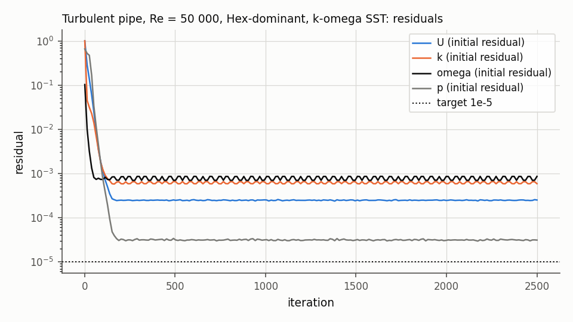

### Hex-dominant, k-epsilon

- Setup: A pipe  D = 20 mm  L = 600 mm (30 D) along +x from x = 0 (STEP in mm  built with OCP); a custom fluid with nu = 4e-07 m²/s and rho = 1 kg/m³  so Re = U D / nu = 50 000; a velocity inlet of 1 m/s normal to the face (its turbulence Auto: 5 % intensity, 0.07 D), a 0 Pa pressure outlet and a no-slip wall; steady (simpleFoam), k-epsilon with wall functions, Accurate numerics, residual targets 1e-5, at most 2500 iterations.
- Status: ok.
- Mesh settings: Hex-dominant at fineness 6 with an Inflate boundary layer of 1 layers, 0.6 mm in all, on the wall (automatic boundary layers off); 1 non-orthogonal corrector.
- Mesh: the same mesh as the Hex-dominant, k-omega SST run's (the same geometry, fluid, BCs and mesh settings; only the study's settings and the run differ).
- Mesh: 76 184 cells (the plan's estimate about 105 000), background block 67 × 8 × 12, wall cells 2.98 × 0.831 × 0.554 mm (x × y × z); checkMesh OK (max non-orthogonality 65°, max skewness 2.37, max aspect ratio 43.8); wall layers applied (pipe_wall 0.909 of 1), first layer 0.529 mm.
- Run: 2500 iterations, did not reach its residual targets within 2500 iterations (over its last 10 % of iterations: the inlet's area-averaged pressure moved 0.0048 %, U_x at the centreline probe at x = 20 D moved 0.00042 %); solve 97 s on 8 ranks (Cores 8); run health watch: The U residual has stopped falling at 0.0033; a steady run's residuals should keep falling; It ended without its residuals meeting their targets: its results may not have settled.
- The solver's last initial residuals: Ux 8.5 × 10^-5, Uy 0.0033, Uz 0.0024, p 0.0012, epsilon 0.00045, k 0.00025.
- Pre-run check: info still_start: The run starts from rest; starting from potential flow shortens the start-up.
- Its estimate before Start: 2,500 iterations at most · ~1 minute on 8 cores · Re ≈ 50,000 · y+ ≈ 27.
- **Darcy friction factor from the pressure drop, x/D 20 to 25**: 0.019474 against 0.0211 (-7.71 %, band ±10 % (inside), report-only); ± 0.087 % (the slope's standard error and 2.5 times the cross-section's). How: f = (−dp/dx) D_eff / (rho U_b² / 2): dp/dx the least-squares slope of the centreline pressure from Plot over path (0,0,0) to (0.6,0,0) m, 300 subdivisions, over x/D 20 to 25; U_b = Q / A and D_eff = sqrt(4 A / pi), Q the flow through the inlet and A the pipe's meshed cross-section, the mean of the inlet's and the outlet's mesh areas (all three from the run's monitors). Source: `route:/api/plot-over-path`. -dp/dx 0.48697 Pa/m from 50 samples (slope standard error 0.09 %, r² 0.99996); D_eff 19.995 mm, U_b 1.0000 m/s.
- **Darcy friction factor from the wall shear stress, x/D 20 to 25**: 0.019581 against 0.0211 (-7.20 %, band ±10 % (inside), report-only). How: f_tau = 8 tau_w / (rho U_b²): tau_w the area-weighted mean of the axial wall shear stress the run saved (wallShearStress, kinematic, times rho) on the wall's faces between x/D 20 and 25; U_b as for f. Source: `case_file:<latest>/wallShearStress`. tau_w 0.0024476 Pa over 2772 wall faces, U_b 1.0000 m/s.
- Shown, not compared: the pipe's cross-section as meshed 314 mm² (-0.05 % against pi D²/4), so D_eff 19.995 mm, U_b 1 m/s and Re_eff 49987; f from the pressure over x/D 15 to 20 0.0197 (+1.17 % against x/D 20 to 25: a developed flow reads the same); f from the wall shear stress +0.55 % against f from the pressure drop; the wall's y+ over x/D 20 to 25 from 36.2 to 36.9, area-weighted mean 36.6 (2772 faces; k-epsilon's wall functions assume about 30 to 100); the centreline speed over x/D 20 to 25 1.191 U_b (Plot over path); the inlet's area-averaged pressure 0.3291 Pa, flow out against in 0 %.
- Warning: the run stopped at its iteration limit without reaching its residual targets; its monitors moved less than 0.1 % over the last 10 % of iterations.
- Warning: still developing where f is read: f over x/D 15 to 20 reads +1.17 % against x/D 20 to 25 (more than 1 % apart; a developed flow reads the same), so f is above its developed value: the pipe is 30 D, not the 40 D from the inlet the reference data ask for, and the app has no cyclic inlet (gap G9).

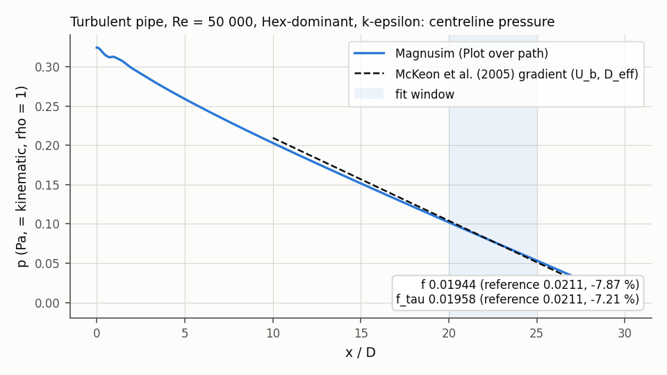

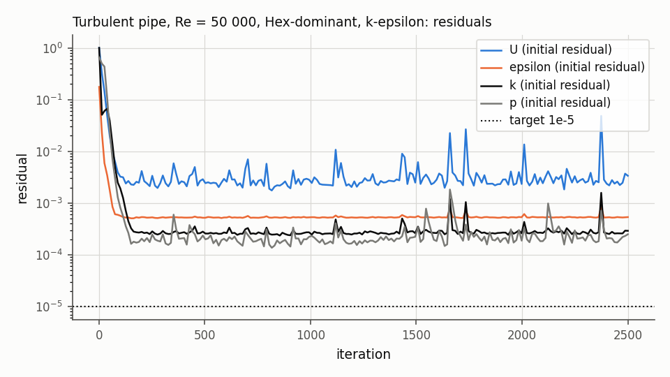

### Standard, k-omega SST

- Status: ok.
- Mesh settings: Standard at fineness 6 with its automatic boundary layers and hex core; 2 non-orthogonal correctors.
- Mesh: 69 436 cells, generated in 10.1 s; checkMesh OK (max non-orthogonality 64.3°, max skewness 1.01, max aspect ratio 7.97); wall layers applied (pipe_wall 3 of 3), first layer 0.189 mm.
- Run: 2500 iterations, did not reach its residual targets within 2500 iterations (over its last 10 % of iterations: the inlet's area-averaged pressure moved 5.1 × 10^-5 %, U_x at the centreline probe at x = 20 D moved 2.6 × 10^-5 %); solve 79 s on 8 ranks (Cores 8); run health healthy: It ended without its residuals meeting their targets: its results may not have settled.
- The solver's last initial residuals: Ux 1.3 × 10^-6, Uy 1.6 × 10^-5, Uz 1.7 × 10^-5, p 1 × 10^-5, omega 8.1 × 10^-5, k 0.00028.
- Pre-run check: info still_start: The run starts from rest; starting from potential flow shortens the start-up.
- Its estimate before Start: 2,500 iterations at most · ~1 minute on 8 cores · Re ≈ 50,000 · y+ ≈ 9.7.
- **Darcy friction factor from the pressure drop, x/D 20 to 25**: 0.015798 against 0.0211 (-25.13 %, band ±10 % (outside), report-only); ± 1.1 % (the slope's standard error and 2.5 times the cross-section's). How: f = (−dp/dx) D_eff / (rho U_b² / 2): dp/dx the least-squares slope of the centreline pressure from Plot over path (0,0,0) to (0.6,0,0) m, 300 subdivisions, over x/D 20 to 25; U_b = Q / A and D_eff = sqrt(4 A / pi), Q the flow through the inlet and A the pipe's meshed cross-section, the mean of the inlet's and the outlet's mesh areas (all three from the run's monitors). Source: `route:/api/plot-over-path`. -dp/dx 0.39649 Pa/m from 50 samples (slope standard error 1.05 %, r² 0.99469); D_eff 19.922 mm, U_b 1.0000 m/s.
- **Darcy friction factor from the wall shear stress, x/D 20 to 25**: 0.015517 against 0.0211 (-26.46 %, band ±10 % (outside), report-only). How: f_tau = 8 tau_w / (rho U_b²): tau_w the area-weighted mean of the axial wall shear stress the run saved (wallShearStress, kinematic, times rho) on the wall's faces between x/D 20 and 25; U_b as for f. Source: `case_file:<latest>/wallShearStress`. tau_w 0.0019396 Pa over 2132 wall faces, U_b 1.0000 m/s.
- Shown, not compared: the pipe's cross-section as meshed 311.71 mm² (-0.78 % against pi D²/4), so D_eff 19.922 mm, U_b 1 m/s and Re_eff 49804; f from the pressure over x/D 15 to 20 0.01644 (+4.10 % against x/D 20 to 25: a developed flow reads the same); f from the wall shear stress -1.78 % against f from the pressure drop; the wall's y+ over x/D 20 to 25 from 9.64 to 11.1, area-weighted mean 10.3 (2132 faces); the centreline speed over x/D 20 to 25 1.165 U_b (Plot over path); the inlet's area-averaged pressure 0.2857 Pa, flow out against in 3.2 × 10^-7 %.
- Warning: the run stopped at its iteration limit without reaching its residual targets; its monitors moved less than 0.1 % over the last 10 % of iterations.
- Warning: still developing where f is read: f over x/D 15 to 20 reads +4.10 % against x/D 20 to 25 (more than 1 % apart; a developed flow reads the same), so f is above its developed value: the pipe is 30 D, not the 40 D from the inlet the reference data ask for, and the app has no cyclic inlet (gap G9).

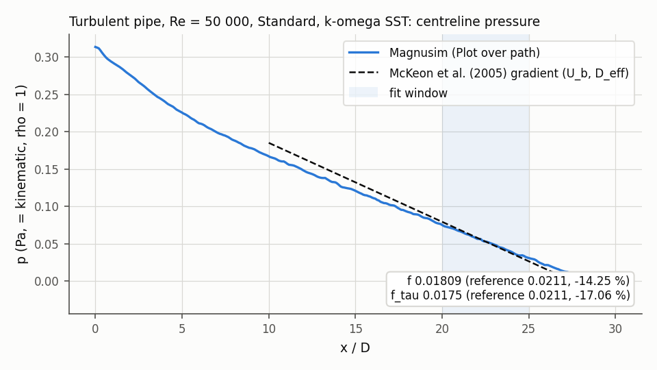

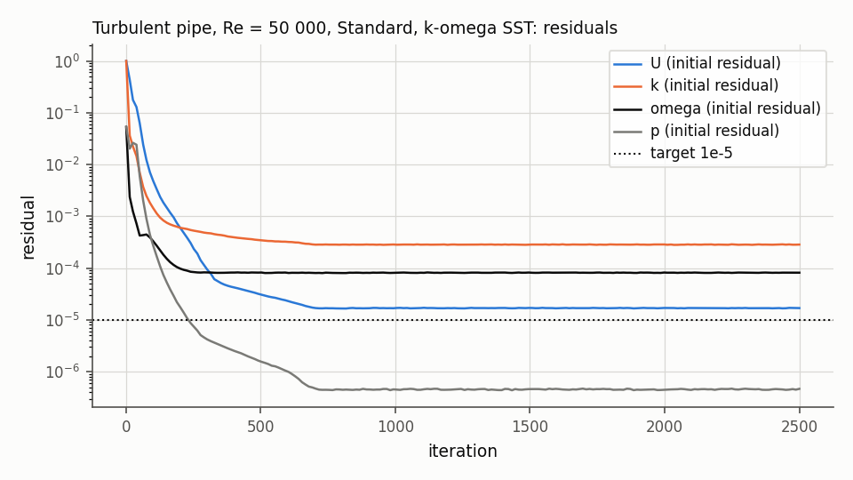

### Standard, k-epsilon

- Setup: A pipe  D = 20 mm  L = 600 mm (30 D) along +x from x = 0 (STEP in mm  built with OCP); a custom fluid with nu = 4e-07 m²/s and rho = 1 kg/m³  so Re = U D / nu = 50 000; a velocity inlet of 1 m/s normal to the face (its turbulence Auto: 5 % intensity, 0.07 D), a 0 Pa pressure outlet and a no-slip wall; steady (simpleFoam), k-epsilon with wall functions, Accurate numerics, residual targets 1e-5, at most 2500 iterations.
- Status: ok.
- Mesh settings: Standard at fineness 6 with its automatic boundary layers and hex core; 2 non-orthogonal correctors.
- Mesh: the same mesh as the Standard, k-omega SST run's (the same geometry, fluid, BCs and mesh settings; only the study's settings and the run differ).
- Mesh: 69 436 cells; checkMesh OK (max non-orthogonality 64.3°, max skewness 1.01, max aspect ratio 7.97); wall layers applied (pipe_wall 3 of 3), first layer 0.189 mm.
- Run: 2500 iterations, did not reach its residual targets within 2500 iterations (over its last 10 % of iterations: the inlet's area-averaged pressure moved 0.00068 %, U_x at the centreline probe at x = 20 D moved 0.0002 %); solve 80 s on 8 ranks (Cores 8); run health watch: The k residual has stopped falling at 0.0026; a steady run's residuals should keep falling; It ended without its residuals meeting their targets: its results may not have settled.
- The solver's last initial residuals: Ux 1.5 × 10^-5, Uy 0.00037, Uz 0.00038, p 0.00013, epsilon 7.1 × 10^-5, k 0.0026.
- Pre-run check: warn yplus_model: Estimated y+ ≈ 9.7 (first cell 0.19 mm). k-epsilon's wall functions assume y+ above about 30; k-omega SST handles any y+; info still_start: The run starts from rest; starting from potential flow shortens the start-up.
- Its estimate before Start: 2,500 iterations at most · ~1 minute on 8 cores · Re ≈ 50,000 · y+ ≈ 9.7.
- **Darcy friction factor from the pressure drop, x/D 20 to 25**: 0.020301 against 0.0211 (-3.79 %, band ±10 % (inside), report-only); ± 0.58 % (the slope's standard error and 2.5 times the cross-section's). How: f = (−dp/dx) D_eff / (rho U_b² / 2): dp/dx the least-squares slope of the centreline pressure from Plot over path (0,0,0) to (0.6,0,0) m, 300 subdivisions, over x/D 20 to 25; U_b = Q / A and D_eff = sqrt(4 A / pi), Q the flow through the inlet and A the pipe's meshed cross-section, the mean of the inlet's and the outlet's mesh areas (all three from the run's monitors). Source: `route:/api/plot-over-path`. -dp/dx 0.50952 Pa/m from 50 samples (slope standard error 0.58 %, r² 0.99840); D_eff 19.922 mm, U_b 1.0000 m/s.
- **Darcy friction factor from the wall shear stress, x/D 20 to 25**: 0.020472 against 0.0211 (-2.98 %, band ±10 % (inside), report-only). How: f_tau = 8 tau_w / (rho U_b²): tau_w the area-weighted mean of the axial wall shear stress the run saved (wallShearStress, kinematic, times rho) on the wall's faces between x/D 20 and 25; U_b as for f. Source: `case_file:<latest>/wallShearStress`. tau_w 0.002559 Pa over 2132 wall faces, U_b 1.0000 m/s.
- Shown, not compared: the pipe's cross-section as meshed 311.71 mm² (-0.78 % against pi D²/4), so D_eff 19.922 mm, U_b 1 m/s and Re_eff 49804; f from the pressure over x/D 15 to 20 0.0203 (-0.01 % against x/D 20 to 25: a developed flow reads the same); f from the wall shear stress +0.84 % against f from the pressure drop; the wall's y+ over x/D 20 to 25 from 11.4 to 12.3, area-weighted mean 11.9 (2132 faces; k-epsilon's wall functions assume about 30 to 100); the centreline speed over x/D 20 to 25 1.125 U_b (Plot over path); the inlet's area-averaged pressure 0.329 Pa, flow out against in 3.2 × 10^-7 %.
- Warning: the run stopped at its iteration limit without reaching its residual targets; its monitors moved less than 0.1 % over the last 10 % of iterations.

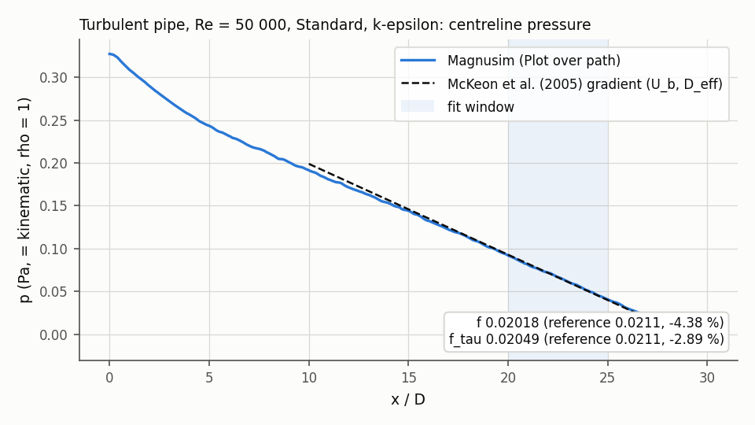

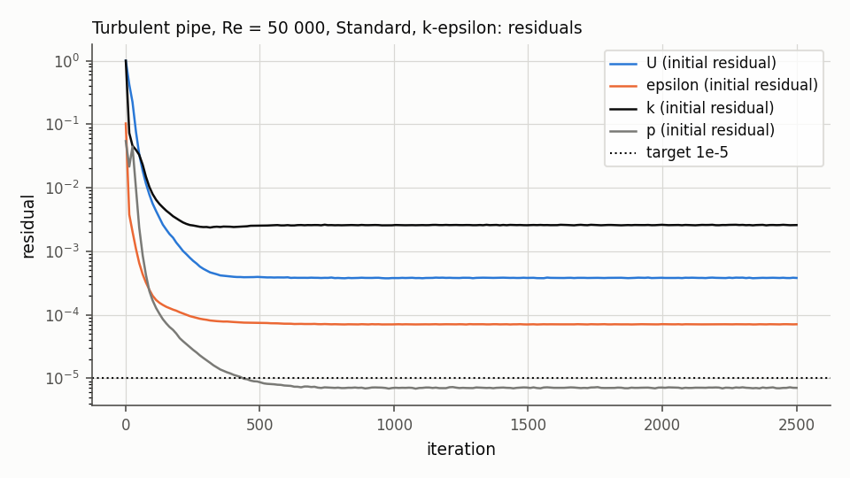

### References

- **Darcy friction factor from the pressure drop, x/D 20 to 25**: 0.0211 (correlation, CONFIRMED). B. J. McKeon, M. V. Zagarola, A. J. Smits (2005), "A new friction factor relationship for fully developed pipe flow", J. Fluid Mech. 538:429-443; eq. (3.5), p. 441: 1/sqrt f = 1.920 log10(Re sqrt f) - 0.475 - 7.04/(Re sqrt f)^0.55, within 1.4 % of the Princeton Superpipe data and within 2.0 % of Blasius for 10e3 < Re <= 90e3; 0.02109 at Re 5e4. Conditions: fully developed flow in a hydraulically smooth pipe; Darcy f = (dp/L) D / (rho U_b² / 2); Re = U_b D / nu = 50 000. Blasius (1913), f = 0.3164 Re^-0.25 (as given in McKeon et al. 2005 eq. 1.3), gives 0.02116; Colebrook (1939), J. ICE 11(4):133-156, smooth, 0.02089 (as reproduced in standard texts); the correlations span 0.0207 to 0.0212, and the data scatter about ±1.5 %.
- **Darcy friction factor from the wall shear stress, x/D 20 to 25**: 0.0211 (correlation, CONFIRMED). B. J. McKeon, M. V. Zagarola, A. J. Smits (2005), "A new friction factor relationship for fully developed pipe flow", J. Fluid Mech. 538:429-443; eq. (3.5), p. 441: 1/sqrt f = 1.920 log10(Re sqrt f) - 0.475 - 7.04/(Re sqrt f)^0.55, within 1.4 % of the Princeton Superpipe data and within 2.0 % of Blasius for 10e3 < Re <= 90e3; 0.02109 at Re 5e4. Conditions: fully developed flow in a hydraulically smooth pipe; Darcy f = (dp/L) D / (rho U_b² / 2); Re = U_b D / nu = 50 000. Blasius (1913), f = 0.3164 Re^-0.25 (as given in McKeon et al. 2005 eq. 1.3), gives 0.02116; Colebrook (1939), J. ICE 11(4):133-156, smooth, 0.02089 (as reproduced in standard texts); the correlations span 0.0207 to 0.0212, and the data scatter about ±1.5 %.

### Notes

- The reference is McKeon et al.'s relation (0.0211 at Re 5e4); the band is ±10 %, the reference data's for RANS with wall functions (the design proposed ±8 % for SST, ±10 % for k-epsilon and ±15 % on Standard). The reference data win.
- The reference data ask for the friction to be read at least 40 D from the inlet, or with a cyclic or mapped inlet. This case meets neither: the app has no cyclic or mapped inlet (gap G9), and the pipe is 30 D long. The friction is read over x/D 20 to 25 and its slope over x/D 15 to 20 is shown beside it: in a developed flow the two agree. Where they differ by more than 1 % the run carries a warning: the flow is still developing where f is read, so it is not quite the fully developed f the reference is for. Which side of it f reads depends on the inlet's turbulence: from the Auto inlet (5 %, 0.07 D) the centreline speed overshoots and f at 20 to 25 D reads below its developed value (the probes of 2026-11-06: 2.6 to 3.6 % below on Hex-dominant, against a mapped inlet that holds the developed flow), from 10 % and 0.1 D it read above it. On Standard the slope over 5 D moved by about 2 % between two meshes of the same settings while the wall shear stress agreed within 0.2 %, so a warning there can come from the mesh as much as from the flow. The pipe is not longer because Hex-dominant cannot mesh a much longer pipe cleanly (an app gap): its background block keeps at least 8 and 12 cells across the pipe while its cells along the pipe grow with the length, so the cells near the wall get long and flat. On the mesh probes (2026-11-05) a 55 D pipe at fineness 6 had 25 196 faces over 65 degrees non-orthogonal before snapping, and its mesh failed checkMesh (8 cells of negative volume) although Generate finished; a 40 D pipe at fineness 7 kept 0.03 of its 2 wall layers and failed checkMesh too; the 30 D pipe at fineness 6 passes (its worst face 65 degrees).
- Two readings of the same friction: the pressure drop along the axis, and the wall shear stress the run saved. In a settled, developed flow they are equal (the force balance -dp/dx = 4 tau_w / D); a gap between them is a finding about the solution, not about the reading.
- The wall's y+ (OpenFOAM's yPlus, saved by every turbulent run) is shown for the same faces. k-epsilon's wall functions assume y+ of about 30 to 100 at the first cell's centre (on a clean developed wedge they read f -4.2 to -4.9 % from y+ 11.6 up and 5 to 75 % high below it). k-omega SST's walls take Spalding's law with stepwise omega since the first full run (which wrote nutkWallFunction: 8 to 20 % low from y+ 12 to 35 on the wedge): on the wedge it reads within about 2 % from y+ 5 to 15, +4.4 % at 20 and -3.3 % at 100, and 6 to 9 % low with the first cell's centre at y+ 1 to 3. Hex-dominant's one wall layer of 0.6 mm is sized for about 35; Standard sizes its own layers, so its y+ is what its layers give.
- On Standard, k-epsilon's wall faces where f is read sit at y+ 11.4 to 12.3 on the reported run (the pre-run check estimated 9.7), on both sides of its wall function's switch at y+ 11.53 (their area-weighted mean 11.9). On the clean developed wedge (the probes of 2026-11-06) its walls read f +4.8 % at y+ 10.2 and -4.8 % at y+ 11.6, and 4.2 to 4.9 % low from there to y+ 100, so a mesh whose wall cells sit on the other side of the switch can move f by up to about 10 points. Its walls alone would read f about 4.8 % low there, so its f -3.79 % and f_tau -2.98 % mean the rest (the tetrahedra and the still-developing flow, not probed apart) reads it 1.0 to 1.8 points high: most likely errors that cancel, not a sign that it is the best variant. The 4-core probe after the fixes of 2026-11-06 read f -0.96 % and f_tau +0.34 % at y+ 11.8 to 12.5: errors that cancel there too (the rest 3.8 to 5.1 points high).
- Each mesher's mesh is made once and both turbulence models solve on it (the k-epsilon run on the k-omega SST run's mesh, the same geometry, fluid, BCs and mesh settings).

## Lid-driven cavity

A square cavity 100 × 100 mm in x-y, 10 mm deep in z (one cell across), the lid at y = 100 mm (STEP in mm, built with OCP); a custom fluid with nu = 0.001 m²/s and rho = 1 kg/m³, so Re = U_lid L / nu = 100; the lid a moving wall at 1 m/s along +x, the floor and the two sides no-slip walls, the front and back one Symmetry (the 2D mesh's ends, solved empty); nothing flows in or out; laminar, steady (simpleFoam), Accurate numerics, residual targets 1e-6, at most 12000 iterations.

### Re = 100, Hex-dominant (2D)

- Status: ok.
- Mesh settings: Hex-dominant at fineness 7, One cell across (2D) on, a custom size of 0.6 mm on the lid and the three walls with Refine out to 50 mm (the whole cavity), no wall layers; 1 non-orthogonal corrector.
- Mesh: 34 580 cells, one cell across (2D) along z (the plan's estimate about 34 600), background block 60 × 60 × 1, wall cells 0.277 × 0.277 × 10 mm (x × y × z), Cavity's custom size cells 0.554 × 0.554 × 10 mm (level 2), generated in 20.1 s; checkMesh OK (max non-orthogonality 38.5°, max skewness 0.567, max aspect ratio 3.2); wall layers none asked.
- Run: 6507 iterations, converged at iteration 6507; solve 82 s on 8 ranks (Cores 8); run health healthy.
- The solver's last initial residuals: Ux 6.8 × 10^-7, Uy 1 × 10^-6, p 6.2 × 10^-7.
- Pre-run check: nothing found.
- Its estimate before Start: 12,000 iterations at most · ~3 minutes on 8 cores · Re ≈ 100.
- **u/U_lid on the vertical centreline, RMS difference from Ghia et al. (Re 100)**: 0.0023354 against 0 (+0.00234 U_lid, band ±0.01 U_lid (inside), report-only). How: u/U_lid along the vertical centreline (x = 0.5 L, y from 0 to L), sampled as Plot over path samples a line (201 samples, the field averaged to the mesh's points, the wall's own value on the walls) with the velocity's components kept, on the run's saved U, at mid-depth, linearly interpolated at Ghia et al.'s 15 interior stations; the root mean square of the differences. Source: `app_sampling`. over 15 stations, the largest at y = 0.8516 L.
- **u/U_lid on the vertical centreline, largest difference from Ghia et al. (Re 100)**: 0.0044695 against 0 (+0.00447 U_lid, band ±0.03 U_lid (inside), report-only). How: the largest \|difference\| at the same stations, as for the RMS. Source: `app_sampling`. at y = 0.8516 L: +0.2360 against +0.2315.
- **v/U_lid on the horizontal centreline, RMS difference from Ghia et al. (Re 100)**: 0.0045779 against 0 (+0.00458 U_lid, band ±0.01 U_lid (inside), report-only). How: v/U_lid along the horizontal centreline (y = 0.5 L, x from 0 to L), sampled as Plot over path samples a line (201 samples, the field averaged to the mesh's points, the wall's own value on the walls) with the velocity's components kept, on the run's saved U, at mid-depth, linearly interpolated at Ghia et al.'s 15 interior stations; the root mean square of the differences. Source: `app_sampling`. over 15 stations, the largest at x = 0.8594 L.
- **v/U_lid on the horizontal centreline, largest difference from Ghia et al. (Re 100)**: 0.0085014 against 0 (+0.0085 U_lid, band ±0.03 U_lid (inside), report-only). How: the largest \|difference\| at the same stations, as for the RMS. Source: `app_sampling`. at x = 0.8594 L: -0.2330 against -0.2245.
- **u_min / U_lid on the vertical centreline (Re 100)**: -0.21358 against -0.214 (+0.21 %, band ±3 % (inside), report-only). How: the lowest sample of u/U_lid along the vertical centreline (sampled as Plot over path samples a line (201 samples, the field averaged to the mesh's points, the wall's own value on the walls) with the velocity's components kept, on the run's saved U, at mid-depth), refined by the parabola through it and its two neighbours. Source: `app_sampling`. at y = 0.4587 L (Botella and Peyret 0.4581 L).
- **v_max / U_lid on the horizontal centreline (Re 100)**: 0.17874 against 0.1796 (-0.46 %, band ±3 % (inside), report-only). How: the highest sample of v/U_lid along the horizontal centreline (sampled as Plot over path samples a line (201 samples, the field averaged to the mesh's points, the wall's own value on the walls) with the velocity's components kept, on the run's saved U, at mid-depth), refined by the parabola through it and its two neighbours. Source: `app_sampling`. at x = 0.2376 L (Botella and Peyret 0.237 L).
- **v_min / U_lid on the horizontal centreline (Re 100)**: -0.25296 against -0.2538 (+0.33 %, band ±3 % (inside), report-only). How: the lowest sample of v/U_lid along the horizontal centreline (sampled as Plot over path samples a line (201 samples, the field averaged to the mesh's points, the wall's own value on the walls) with the velocity's components kept, on the run's saved U, at mid-depth), refined by the parabola through it and its two neighbours. Source: `app_sampling`. at x = 0.8103 L (Botella and Peyret 0.8104 L).
- **Primary vortex, psi_min / (U_lid L) (Re 100)**: -0.10335 against -0.1035 (+0.17 %, band ±2 % (inside), report-only). How: psi = the integral of u dy from the floor, on 99 vertical lines at x = L/100 to 99 L/100 (u sampled as for the centrelines, 201 samples each, trapezoid rule), over U_lid L; its lowest value refined by a quadratic surface through the 3 × 3 samples around it. Source: `app_sampling`. at (0.6158, 0.7377) L; psi at the lid (zero for a closed cavity) within 1.3e-03 on every line.
- **Primary vortex centre, x / L (Re 100)**: 0.6158 against 0.6162 (-0.07 %, band ±0.01 L (inside), report-only). How: where psi is lowest (as for psi_min), its x over L. Source: `app_sampling`.
- **Primary vortex centre, y / L (Re 100)**: 0.73766 against 0.7373 (+0.05 %, band ±0.01 L (inside), report-only). How: where psi is lowest (as for psi_min), its y over L. Source: `app_sampling`.
- Shown, not compared: Plot over path's p along the vertical centreline and app_sampling's agree within 0 Pa (p from -0.0337 to 0.0546 Pa); psi at the lid within 0.0013 U_lid L of zero on every line (the cavity is closed: the flow up and down each line balances); the Point probes' u/U_lid at Ghia et al.'s stations within an RMS 0.00232 of them; the Point probes' v/U_lid at Ghia et al.'s stations within an RMS 0.00459 of them.

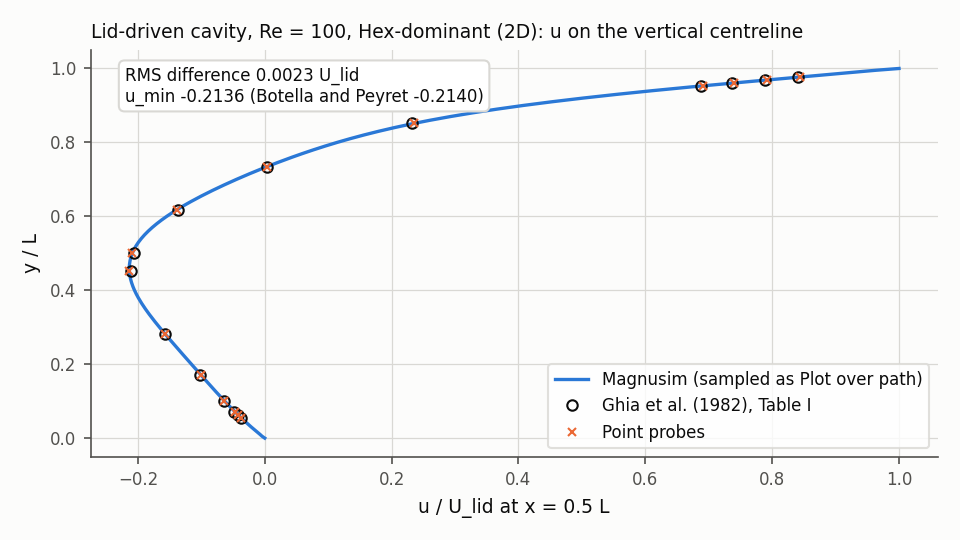

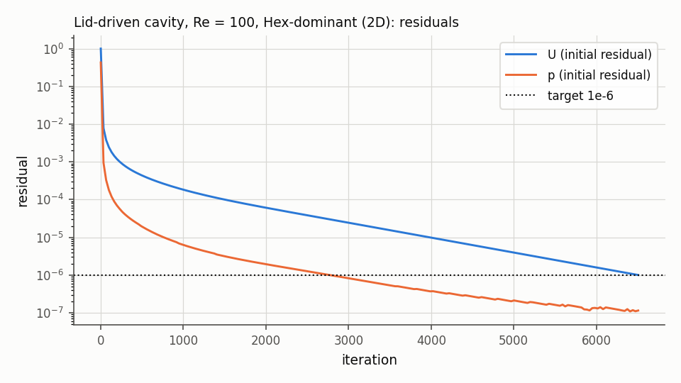

### Re = 1000, Hex-dominant (2D)

- Setup: A square cavity 100 × 100 mm in x-y, 10 mm deep in z (one cell across), the lid at y = 100 mm (STEP in mm, built with OCP); a custom fluid with nu = 0.0001 m²/s and rho = 1 kg/m³, so Re = U_lid L / nu = 1000; the lid a moving wall at 1 m/s along +x, the floor and the two sides no-slip walls, the front and back one Symmetry (the 2D mesh's ends, solved empty); nothing flows in or out; laminar, steady (simpleFoam), Accurate numerics, residual targets 1e-6, at most 8000 iterations.
- Status: ok.
- Mesh settings: Hex-dominant at fineness 7, One cell across (2D) on, a custom size of 0.6 mm on the lid and the three walls with Refine out to 50 mm (the whole cavity), no wall layers; 1 non-orthogonal corrector.
- Mesh: 34 580 cells, one cell across (2D) along z (the plan's estimate about 34 600), background block 60 × 60 × 1, wall cells 0.277 × 0.277 × 10 mm (x × y × z), Cavity's custom size cells 0.554 × 0.554 × 10 mm (level 2), generated in 20.1 s; checkMesh OK (max non-orthogonality 38.5°, max skewness 0.567, max aspect ratio 3.2); wall layers none asked.
- Run: 6055 iterations, converged at iteration 6055; solve 86 s on 8 ranks (Cores 8); run health healthy.
- The solver's last initial residuals: Ux 2.2 × 10^-7, Uy 2.5 × 10^-7, p 1 × 10^-6.
- Pre-run check: nothing found.
- Its estimate before Start: 8,000 iterations at most · ~2 minutes on 8 cores · Re ≈ 1,000.
- **u/U_lid on the vertical centreline, RMS difference from Ghia et al. (Re 1000)**: 0.004111 against 0 (+0.00411 U_lid, band ±0.02 U_lid (inside), report-only). How: u/U_lid along the vertical centreline (x = 0.5 L, y from 0 to L), sampled as Plot over path samples a line (201 samples, the field averaged to the mesh's points, the wall's own value on the walls) with the velocity's components kept, on the run's saved U, at mid-depth, linearly interpolated at Ghia et al.'s 15 interior stations; the root mean square of the differences. Source: `app_sampling`. over 15 stations, the largest at y = 0.9688 L.
- **u/U_lid on the vertical centreline, largest difference from Ghia et al. (Re 1000)**: 0.0075993 against 0 (+0.0076 U_lid, band ±0.03 U_lid (inside), report-only). How: the largest \|difference\| at the same stations, as for the RMS. Source: `app_sampling`. at y = 0.9688 L: +0.5825 against +0.5749.
- **v/U_lid on the horizontal centreline, RMS difference from Ghia et al. (Re 1000)**: 0.0082806 against 0 (+0.00828 U_lid, band ±0.02 U_lid (inside), report-only). How: v/U_lid along the horizontal centreline (y = 0.5 L, x from 0 to L), sampled as Plot over path samples a line (201 samples, the field averaged to the mesh's points, the wall's own value on the walls) with the velocity's components kept, on the run's saved U, at mid-depth, linearly interpolated at Ghia et al.'s 15 interior stations; the root mean square of the differences. Source: `app_sampling`. over 15 stations, the largest at x = 0.9453 L.
- **v/U_lid on the horizontal centreline, largest difference from Ghia et al. (Re 1000)**: 0.015516 against 0 (+0.0155 U_lid, band ±0.03 U_lid (inside), report-only). How: the largest \|difference\| at the same stations, as for the RMS. Source: `app_sampling`. at x = 0.9453 L: -0.4074 against -0.3919.
- **u_min / U_lid on the vertical centreline (Re 1000)**: -0.38757 against -0.3886 (+0.26 %, band ±3 % (inside), report-only). How: the lowest sample of u/U_lid along the vertical centreline (sampled as Plot over path samples a line (201 samples, the field averaged to the mesh's points, the wall's own value on the walls) with the velocity's components kept, on the run's saved U, at mid-depth), refined by the parabola through it and its two neighbours. Source: `app_sampling`. at y = 0.1721 L (Botella and Peyret 0.1717 L).
- **v_max / U_lid on the horizontal centreline (Re 1000)**: 0.37597 against 0.3769 (-0.26 %, band ±3 % (inside), report-only). How: the highest sample of v/U_lid along the horizontal centreline (sampled as Plot over path samples a line (201 samples, the field averaged to the mesh's points, the wall's own value on the walls) with the velocity's components kept, on the run's saved U, at mid-depth), refined by the parabola through it and its two neighbours. Source: `app_sampling`. at x = 0.1576 L (Botella and Peyret 0.1578 L).
- **v_min / U_lid on the horizontal centreline (Re 1000)**: -0.52485 against -0.5271 (+0.42 %, band ±3 % (inside), report-only). How: the lowest sample of v/U_lid along the horizontal centreline (sampled as Plot over path samples a line (201 samples, the field averaged to the mesh's points, the wall's own value on the walls) with the velocity's components kept, on the run's saved U, at mid-depth), refined by the parabola through it and its two neighbours. Source: `app_sampling`. at x = 0.9086 L (Botella and Peyret 0.9092 L).
- **Primary vortex, psi_min / (U_lid L) (Re 1000)**: -0.11858 against -0.1189 (+0.30 %, band ±2 % (inside), report-only). How: psi = the integral of u dy from the floor, on 99 vertical lines at x = L/100 to 99 L/100 (u sampled as for the centrelines, 201 samples each, trapezoid rule), over U_lid L; its lowest value refined by a quadratic surface through the 3 × 3 samples around it. Source: `app_sampling`. at (0.5311, 0.5654) L; psi at the lid (zero for a closed cavity) within 1.4e-03 on every line.
- **Primary vortex centre, x / L (Re 1000)**: 0.53112 against 0.5312 (-0.02 %, band ±0.01 L (inside), report-only). How: where psi is lowest (as for psi_min), its x over L. Source: `app_sampling`.
- **Primary vortex centre, y / L (Re 1000)**: 0.56543 against 0.5654 (-0.00 %, band ±0.01 L (inside), report-only). How: where psi is lowest (as for psi_min), its y over L. Source: `app_sampling`.
- Shown, not compared: Plot over path's p along the vertical centreline and app_sampling's agree within 0 Pa (p from -0.0714 to 0.041 Pa); psi at the lid within 0.0014 U_lid L of zero on every line (the cavity is closed: the flow up and down each line balances); the Point probes' u/U_lid at Ghia et al.'s stations within an RMS 0.00377 of them; the Point probes' v/U_lid at Ghia et al.'s stations within an RMS 0.00837 of them.

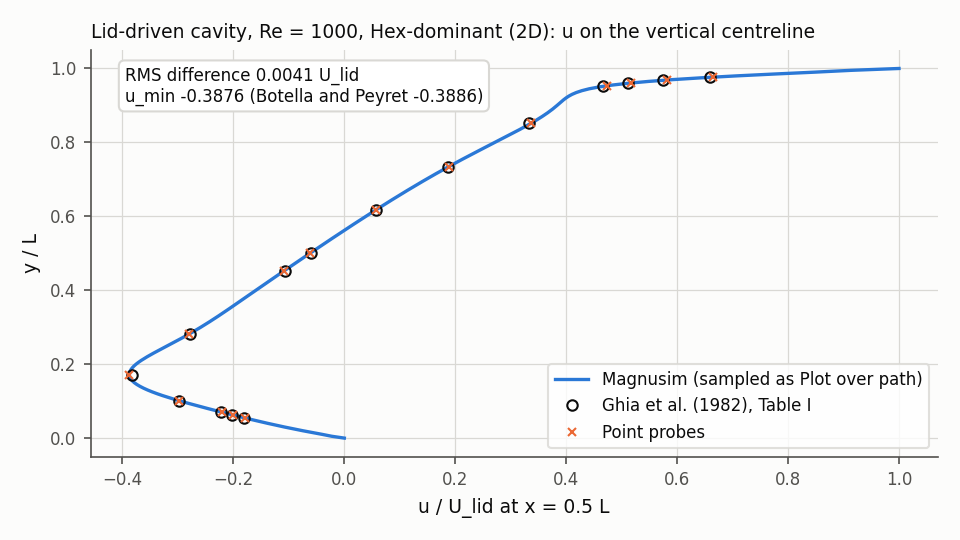

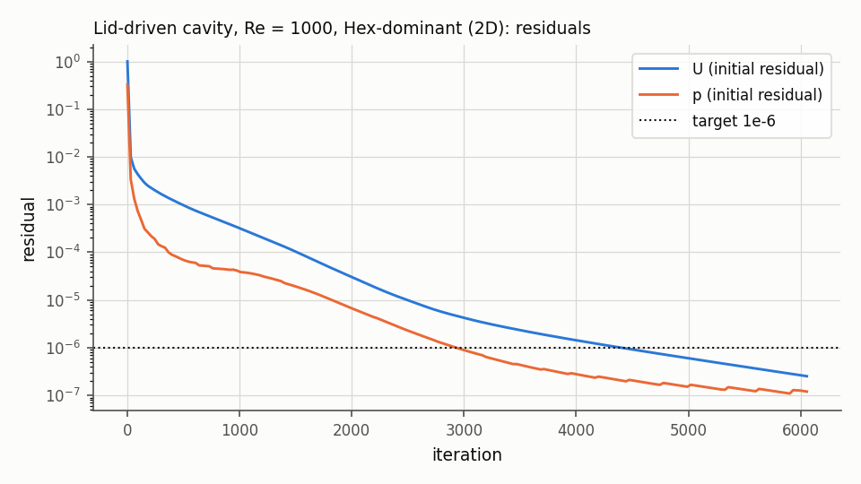

### References

- **u/U_lid on the vertical centreline, RMS difference from Ghia et al. (Re 100)**: 0 (numerical, SECONDARY). U. Ghia, K. N. Ghia, C. T. Shin (1982), "High-Re solutions for incompressible flow using the Navier-Stokes equations and a multigrid method", J. Comput. Phys. 48(3):387-411, doi:10.1016/0021-9991(82)90058-4; Table I at its 15 interior stations (the RMS of the differences from them, zero for a perfect match) (validation/refs/ghia_1982_table1_u.csv). Conditions: lid-driven square cavity, steady, two-dimensional; Re = U_lid L / nu (100 and 1000); x and y over L from the bottom-left corner, the lid at y = 1 moving in +x; u over U_lid; their uniform 129 x 129 grid, second-order accurate. the y = 0.9766 row is missing from the CSV transcription and rests on the gist (and a rounded 0.8412 at Re 100 on a second page). Erturk et al. (2005) call Ghia's Re 1000 solution somewhat under-resolved: its extrema read 1 to 3 % below the converged values of Botella & Peyret (1998)
- **u/U_lid on the vertical centreline, largest difference from Ghia et al. (Re 100)**: 0 (numerical, SECONDARY). U. Ghia, K. N. Ghia, C. T. Shin (1982), "High-Re solutions for incompressible flow using the Navier-Stokes equations and a multigrid method", J. Comput. Phys. 48(3):387-411, doi:10.1016/0021-9991(82)90058-4; Table I at its 15 interior stations (the largest difference from them, zero for a perfect match) (validation/refs/ghia_1982_table1_u.csv). Conditions: lid-driven square cavity, steady, two-dimensional; Re = U_lid L / nu (100 and 1000); x and y over L from the bottom-left corner, the lid at y = 1 moving in +x; u over U_lid; their uniform 129 x 129 grid, second-order accurate. the y = 0.9766 row is missing from the CSV transcription and rests on the gist (and a rounded 0.8412 at Re 100 on a second page). Erturk et al. (2005) call Ghia's Re 1000 solution somewhat under-resolved: its extrema read 1 to 3 % below the converged values of Botella & Peyret (1998)
- **v/U_lid on the horizontal centreline, RMS difference from Ghia et al. (Re 100)**: 0 (numerical, SECONDARY). U. Ghia, K. N. Ghia, C. T. Shin (1982), "High-Re solutions for incompressible flow using the Navier-Stokes equations and a multigrid method", J. Comput. Phys. 48(3):387-411, doi:10.1016/0021-9991(82)90058-4; Table II at its 15 interior stations (the RMS of the differences from them, zero for a perfect match) (validation/refs/ghia_1982_table2_v.csv). Conditions: lid-driven square cavity, steady, two-dimensional; Re = U_lid L / nu (100 and 1000); x and y over L from the bottom-left corner, the lid at y = 1 moving in +x; v over U_lid; their uniform 129 x 129 grid, second-order accurate. at x = 0.9063, Re 1000, the gist has -0.51500 and the CSV -0.5155; Marchi et al. (2009) Table 12 quote Ghia's v_min at Re 1000 as -0.51550 at x = 0.9063, so -0.51550 is used here (the gist's value is a typo). Erturk et al. (2005) call Ghia's Re 1000 solution somewhat under-resolved: its extrema read 1 to 3 % below the converged values of Botella & Peyret (1998)
- **v/U_lid on the horizontal centreline, largest difference from Ghia et al. (Re 100)**: 0 (numerical, SECONDARY). U. Ghia, K. N. Ghia, C. T. Shin (1982), "High-Re solutions for incompressible flow using the Navier-Stokes equations and a multigrid method", J. Comput. Phys. 48(3):387-411, doi:10.1016/0021-9991(82)90058-4; Table II at its 15 interior stations (the largest difference from them, zero for a perfect match) (validation/refs/ghia_1982_table2_v.csv). Conditions: lid-driven square cavity, steady, two-dimensional; Re = U_lid L / nu (100 and 1000); x and y over L from the bottom-left corner, the lid at y = 1 moving in +x; v over U_lid; their uniform 129 x 129 grid, second-order accurate. at x = 0.9063, Re 1000, the gist has -0.51500 and the CSV -0.5155; Marchi et al. (2009) Table 12 quote Ghia's v_min at Re 1000 as -0.51550 at x = 0.9063, so -0.51550 is used here (the gist's value is a typo). Erturk et al. (2005) call Ghia's Re 1000 solution somewhat under-resolved: its extrema read 1 to 3 % below the converged values of Botella & Peyret (1998)
- **u_min / U_lid on the vertical centreline (Re 100)**: -0.214 (numerical, SECONDARY). O. Botella, R. Peyret (1998), "Benchmark spectral results on the lid-driven cavity flow", Computers & Fluids 27(4):421-433; the u_min of Re 100, at y = 0.4581 L (validation/refs/botella_peyret_1998_extrema.csv). Conditions: lid-driven square cavity, steady, two-dimensional; Re = U_lid L / nu (100 and 1000); x and y over L from the bottom-left corner, the lid at y = 1 moving in +x; velocities over U_lid; converged to about 1e-6. "at" is where the extremum lies along its line: y for u_min, x for v_max and v_min
- **v_max / U_lid on the horizontal centreline (Re 100)**: 0.1796 (numerical, SECONDARY). O. Botella, R. Peyret (1998), "Benchmark spectral results on the lid-driven cavity flow", Computers & Fluids 27(4):421-433; the v_max of Re 100, at x = 0.237 L (validation/refs/botella_peyret_1998_extrema.csv). Conditions: lid-driven square cavity, steady, two-dimensional; Re = U_lid L / nu (100 and 1000); x and y over L from the bottom-left corner, the lid at y = 1 moving in +x; velocities over U_lid; converged to about 1e-6. "at" is where the extremum lies along its line: y for u_min, x for v_max and v_min
- **v_min / U_lid on the horizontal centreline (Re 100)**: -0.2538 (numerical, SECONDARY). O. Botella, R. Peyret (1998), "Benchmark spectral results on the lid-driven cavity flow", Computers & Fluids 27(4):421-433; the v_min of Re 100, at x = 0.8104 L (validation/refs/botella_peyret_1998_extrema.csv). Conditions: lid-driven square cavity, steady, two-dimensional; Re = U_lid L / nu (100 and 1000); x and y over L from the bottom-left corner, the lid at y = 1 moving in +x; velocities over U_lid; converged to about 1e-6. "at" is where the extremum lies along its line: y for u_min, x for v_max and v_min
- **Primary vortex, psi_min / (U_lid L) (Re 100)**: -0.1035 (numerical, CONFIRMED). C. H. Marchi, R. Suero, L. K. Araki (2009), "The lid-driven square cavity flow: numerical solution with a 1024 x 1024 grid", J. Braz. Soc. Mech. Sci. & Eng. 31(3):186-198; psi_min of Re 100 (validation/refs/marchi_2009_vortex.csv). Conditions: lid-driven square cavity, steady, two-dimensional; Re = U_lid L / nu (100 and 1000); x and y over L from the bottom-left corner, the lid at y = 1 moving in +x; psi over U_lid L, zero on the walls (u = d psi / d y). Ghia et al. (1982) give -0.103423 at (0.6172, 0.7344) for Re 100 and -0.117929 at (0.5313, 0.5625) for Re 1000
- **Primary vortex centre, x / L (Re 100)**: 0.6162 (numerical, CONFIRMED). C. H. Marchi, R. Suero, L. K. Araki (2009), "The lid-driven square cavity flow: numerical solution with a 1024 x 1024 grid", J. Braz. Soc. Mech. Sci. & Eng. 31(3):186-198; the vortex centre's x of Re 100 (validation/refs/marchi_2009_vortex.csv). Conditions: lid-driven square cavity, steady, two-dimensional; Re = U_lid L / nu (100 and 1000); x and y over L from the bottom-left corner, the lid at y = 1 moving in +x; psi over U_lid L, zero on the walls (u = d psi / d y). Ghia et al. (1982) give -0.103423 at (0.6172, 0.7344) for Re 100 and -0.117929 at (0.5313, 0.5625) for Re 1000
- **Primary vortex centre, y / L (Re 100)**: 0.7373 (numerical, CONFIRMED). C. H. Marchi, R. Suero, L. K. Araki (2009), "The lid-driven square cavity flow: numerical solution with a 1024 x 1024 grid", J. Braz. Soc. Mech. Sci. & Eng. 31(3):186-198; the vortex centre's y of Re 100 (validation/refs/marchi_2009_vortex.csv). Conditions: lid-driven square cavity, steady, two-dimensional; Re = U_lid L / nu (100 and 1000); x and y over L from the bottom-left corner, the lid at y = 1 moving in +x; psi over U_lid L, zero on the walls (u = d psi / d y). Ghia et al. (1982) give -0.103423 at (0.6172, 0.7344) for Re 100 and -0.117929 at (0.5313, 0.5625) for Re 1000
- **u/U_lid on the vertical centreline, RMS difference from Ghia et al. (Re 1000)**: 0 (numerical, SECONDARY). U. Ghia, K. N. Ghia, C. T. Shin (1982), "High-Re solutions for incompressible flow using the Navier-Stokes equations and a multigrid method", J. Comput. Phys. 48(3):387-411, doi:10.1016/0021-9991(82)90058-4; Table I at its 15 interior stations (the RMS of the differences from them, zero for a perfect match) (validation/refs/ghia_1982_table1_u.csv). Conditions: lid-driven square cavity, steady, two-dimensional; Re = U_lid L / nu (100 and 1000); x and y over L from the bottom-left corner, the lid at y = 1 moving in +x; u over U_lid; their uniform 129 x 129 grid, second-order accurate. the y = 0.9766 row is missing from the CSV transcription and rests on the gist (and a rounded 0.8412 at Re 100 on a second page). Erturk et al. (2005) call Ghia's Re 1000 solution somewhat under-resolved: its extrema read 1 to 3 % below the converged values of Botella & Peyret (1998)
- **u/U_lid on the vertical centreline, largest difference from Ghia et al. (Re 1000)**: 0 (numerical, SECONDARY). U. Ghia, K. N. Ghia, C. T. Shin (1982), "High-Re solutions for incompressible flow using the Navier-Stokes equations and a multigrid method", J. Comput. Phys. 48(3):387-411, doi:10.1016/0021-9991(82)90058-4; Table I at its 15 interior stations (the largest difference from them, zero for a perfect match) (validation/refs/ghia_1982_table1_u.csv). Conditions: lid-driven square cavity, steady, two-dimensional; Re = U_lid L / nu (100 and 1000); x and y over L from the bottom-left corner, the lid at y = 1 moving in +x; u over U_lid; their uniform 129 x 129 grid, second-order accurate. the y = 0.9766 row is missing from the CSV transcription and rests on the gist (and a rounded 0.8412 at Re 100 on a second page). Erturk et al. (2005) call Ghia's Re 1000 solution somewhat under-resolved: its extrema read 1 to 3 % below the converged values of Botella & Peyret (1998)
- **v/U_lid on the horizontal centreline, RMS difference from Ghia et al. (Re 1000)**: 0 (numerical, SECONDARY). U. Ghia, K. N. Ghia, C. T. Shin (1982), "High-Re solutions for incompressible flow using the Navier-Stokes equations and a multigrid method", J. Comput. Phys. 48(3):387-411, doi:10.1016/0021-9991(82)90058-4; Table II at its 15 interior stations (the RMS of the differences from them, zero for a perfect match) (validation/refs/ghia_1982_table2_v.csv). Conditions: lid-driven square cavity, steady, two-dimensional; Re = U_lid L / nu (100 and 1000); x and y over L from the bottom-left corner, the lid at y = 1 moving in +x; v over U_lid; their uniform 129 x 129 grid, second-order accurate. at x = 0.9063, Re 1000, the gist has -0.51500 and the CSV -0.5155; Marchi et al. (2009) Table 12 quote Ghia's v_min at Re 1000 as -0.51550 at x = 0.9063, so -0.51550 is used here (the gist's value is a typo). Erturk et al. (2005) call Ghia's Re 1000 solution somewhat under-resolved: its extrema read 1 to 3 % below the converged values of Botella & Peyret (1998)
- **v/U_lid on the horizontal centreline, largest difference from Ghia et al. (Re 1000)**: 0 (numerical, SECONDARY). U. Ghia, K. N. Ghia, C. T. Shin (1982), "High-Re solutions for incompressible flow using the Navier-Stokes equations and a multigrid method", J. Comput. Phys. 48(3):387-411, doi:10.1016/0021-9991(82)90058-4; Table II at its 15 interior stations (the largest difference from them, zero for a perfect match) (validation/refs/ghia_1982_table2_v.csv). Conditions: lid-driven square cavity, steady, two-dimensional; Re = U_lid L / nu (100 and 1000); x and y over L from the bottom-left corner, the lid at y = 1 moving in +x; v over U_lid; their uniform 129 x 129 grid, second-order accurate. at x = 0.9063, Re 1000, the gist has -0.51500 and the CSV -0.5155; Marchi et al. (2009) Table 12 quote Ghia's v_min at Re 1000 as -0.51550 at x = 0.9063, so -0.51550 is used here (the gist's value is a typo). Erturk et al. (2005) call Ghia's Re 1000 solution somewhat under-resolved: its extrema read 1 to 3 % below the converged values of Botella & Peyret (1998)
- **u_min / U_lid on the vertical centreline (Re 1000)**: -0.3886 (numerical, SECONDARY). O. Botella, R. Peyret (1998), "Benchmark spectral results on the lid-driven cavity flow", Computers & Fluids 27(4):421-433; the u_min of Re 1000, at y = 0.1717 L (validation/refs/botella_peyret_1998_extrema.csv). Conditions: lid-driven square cavity, steady, two-dimensional; Re = U_lid L / nu (100 and 1000); x and y over L from the bottom-left corner, the lid at y = 1 moving in +x; velocities over U_lid; converged to about 1e-6. "at" is where the extremum lies along its line: y for u_min, x for v_max and v_min
- **v_max / U_lid on the horizontal centreline (Re 1000)**: 0.3769 (numerical, SECONDARY). O. Botella, R. Peyret (1998), "Benchmark spectral results on the lid-driven cavity flow", Computers & Fluids 27(4):421-433; the v_max of Re 1000, at x = 0.1578 L (validation/refs/botella_peyret_1998_extrema.csv). Conditions: lid-driven square cavity, steady, two-dimensional; Re = U_lid L / nu (100 and 1000); x and y over L from the bottom-left corner, the lid at y = 1 moving in +x; velocities over U_lid; converged to about 1e-6. "at" is where the extremum lies along its line: y for u_min, x for v_max and v_min
- **v_min / U_lid on the horizontal centreline (Re 1000)**: -0.5271 (numerical, SECONDARY). O. Botella, R. Peyret (1998), "Benchmark spectral results on the lid-driven cavity flow", Computers & Fluids 27(4):421-433; the v_min of Re 1000, at x = 0.9092 L (validation/refs/botella_peyret_1998_extrema.csv). Conditions: lid-driven square cavity, steady, two-dimensional; Re = U_lid L / nu (100 and 1000); x and y over L from the bottom-left corner, the lid at y = 1 moving in +x; velocities over U_lid; converged to about 1e-6. "at" is where the extremum lies along its line: y for u_min, x for v_max and v_min
- **Primary vortex, psi_min / (U_lid L) (Re 1000)**: -0.1189 (numerical, CONFIRMED). C. H. Marchi, R. Suero, L. K. Araki (2009), "The lid-driven square cavity flow: numerical solution with a 1024 x 1024 grid", J. Braz. Soc. Mech. Sci. & Eng. 31(3):186-198; psi_min of Re 1000 (validation/refs/marchi_2009_vortex.csv). Conditions: lid-driven square cavity, steady, two-dimensional; Re = U_lid L / nu (100 and 1000); x and y over L from the bottom-left corner, the lid at y = 1 moving in +x; psi over U_lid L, zero on the walls (u = d psi / d y). Ghia et al. (1982) give -0.103423 at (0.6172, 0.7344) for Re 100 and -0.117929 at (0.5313, 0.5625) for Re 1000
- **Primary vortex centre, x / L (Re 1000)**: 0.5312 (numerical, CONFIRMED). C. H. Marchi, R. Suero, L. K. Araki (2009), "The lid-driven square cavity flow: numerical solution with a 1024 x 1024 grid", J. Braz. Soc. Mech. Sci. & Eng. 31(3):186-198; the vortex centre's x of Re 1000 (validation/refs/marchi_2009_vortex.csv). Conditions: lid-driven square cavity, steady, two-dimensional; Re = U_lid L / nu (100 and 1000); x and y over L from the bottom-left corner, the lid at y = 1 moving in +x; psi over U_lid L, zero on the walls (u = d psi / d y). Ghia et al. (1982) give -0.103423 at (0.6172, 0.7344) for Re 100 and -0.117929 at (0.5313, 0.5625) for Re 1000
- **Primary vortex centre, y / L (Re 1000)**: 0.5654 (numerical, CONFIRMED). C. H. Marchi, R. Suero, L. K. Araki (2009), "The lid-driven square cavity flow: numerical solution with a 1024 x 1024 grid", J. Braz. Soc. Mech. Sci. & Eng. 31(3):186-198; the vortex centre's y of Re 1000 (validation/refs/marchi_2009_vortex.csv). Conditions: lid-driven square cavity, steady, two-dimensional; Re = U_lid L / nu (100 and 1000); x and y over L from the bottom-left corner, the lid at y = 1 moving in +x; psi over U_lid L, zero on the walls (u = d psi / d y). Ghia et al. (1982) give -0.103423 at (0.6172, 0.7344) for Re 100 and -0.117929 at (0.5313, 0.5625) for Re 1000

### Notes

- One cell across (2D): the cavity is meshed one cell deep between its front and back, both on one Symmetry, which the solve makes the 2D mesh's empty ends, so the solution is exactly 2D and nothing is solved across the depth. The design's 40 mm slab is not needed (it cost several hundred times the cells and its middle was coarser than its ends), and there is nothing to measure between mid-depth and the symmetry planes: the design's second pair of lines at a quarter of the depth is left out.
- The mesh is one Hex-dominant custom size of 0.6 mm on all four walls with Refine out to 50 mm (half the cavity), so the whole cavity is meshed at that size's level (about 0.55 mm, L/181), and a band a few cells deep along the walls at the walls' own level of fineness 7 (about 0.28 mm): finer than Ghia et al.'s uniform 129 × 129 grid. No wall layers: the cells are that fine up to the walls.
- The profiles are read as Plot over path reads a line, with the velocity's components kept (the route gives a vector's magnitude only). A Plot over path of the pressure along the vertical centreline is compared with the same samples of the pressure here: they must agree (shown with each run).
- Ghia et al.'s profile values are the community's reference at fixed stations; at Re 1000 their own solution is under-resolved, 1 to 3 % below the converged extrema of Botella and Peyret (1998), so the extrema are compared with those, and the primary vortex with Marchi et al. (2009).
- The Point probes at Ghia et al.'s stations are a cross-check (shown): they read the value at each point (OpenFOAM's cellPoint interpolation, gap G3, fixed).
- Each run stops on its residual targets of 1e-6 (Re 100 at 6507 iterations and Re 1000 at 6055 iterations; the solver's last residuals are listed with each run); one that reached its iteration limit would count only if it settled there (its centre probes moving less than 0.1 % over its last 10 % of iterations). The first full runs (2026-11-05) kept the two ends as mirror planes, where OpenFOAM still solves the velocity's z component: zero to round-off, its normalised residual stayed at 0.035 to 0.068, so neither run met its targets, both went to their limits (12 000 and 8 000 iterations, Ux, Uy and p near 1e-8) and Run health read the U residual as stalled (an app bug of One cell across, fixed: the ends are now empty).
- The residual targets, not the empty ends, set how far these runs are converged: a probe of Re 100 with targets of 1e-8 (2026-11-05, not reported; it went to its 12 000 iterations) gave psi_min -0.10345, u_min -0.21390 and v_max 0.17945, against -0.10335, -0.21358 and 0.17874 in the reported run at 1e-6: they move by 0.1 to 0.4 %, all inside their bands.

## Backward-facing step

A backward-facing step channel: an inlet channel h = 5.2 mm high and 52 mm long on top of a step S = 4.9 mm, then a channel H = 10.1 mm high and 303 mm (30 H) long after it (expansion ratio 1.942), 5 mm deep in z (one cell across) (STEP in mm, built with OCP: two boxes fused and unified); a custom fluid with nu = 0.000104 m²/s and rho = 1 kg/m³, so Re_D = U_b 2h / nu = 100; a uniform velocity inlet of 1 m/s normal to the face, a 0 Pa pressure outlet, every wall no-slip (the floor after the step and the top wall BCs of their own), the front and back one Symmetry (the 2D mesh's ends, solved empty); laminar, steady (simpleFoam), Accurate numerics, residual targets 1e-6, at most 4000 iterations.

### Re_D = 100 (Armaly et al.), Hex-dominant (2D)

- Status: ok.
- Mesh settings: Hex-dominant at fineness 10, One cell across (2D) on, a custom size of 0.3 mm on every wall with Refine out to 5.05 mm (half the height: the whole channel), no wall layers; 1 non-orthogonal corrector.
- Mesh: 182 316 cells, one cell across (2D) along z (the plan's estimate about 183 600), background block 170 × 8 × 1, wall cells 0.347 × 0.21 × 5 mm (x × y × z), Channel's custom size cells 0.174 × 0.105 × 5 mm (level 4), generated in 236 s; checkMesh OK (max non-orthogonality 24°, max skewness 0.323, max aspect ratio 2.33); wall layers none asked.
- Run: 2665 iterations, converged at iteration 2665; solve 115 s on 8 ranks (Cores 8); run health healthy.
- The solver's last initial residuals: Ux 1.1 × 10^-7, Uy 1 × 10^-6, p 9 × 10^-8.
- Pre-run check: info still_start: The run starts from rest; starting from potential flow shortens the start-up.
- Its estimate before Start: 4,000 iterations at most · ~5 minutes on 8 cores · Re ≈ 100.
- **Primary reattachment on the floor, x1/S (Re_D 100)**: 2.8543 against 3 (-4.86 %, band ±10 % (inside), report-only); ± 0.62 % (half the spacing of the two face centres around the zero). How: the x component of the wall shear stress the run saved on the floor after the step (wallShearStress, one face per x on the 2D mesh), its sign in the attached flow far after the step (0.6 to 0.9 of the length after it) taken as forward; x1 where it turns from reversed to forward at the end of its longest reversed stretch, the primary eddy from the step's foot (a corner eddy's forward flow at the foot, if any, is passed over), the zero linearly interpolated between the two face centres around it; over the step height S. Source: `case_file:<latest>/wallShearStress`. x = 13.986 mm (1.385 H) between face centres 0.174 mm apart; 1746 floor faces.
- Shown, not compared: the inlet channel as meshed 5.2 mm high, U_b 1 m/s, so Re_D 100; U_x 0.02 S above the floor turns forward again at 2.828 S (the cross-check); a corner eddy at the step's foot, its forward flow on the floor to 0.0959 S; no reversed flow on the top wall (Armaly et al.'s upper bubble appears near Re_D 400); the profile at x = -1 h: u_max 1.498 U_b (the parabola 1.5), within 0.011 U_b of 6 eta (1 - eta) U_b everywhere; Plot over path's p along the floor line and app_sampling's agree within 0 Pa (p from 0.000124 to 1.78 Pa); the inlet's area-averaged pressure 4.519 Pa, flow out against in 0 %.

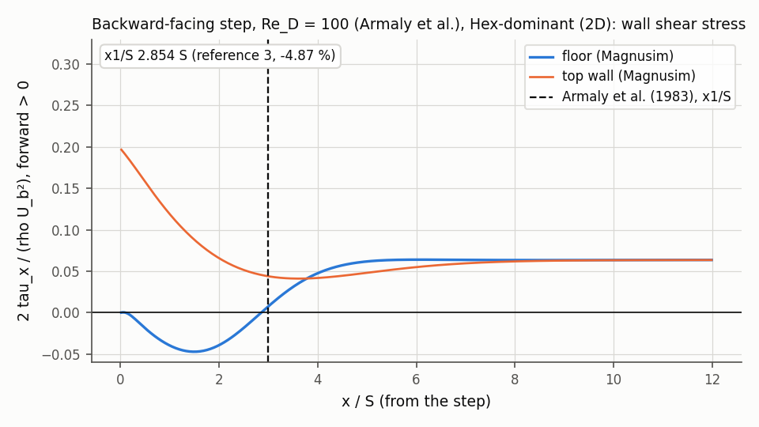
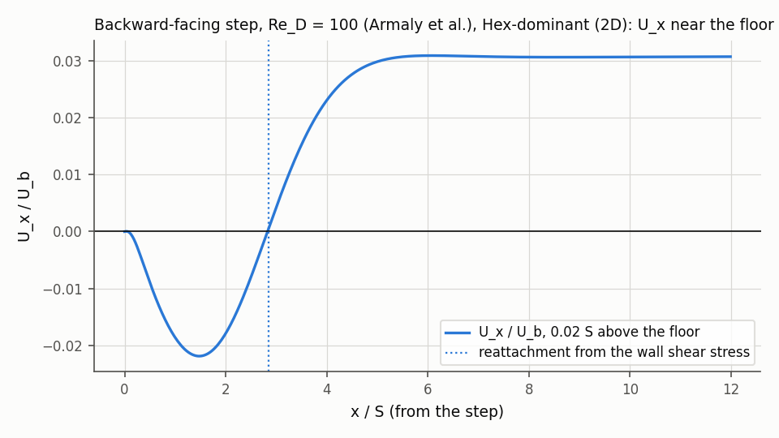
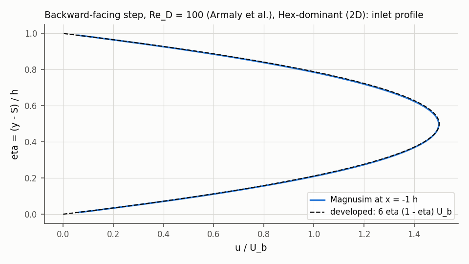
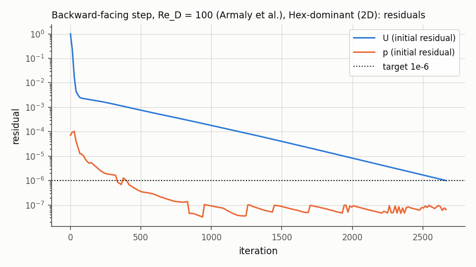

### Re_D = 800 (Gartling), Hex-dominant (2D)

- Setup: A backward-facing step channel: an inlet channel h = 5 mm high and 100 mm long on top of a step S = 5 mm, then a channel H = 10 mm high and 300 mm (30 H) long after it (expansion ratio 2), 5 mm deep in z (one cell across) (STEP in mm, built with OCP: two boxes fused and unified); a custom fluid with nu = 1.25e-05 m²/s and rho = 1 kg/m³, so Re_D = U_b 2h / nu = 800; a uniform velocity inlet of 1 m/s normal to the face, a 0 Pa pressure outlet, every wall no-slip (the floor after the step and the top wall BCs of their own), the front and back one Symmetry (the 2D mesh's ends, solved empty); laminar, steady (simpleFoam, SIMPLEC), Accurate numerics, residual targets 1e-6, at most 6000 iterations.
- Status: ok.
- Mesh settings: Hex-dominant at fineness 10, One cell across (2D) on, a custom size of 0.3 mm on every wall with Refine out to 5 mm (half the height: the whole channel), no wall layers; 1 non-orthogonal corrector.
- Mesh: 171 840 cells, one cell across (2D) along z (the plan's estimate about 172 900), background block 170 × 8 × 1, wall cells 0.391 × 0.208 × 5 mm (x × y × z), Channel's custom size cells 0.196 × 0.104 × 5 mm (level 4), generated in 226 s; checkMesh OK (max non-orthogonality 48.1°, max skewness 0.395, max aspect ratio 5.22); wall layers none asked.
- Run: 6000 iterations, did not reach its residual targets within 6000 iterations (over its last 10 % of iterations: the inlet's area-averaged pressure moved 4.5 × 10^-6 %, U_x in the floor's bubble (the first Bubble probe) moved 1 × 10^-5 %); solve 258 s on 8 ranks (Cores 8); run health healthy: It ended without its residuals meeting their targets: its results may not have settled.
- The solver's last initial residuals: Ux 4.5 × 10^-7, Uy 1.4 × 10^-5, p 6.7 × 10^-6.
- Pre-run check: info still_start: The run starts from rest; starting from potential flow shortens the start-up.
- Its estimate before Start: 6,000 iterations at most · ~7 minutes on 8 cores · Re ≈ 800.
- **Primary reattachment on the floor, x_r/S (Re_D 800)**: 11.683 against 12.2 (-4.24 %, band ±7 % (inside), report-only); ± 0.17 % (half the spacing of the two face centres around the zero). How: the x component of the wall shear stress the run saved on the floor after the step (wallShearStress, one face per x on the 2D mesh), its sign in the attached flow far after the step (0.6 to 0.9 of the length after it) taken as forward; x_r where it turns from reversed to forward at the end of its longest reversed stretch, the primary eddy from the step's foot (a corner eddy's forward flow at the foot, if any, is passed over), the zero linearly interpolated between the two face centres around it; over the step height S. Source: `case_file:<latest>/wallShearStress`. x = 58.413 mm (5.841 H) between face centres 0.196 mm apart; 1534 floor faces.
- **Top wall's bubble, separation x_s/S (Re_D 800)**: 9.2206 against 9.7 (-4.94 %, band ±10 % (inside), report-only). How: the x component of the wall shear stress the run saved on the top wall after the step (wallShearStress, one face per x on the 2D mesh), its sign in the attached flow far after the step (0.6 to 0.9 of the length after it) taken as forward; x_s where it turns from forward to reversed at the start of its longest reversed stretch after the step (the bubble), the zero linearly interpolated between the two face centres around it; over the step height S. Source: `case_file:<latest>/wallShearStress`. x = 46.103 mm (4.610 H).
- **Top wall's bubble, reattachment x_r2/S (Re_D 800)**: 20.385 against 20.96 (-2.75 %, band ±10 % (inside), report-only); ± 0.096 % (half the spacing of the two face centres around the zero). How: the x component of the wall shear stress the run saved on the top wall after the step (wallShearStress, one face per x on the 2D mesh), its sign in the attached flow far after the step (0.6 to 0.9 of the length after it) taken as forward; x_r2 where it turns forward again at the end of that stretch, the zero linearly interpolated between the two face centres around it; over the step height S. Source: `case_file:<latest>/wallShearStress`. x = 101.923 mm (10.192 H).
- Shown, not compared: the inlet channel as meshed 5 mm high, U_b 1 m/s, so Re_D 800; U_x 0.02 S above the floor turns forward again at 11.64 S (the cross-check); a corner eddy at the step's foot, its forward flow on the floor to 0.166 S; the top wall's bubble 11.16 S long (Gartling 11.26 S; the literature 10.6 to 11.5 S); U_x 0.02 S below the top reversed from 9.404 to 20.22 S (the cross-check); the profile at x = -1 h: u_max 1.486 U_b (the parabola 1.5), within 0.014 U_b of 6 eta (1 - eta) U_b everywhere; Plot over path's p along the floor line and app_sampling's agree within 0 Pa (p from -0.146 to 0.0824 Pa); the inlet's area-averaged pressure 0.8192 Pa, flow out against in 0 %.
- Warning: the run stopped at its iteration limit without reaching its residual targets; its monitors moved less than 0.1 % over the last 10 % of iterations.

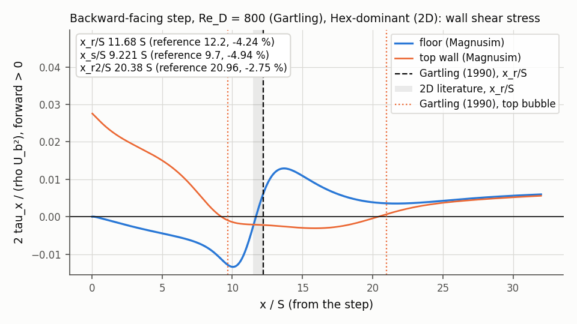
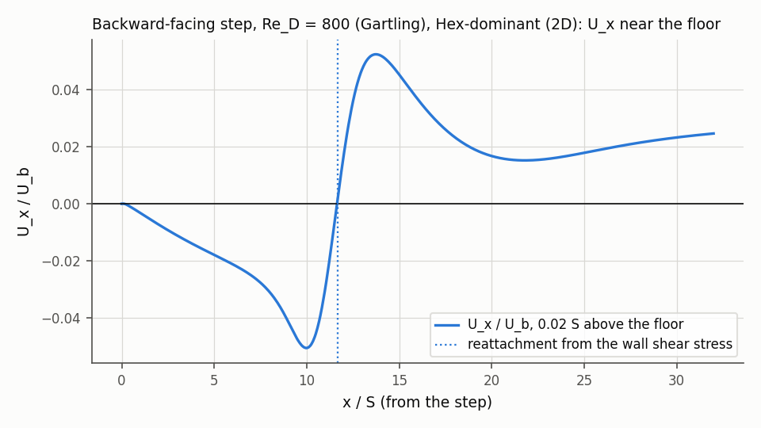
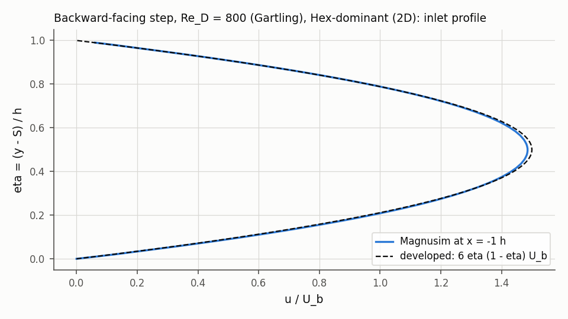
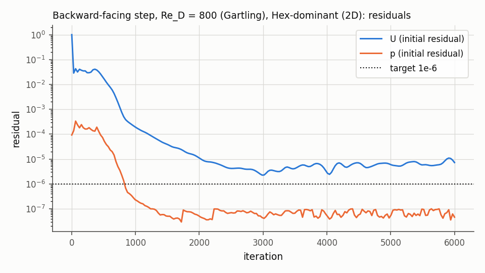

### References

- **Primary reattachment on the floor, x1/S (Re_D 100)**: 3 (experimental, CONFIRMED). B. F. Armaly, F. Durst, J. C. F. Pereira, B. Schonung (1983), "Experimental and theoretical investigation of backward-facing step flow", J. Fluid Mech. 127:473-496; Fig. 14 at Re = 100, the measured primary reattachment x1/S (validation/refs/armaly_1983_fig14_x1.csv). Conditions: backward-facing step, expansion ratio 1:1.94 (downstream channel 10.1 mm high, aspect ratio 18:1; inlet channel h about 5.2 mm and step S about 4.9 mm, derived); Re = V D / nu with V the mean inlet velocity (two-thirds of the measured maximum) and D = 2h the inlet channel's hydraulic diameter; air, laser-Doppler measurements; x1 from the step. The flow was two-dimensional only for Re < 400 (and Re > 6000); from Re 453 upward the values are three-dimensional-affected and Armaly's own 2D predictions are no reference above Re about 400 (pp. 474, 489-490, 493)
- **Primary reattachment on the floor, x_r/S (Re_D 800)**: 12.2 (numerical, SECONDARY). D. K. Gartling (1990), "A test problem for outflow boundary conditions - flow over a backward-facing step", Int. J. Numer. Meth. Fluids 11(7):953-967, doi:10.1002/fld.1650110704; Tables II and III, the lower-wall reattachment x = 6.10 H (validation/refs/gartling_1990_re800.csv). Conditions: two-dimensional, steady, Galerkin finite elements; expansion ratio 2 (step S = H/2, inlet channel h = H/2); a parabolic inlet u = 24 y (0.5 - y) at the step (mean 1, maximum 1.5); outlet channel 30 H long; Re = U_mean H / nu = 800 (equal to Re_D = U_mean 2h / nu); x from the step. The upper bubble's length is 5.63 H (11.26 S); the lower eddy's centre (3.35, -0.20) H
- **Top wall's bubble, separation x_s/S (Re_D 800)**: 9.7 (numerical, SECONDARY). D. K. Gartling (1990), "A test problem for outflow boundary conditions - flow over a backward-facing step", Int. J. Numer. Meth. Fluids 11(7):953-967, doi:10.1002/fld.1650110704; Tables II and III, the upper-wall separation x = 4.85 H (validation/refs/gartling_1990_re800.csv). Conditions: two-dimensional, steady, Galerkin finite elements; expansion ratio 2 (step S = H/2, inlet channel h = H/2); a parabolic inlet u = 24 y (0.5 - y) at the step (mean 1, maximum 1.5); outlet channel 30 H long; Re = U_mean H / nu = 800 (equal to Re_D = U_mean 2h / nu); x from the step. The upper bubble's length is 5.63 H (11.26 S); the lower eddy's centre (3.35, -0.20) H
- **Top wall's bubble, reattachment x_r2/S (Re_D 800)**: 20.96 (numerical, SECONDARY). D. K. Gartling (1990), "A test problem for outflow boundary conditions - flow over a backward-facing step", Int. J. Numer. Meth. Fluids 11(7):953-967, doi:10.1002/fld.1650110704; Tables II and III, the upper-wall reattachment x = 10.48 H (validation/refs/gartling_1990_re800.csv). Conditions: two-dimensional, steady, Galerkin finite elements; expansion ratio 2 (step S = H/2, inlet channel h = H/2); a parabolic inlet u = 24 y (0.5 - y) at the step (mean 1, maximum 1.5); outlet channel 30 H long; Re = U_mean H / nu = 800 (equal to Re_D = U_mean 2h / nu); x from the step. The upper bubble's length is 5.63 H (11.26 S); the lower eddy's centre (3.35, -0.20) H

### Notes

- Where the design and the reference data differ, the reference data win: the first variant runs at Re_D = 100 against Armaly et al.'s measured x1/S = 3.00 (±10 %), not at the design's Re 389 (the experiment turns three-dimensional near Re_D 400, where a 2D solution and the measurement part), and the second against Gartling's x_r/S = 12.20 with ±7 % (the design's ±3 %) and the top wall's bubble with ±10 % (the design's ±5 %).
- Re_D = U_b 2h / nu with U_b the mean inlet velocity and h the inlet channel's height (Armaly et al.'s definition; for expansion ratio 2 it equals Gartling's U_b H / nu). The first variant has Armaly et al.'s expansion ratio 1.942, the second Gartling's 2: the reference data note that a code giving 3.00 at Re 100 for ratio 2 suggests the difference is within a few per cent at Re 100, on one source.
- The app has no profile (parabolic) inlet (gap G10): a uniform 1 m/s inlet feeds an upstream channel of 10 h (Re_D 100; a channel develops in about 2.4 h there, Durst et al. 2005) or 10 H = 20 h (Re_D 800; about 17.7 h), so the flow reaching the step is the developed channel's. The profile at x = -1 h is shown against the parabola 6 eta (1 - eta) U_b (Gartling's inlet) with each run: what is left of the uniform inlet there, and the step's own pull on the flow just before it.
- The outlet lies 30 H after the step, as the reference data ask (Gartling's domain; his paper is about the outflow boundary's effect). A 0 Pa pressure outlet; every wall no-slip; nothing else.
- One cell across (2D): the part is meshed one cell deep between its front and back, both on one Symmetry, which the solve makes the 2D mesh's empty ends, so the solution is exactly 2D. The wall shear stress then has one face per x on each wall, so no averaging across the depth is needed (the design's slab read the faces in the middle half of its depth).
- The mesh is Hex-dominant at fineness 10 with one custom size of 0.3 mm on every wall and Refine out to half the height, so every cell of the channel has that size's level (4): cells 0.17 to 0.20 mm along x and 0.10 mm across (S/26 to S/28 along, S/47 to S/48 across). No wall layers: the cells are that fine up to the walls. Fineness 10 because the part is long and thin (35 to 40 times longer than high, an app gap of Hex-dominant): its background block keeps at least 8 cells across the height (170 × 8 here) while it sizes them along the length from the part's diagonal, so at fineness 5 its cells would be 5 to 6 times longer than high (54 × 8), at 10 about 1.7 to 1.9.
- The reported meshes, at Re_D 100 checkMesh OK (its most non-orthogonal face 24°, max skewness 0.323, max aspect ratio 2.33) and at Re_D 800 checkMesh OK (its most non-orthogonal face 48.1°, max skewness 0.395, max aspect ratio 5.22).
- How much the mesh moves the answer (the coarse runs of 2026-11-06, the custom size doubled to 0.6 mm: level 3, a quarter of the cells; not reported): at Re_D 100, x1/S 2.852 on 45 663 cells against 2.854 on 182 316 (0.08 %); at Re_D 800, x_r/S 11.48, x_s/S 9.03 and x_r2/S 20.33 on 42 989 cells against 11.68, 9.221 and 20.38 on 171 840 (1.7, 2.1 and 0.3 %): at Re_D 800 the values still move by up to 2.1 % for one level, so they are not converged in the mesh to better than that.
- SIMPLEC at Re_D 800 (the study's own setting, its relaxation the app's). With SIMPLE at 0.7 / 0.3 the coarse run of 2026-11-06 never settled: its U residual stayed near 0.05 from iteration 600 to its limit of 6000, the inlet pressure swung by ±0.75 % and a train of waves ran along the channel after the step (U_y up to 0.03 m/s on its centreline, 30 to 60 S); Run health read the pressure residual as stalled. With SIMPLEC the same mesh met its targets in 1131 iterations. The reported run stopped at its limit of 6000 iterations without meeting its residual targets (258 s of solve): its lowest U residual was 1.3 × 10^-6, at iteration 2805, and over its last 10 % of iterations it stayed between 9.6 × 10^-6 and 1.4 × 10^-5; the inlet's area-averaged pressure and U_x in the floor's bubble (the first Bubble probe) moved by at most 1 × 10^-7 of their values over those iterations: settled, by this harness's rule, without meeting its targets.
- The pre-run check's time estimates against what the solves took: Re_D 100 about 5.1 minutes, the solve 115 s; Re_D 800 about 7.2 minutes, the solve 258 s (each run's facts give the check's whole line).
- Reading the wall shear stress: OpenFOAM's wallShearStress carries the sign of its own convention, so on each wall its sign in the attached flow far after the step (from 0.6 to 0.9 of the length after it, where U_x 0.02 S from the wall must be forward too) is taken as forward. The reattachment is where the floor's turns from reversed to forward at the end of its longest reversed stretch, the primary eddy; a corner eddy at the step's foot is passed over (its end is shown when there is one), and a value within 1e-6 of the largest counts as zero (a wall's own zero is no sign). The top wall's bubble is its longest reversed stretch after the step. U_x on a line 0.02 S from the wall, sampled as Plot over path samples it with the components kept, crosses zero near the same places: shown as the cross-check.
- Gartling's values are SECONDARY (his Tables II and III as the MFIX-Exa tutorial reproduces them; the paper was not read). Ten 2D solutions at Re 800 put the primary reattachment between 11.48 and 12.20 S (about 6 %) and the top bubble's length between 10.6 and 11.5 S (validation/refs/bfs_re800_scatter.csv): the band of ±7 % is that scatter's size.
- Armaly et al.'s Fig. 14 value is CONFIRMED in the primary source but digitised (about ±0.05 in x1/S); the experiment's own uncertainty is not stated. At Re_D 100 the flow was two-dimensional and 2D computations matched it.

## Circular cylinder

The domain is a box x from -15 D to 30 D and y from -20 D to 20 D round a circular cylinder D = 10 mm along z at the origin (cut out: the box is the fluid), 5 mm deep in z (one cell across); blockage D / 40 D = 2.5 % (STEP in mm, built with OCP: a box with the cylinder cut out); a custom fluid with nu = 0.0005 m²/s and rho = 1 kg/m³, so Re = U D / nu = 20; the four sides one Freestream of 1 m/s along +x and 0 Pa, the cylinder a no-slip wall, the front and back one Symmetry (the 2D mesh's ends, solved empty); laminar; the study's reference values speed 1 m/s, area D x depth = 5e-5 m², length D, drag +x, lift +y; a Forces monitor on the cylinder, 30 Point probes on the wake axis and one at (2 D, 0.5 D); steady (simpleFoam), Accurate numerics, residual targets 1e-6, at most 3000 iterations, starting from the free stream's velocity.

### Re = 20, steady, Hex-dominant (2D)

- Status: ok.
- Mesh settings: Hex-dominant at fineness 6, One cell across (2D) on, custom sizes on the cylinder with Refine out to (Cylinder 0.2083 mm out to 5 mm, Near wake 0.4167 mm out to 30 mm, Wake 0.8333 mm out to 80 mm), no wall layers; 1 non-orthogonal corrector.
- Mesh: 70 793 cells, one cell across (2D) along z (the plan's estimate about 77 000), background block 50 × 45 × 1, wall cells 2.99 × 2.96 × 5 mm (x × y × z), Cylinder's custom size cells 0.187 × 0.185 × 5 mm (level 6), Near wake's custom size cells 0.374 × 0.369 × 5 mm (level 5), Wake's custom size cells 0.748 × 0.739 × 5 mm (level 4), generated in 126 s; checkMesh OK (max non-orthogonality 24.5°, max skewness 0.824, max aspect ratio 2.37); wall layers none asked.
- Run: 2666 iterations, converged at iteration 2666; solve 58 s on 8 ranks (Cores 8); run health healthy.
- The solver's last initial residuals: Ux 2.7 × 10^-7, Uy 5.1 × 10^-7, p 1 × 10^-6.
- Pre-run check: nothing found.
- Its estimate before Start: 3,000 iterations at most · ~1 minute on 8 cores · Re ≈ 20.
- **Drag coefficient Cd (Re 20)**: 2.0764 against 2.02 (+2.79 %, band ±5 % (inside), report-only). How: the Forces monitor's drag coefficient on the cylinder (its last value; the run stops on its residual targets): the study's reference values, speed 1 m/s, area D x depth (the 2D mesh's span), drag along +x; recomputed from its drag force as a check. Source: `route:/api/run/monitors`. at iteration 2666; from its drag force 2.0764 (F_d / (0.5 rho U² D depth)).
- **Recirculation length L/D (Re 20)**: 0.92907 against 0.93 (-0.10 %, band ±5 % (inside), report-only); ± 0.27 % (half the spacing of the two samples around the zero). How: the recirculation length: x0, where U_x on the wake axis (y = 0 at mid-depth, sampled as Plot over path samples it with the components kept) turns from reversed to forward after the most reversed point behind the cylinder, linearly interpolated between the two samples around it; L/D = (x0 - D/2) / D from the cylinder's back. Source: `app_sampling`. x0 = 14.291 mm (1.4291 D from the centre); the most reversed U_x -0.03179 m/s at 0.915 D.
- Shown, not compared: the drag's pressure part Cdp 1.232 and viscous part Cdv 0.8444; Cd from the drag force 2.0764; the lift coefficient 3.1 × 10^-7; Cd moved 0.008 % over the last 10 % of iterations; the wake-axis probes close the bubble at L/D 0.9259 (the cross-check); the separation angle 43.6° from the rear stagnation point, where the wall shear stress along the wall turns (Dennis & Chang 43.7°); the literature the reference data list at Re 20: Cd 2 to 2.06, L/D 0.91 to 0.94, the separation angle 43.3 to 45° (refs/cylinder_steady_scatter.csv); Plot over path's p along the wake axis and app_sampling's agree within 0 Pa (p from -0.283 to -0.0106 Pa).

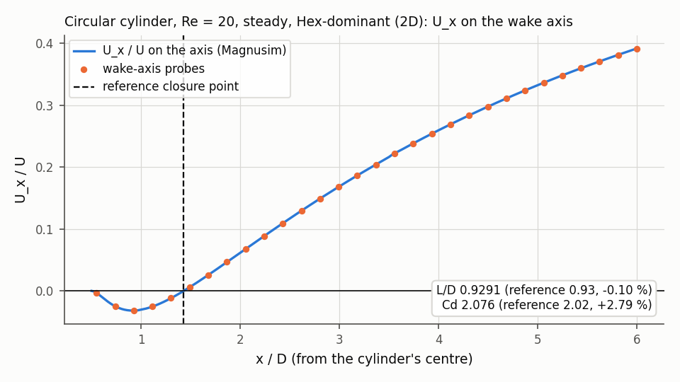
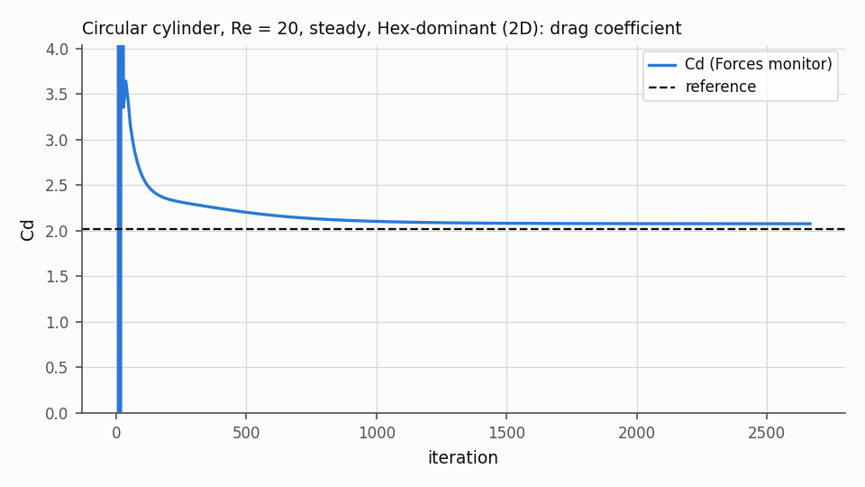
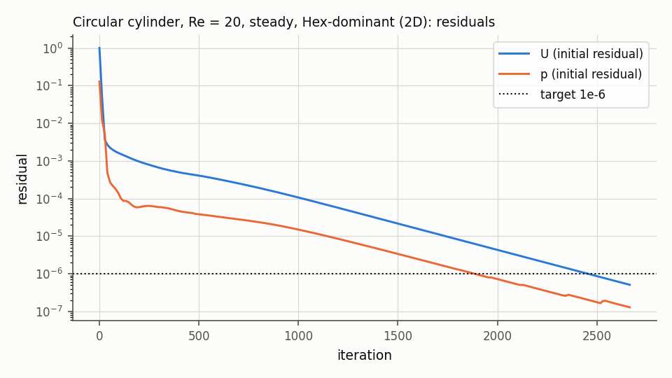

### Re = 40, steady, Hex-dominant (2D)

- Setup: The domain is a box x from -15 D to 30 D and y from -20 D to 20 D round a circular cylinder D = 10 mm along z at the origin (cut out: the box is the fluid), 5 mm deep in z (one cell across); blockage D / 40 D = 2.5 % (STEP in mm, built with OCP: a box with the cylinder cut out); a custom fluid with nu = 0.00025 m²/s and rho = 1 kg/m³, so Re = U D / nu = 40; the four sides one Freestream of 1 m/s along +x and 0 Pa, the cylinder a no-slip wall, the front and back one Symmetry (the 2D mesh's ends, solved empty); laminar; the study's reference values speed 1 m/s, area D x depth = 5e-5 m², length D, drag +x, lift +y; a Forces monitor on the cylinder, 30 Point probes on the wake axis and one at (2 D, 0.5 D); steady (simpleFoam), Accurate numerics, residual targets 1e-6, at most 3000 iterations, starting from the free stream's velocity.
- Status: ok.
- Mesh settings: Hex-dominant at fineness 6, One cell across (2D) on, custom sizes on the cylinder with Refine out to (Cylinder 0.2083 mm out to 5 mm, Near wake 0.4167 mm out to 30 mm, Wake 0.8333 mm out to 80 mm), no wall layers; 1 non-orthogonal corrector.
- Mesh: 70 793 cells, one cell across (2D) along z (the plan's estimate about 77 000), background block 50 × 45 × 1, wall cells 2.99 × 2.96 × 5 mm (x × y × z), Cylinder's custom size cells 0.187 × 0.185 × 5 mm (level 6), Near wake's custom size cells 0.374 × 0.369 × 5 mm (level 5), Wake's custom size cells 0.748 × 0.739 × 5 mm (level 4), generated in 121 s; checkMesh OK (max non-orthogonality 24.5°, max skewness 0.824, max aspect ratio 2.37); wall layers none asked.
- Run: 1855 iterations, converged at iteration 1855; solve 39 s on 8 ranks (Cores 8); run health healthy.
- The solver's last initial residuals: Ux 2.5 × 10^-7, Uy 5.2 × 10^-7, p 1 × 10^-6.
- Pre-run check: nothing found.
- Its estimate before Start: 3,000 iterations at most · ~1 minute on 8 cores · Re ≈ 40.
- **Drag coefficient Cd (Re 40)**: 1.5481 against 1.5 (+3.21 %, band ±5 % (inside), report-only). How: the Forces monitor's drag coefficient on the cylinder (its last value; the run stops on its residual targets): the study's reference values, speed 1 m/s, area D x depth (the 2D mesh's span), drag along +x; recomputed from its drag force as a check. Source: `route:/api/run/monitors`. at iteration 1855; from its drag force 1.5481 (F_d / (0.5 rho U² D depth)).
- **Recirculation length L/D (Re 40)**: 2.2818 against 2.24 (+1.87 %, band ±5 % (inside), report-only); ± 0.11 % (half the spacing of the two samples around the zero). How: the recirculation length: x0, where U_x on the wake axis (y = 0 at mid-depth, sampled as Plot over path samples it with the components kept) turns from reversed to forward after the most reversed point behind the cylinder, linearly interpolated between the two samples around it; L/D = (x0 - D/2) / D from the cylinder's back. Source: `app_sampling`. x0 = 27.818 mm (2.7818 D from the centre); the most reversed U_x -0.09749 m/s at 1.290 D.
- Shown, not compared: the drag's pressure part Cdp 1.003 and viscous part Cdv 0.545; Cd from the drag force 1.5481; the lift coefficient -2.7 × 10^-7; Cd moved 0.0043 % over the last 10 % of iterations; the wake-axis probes close the bubble at L/D 2.282 (the cross-check); the separation angle 53.7° from the rear stagnation point, where the wall shear stress along the wall turns (Gautier et al. 53.6°); the literature the reference data list at Re 40: Cd 1.493 to 1.54, L/D 2.13 to 2.345, the separation angle 53.6 to 55.6° (refs/cylinder_steady_scatter.csv); Plot over path's p along the wake axis and app_sampling's agree within 0 Pa (p from -0.251 to -0.00601 Pa).

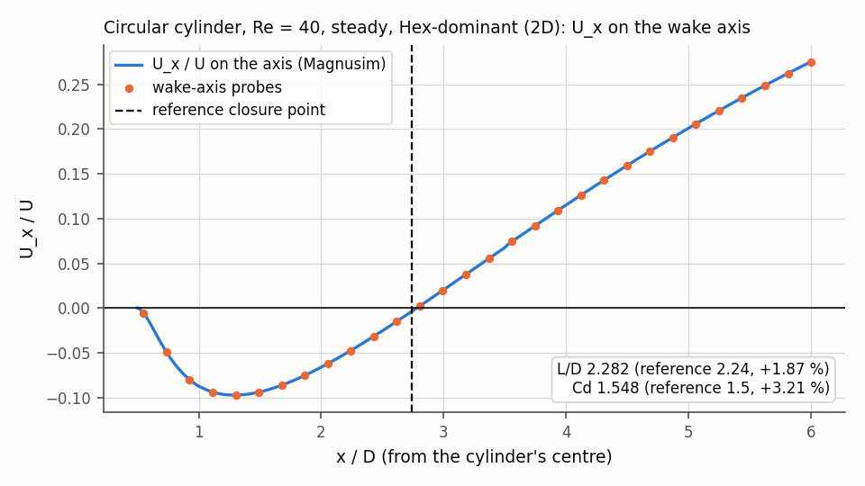
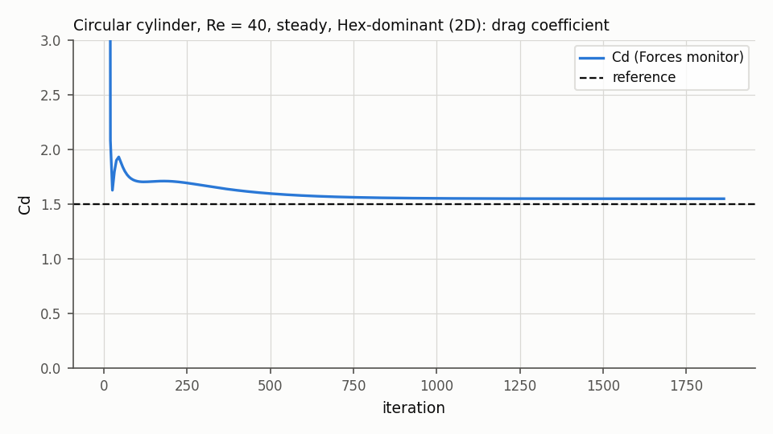
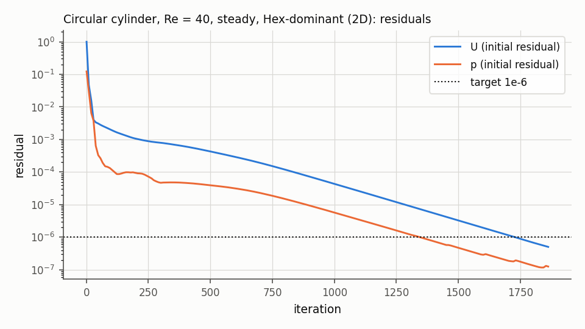

### Re = 100, transient (shedding), Hex-dominant (2D)

- Setup: The domain is a box x from -15 D to 30 D and y from -20 D to 20 D round a circular cylinder D = 10 mm along z at the origin (cut out: the box is the fluid), 5 mm deep in z (one cell across); blockage D / 40 D = 2.5 % (STEP in mm, built with OCP: a box with the cylinder cut out); a custom fluid with nu = 0.0001 m²/s and rho = 1 kg/m³, so Re = U D / nu = 100; the four sides one Freestream of 1 m/s along +x and 0 Pa, the cylinder a no-slip wall, the front and back one Symmetry (the 2D mesh's ends, solved empty); laminar; the study's reference values speed 1 m/s, area D x depth = 5e-5 m², length D, drag +x, lift +y; a Forces monitor on the cylinder, 30 Point probes on the wake axis and one at (2 D, 0.5 D); transient (pimpleFoam), 3 s (300 D/U), 50 Result frames, the time step adjusted to Courant 1, backward in time, 2 pressure correctors and 1 non-orthogonal corrector, time averages from 1.5 s; starting flow Custom U = (1, 0.05, 0) m/s.
- Status: ok.
- Mesh settings: Hex-dominant at fineness 6, One cell across (2D) on, custom sizes on the cylinder with Refine out to (Cylinder 0.2083 mm out to 5 mm, Near wake 0.4167 mm out to 30 mm, Wake 0.8333 mm out to 80 mm), no wall layers; 1 non-orthogonal corrector.
- Mesh: 70 793 cells, one cell across (2D) along z (the plan's estimate about 77 000), background block 50 × 45 × 1, wall cells 2.99 × 2.96 × 5 mm (x × y × z), Cylinder's custom size cells 0.187 × 0.185 × 5 mm (level 6), Near wake's custom size cells 0.374 × 0.369 × 5 mm (level 5), Wake's custom size cells 0.748 × 0.739 × 5 mm (level 4), generated in 116 s; checkMesh OK (max non-orthogonality 24.5°, max skewness 0.824, max aspect ratio 2.37); wall layers none asked.
- Run: 3 s of flow of the 3 s set, 27 153 time steps; solve 936 s on 8 ranks (Cores 8); run health healthy.
- The solver's last initial residuals: Ux 0.0004, Uy 0.0029, p 0.0023.
- Pre-run check: warn duration_vs_ftt: Averaging from 1.5 s to 3 s is about 3.3 flow-throughs; a mean usually settles within 10-20 after the start-up.
- Its estimate before Start: Δt ≈ 1.1e-4 s at Max Courant 1 (smallest cells at 1 m/s) · ~26,000 steps · ~11 minutes on 8 cores · one flow-through ≈ 0.45 s · Re ≈ 100.
- **Strouhal number St = f D / U (Re 100)**: 0.16568 against 0.164 (+1.03 %, band ±3 % (inside), report-only); ± 0.0097 % (its difference from the mean period's St). How: f, the peak of the lift coefficient's spectrum over the window of whole shedding periods after the transient (from the first period whose lift amplitude is within 2 % of the settled one, the last 5 periods' amplitudes agreeing within 2 %; at least 20 periods): the Forces monitor's Cl resampled evenly, a Hann window, zero padded 8 times, the peak refined by a parabola through the logarithms of its three highest bins; the mean period between the window's up-crossings as the cross-check. Source: `route:/api/run/monitors`. f = 16.568 Hz over 39 whole periods, t = 0.6226 to 2.977 s (235.4 D/U); the spectrum's bins 0.0531 Hz apart; the mean period 0.060362 s gives St 0.16567.
- **Mean drag coefficient (Re 100)**: 1.3568 against 1.33 (+2.01 %, band ±5 % (inside), report-only). How: the Forces monitor's drag coefficient on the cylinder (its time mean over the window of whole shedding periods after the transient (from the first period whose lift amplitude is within 2 % of the settled one, the last 5 periods' amplitudes agreeing within 2 %; at least 20 periods)): the study's reference values, speed 1 m/s, area D x depth (the 2D mesh's span), drag along +x; recomputed from its drag force as a check. Source: `route:/api/run/monitors`. over the same 39 periods; from its drag force 1.3568; pressure part 1.004, viscous 0.3524.
- **Lift coefficient rms (Re 100)**: 0.24939 against 0.23 (+8.43 %, band ±15 % (inside), report-only). How: the root-mean-square of the Forces monitor's lift coefficient about its mean over the window of whole shedding periods after the transient (from the first period whose lift amplitude is within 2 % of the settled one, the last 5 periods' amplitudes agreeing within 2 %; at least 20 periods), lift along +y. Source: `route:/api/run/monitors`. about its mean -3.54e-05; its amplitude (half its peak-to-peak, per period) 0.3529.
- **Mean recirculation length L/D (Re 100, information)**: 1.3584 against 1.41 (-3.66 %, band ±10 % (inside), report-only); ± 6.9 % (half the spacing of the two probes around the zero). How: the 30 wake-axis Point probes' U_x (0.55 D to 6 D, y = 0, mid-depth), each a time mean over the window of whole shedding periods after the transient (from the first period whose lift amplitude is within 2 % of the settled one, the last 5 periods' amplitudes agreeing within 2 %; at least 20 periods); x0 where that mean turns from reversed to forward, linearly interpolated between the two probes around it; L/D = (x0 - D/2) / D. Source: `route:/api/run/monitors`. x0 = 18.584 mm (1.8584 D from the centre) between probes 0.188 D apart; 30 probes.
- Shown, not compared: the shedding window t = 0.6226 to 2.977 s, 39 whole periods of 0.060362 s (the periods within 0.21 % of each other), the last 5 lift amplitudes within 0.022 %; 50.3 monitor samples a period (every 0.0012 s); St from the mean period 0.16567, from the shedding probe's U_y spectrum 0.16568; the mean drag's pressure part 1.004 and viscous part 0.3524 (Park et al. 0.99 and 0.34); the lift coefficient's amplitude 0.3529 (Park et al. 0.332), its mean -3.5 × 10^-5; the drag coefficient's fluctuation amplitude 0.0108 (Park et al. 0.0091); the mean Cd from the drag force 1.3568; the run's UMean (from 1.5 s) closes the bubble at L/D 1.359; the 2D computations the reference data list at Re 100: St 0.164 to 0.167, mean Cd 1.314 to 1.386, CL rms 0.222 to 0.235, mean L/D 1.405 to 1.45 (refs/cylinder_re100_scatter.csv); Plot over path's p along the wake axis and app_sampling's agree within 0 Pa (p from -0.445 to -0.0711 Pa).

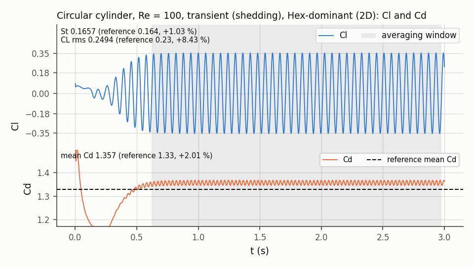
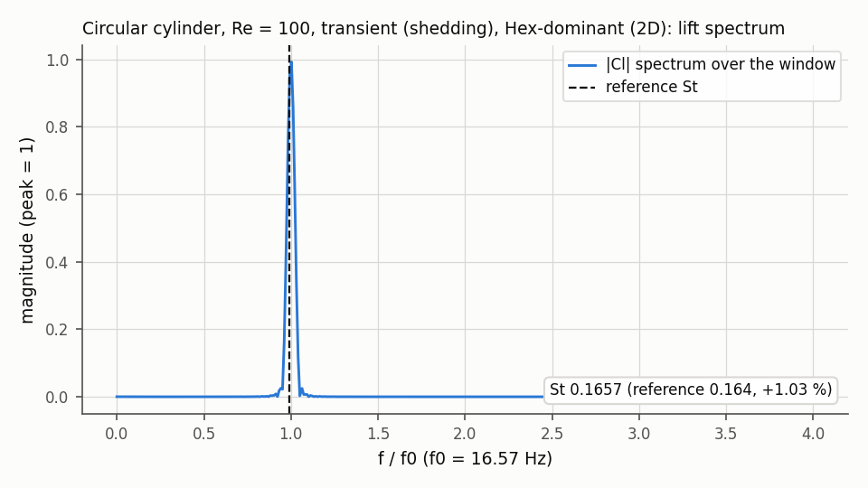
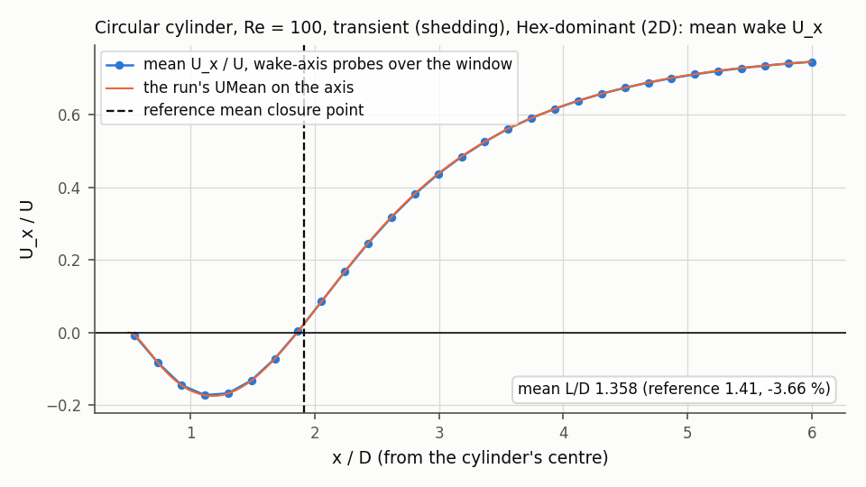

### References

- **Drag coefficient Cd (Re 20)**: 2.02 (numerical, SECONDARY). Fornberg (1980), J. Fluid Mech. 98:819-855 (2.000), and S. C. R. Dennis, G.-Z. Chang (1970), J. Fluid Mech. 42:471-489 (2.045); Re 20, Cd 2.02: the reference data's value to use (section 5a) (validation/refs/cylinder_re20_re40.csv). Conditions: steady two-dimensional flow past a circular cylinder in an unbounded uniform stream; Re = U D / nu; Cd = F_x / (0.5 rho U^2 D) per unit span; L the recirculation length from the rear stagnation point to the closure point on the axis. Steady flow loses its stability near Re 47 (Legendre et al. 2009: 47.5), so Re 20 and 40 are steady. Gautier et al. put the literature at Re 40 between 2.13 and 2.35 in L/D and 1.48 and 1.62 in Cd; finite-box immersed-boundary results sit about 3 % above the large-domain values.
- **Recirculation length L/D (Re 20)**: 0.93 (numerical, SECONDARY). Fornberg (1980), J. Fluid Mech. 98:819-855 (0.91), and S. C. R. Dennis, G.-Z. Chang (1970), J. Fluid Mech. 42:471-489 (0.94); between them M. Coutanceau, R. Bouard (1977), J. Fluid Mech. 79:231-256 (measured, 0.93) and Linnick & Fasel (2005) (0.93); Re 20, L/D 0.93: the reference data's value to use (section 5a) (validation/refs/cylinder_re20_re40.csv). Conditions: steady two-dimensional flow past a circular cylinder in an unbounded uniform stream; Re = U D / nu; Cd = F_x / (0.5 rho U^2 D) per unit span; L the recirculation length from the rear stagnation point to the closure point on the axis. Steady flow loses its stability near Re 47 (Legendre et al. 2009: 47.5), so Re 20 and 40 are steady. Gautier et al. put the literature at Re 40 between 2.13 and 2.35 in L/D and 1.48 and 1.62 in Cd; finite-box immersed-boundary results sit about 3 % above the large-domain values.
- **Drag coefficient Cd (Re 40)**: 1.5 (numerical, SECONDARY). Fornberg (1980), J. Fluid Mech. 98:819-855 (1.498), and Gautier, Biau & Lamballais (2013), Computers & Fluids 75:103-111 (1.4931, CONFIRMED); Re 40, Cd 1.50: the reference data's value to use (section 5a) (validation/refs/cylinder_re20_re40.csv). Conditions: steady two-dimensional flow past a circular cylinder in an unbounded uniform stream; Re = U D / nu; Cd = F_x / (0.5 rho U^2 D) per unit span; L the recirculation length from the rear stagnation point to the closure point on the axis. Steady flow loses its stability near Re 47 (Legendre et al. 2009: 47.5), so Re 20 and 40 are steady. Gautier et al. put the literature at Re 40 between 2.13 and 2.35 in L/D and 1.48 and 1.62 in Cd; finite-box immersed-boundary results sit about 3 % above the large-domain values.
- **Recirculation length L/D (Re 40)**: 2.24 (numerical, SECONDARY). Fornberg (1980), J. Fluid Mech. 98:819-855 (2.24), and Gautier, Biau & Lamballais (2013), Computers & Fluids 75:103-111 (2.2360, CONFIRMED); Re 40, L/D 2.24: the reference data's value to use (section 5a) (validation/refs/cylinder_re20_re40.csv). Conditions: steady two-dimensional flow past a circular cylinder in an unbounded uniform stream; Re = U D / nu; Cd = F_x / (0.5 rho U^2 D) per unit span; L the recirculation length from the rear stagnation point to the closure point on the axis. Steady flow loses its stability near Re 47 (Legendre et al. 2009: 47.5), so Re 20 and 40 are steady. Gautier et al. put the literature at Re 40 between 2.13 and 2.35 in L/D and 1.48 and 1.62 in Cd; finite-box immersed-boundary results sit about 3 % above the large-domain values.
- **Strouhal number St = f D / U (Re 100)**: 0.164 (numerical, SECONDARY). C. H. K. Williamson (1988), Phys. Fluids 31:2742-2744 (experiment, and the fit St = -3.3265/Re + 0.1816 + 1.6e-4 Re = 0.1643); St at Re 100 (section 5b) (validation/refs/cylinder_re100.csv). Conditions: periodic two-dimensional (parallel) vortex shedding behind a circular cylinder in a uniform stream at Re = U D / nu = 100; St = f D / U with f the shedding (lift) frequency; Cd = F_x / (0.5 rho U^2 D) per unit span, averaged over whole periods; CL rms the lift coefficient's root-mean-square fluctuation; L the mean recirculation length from the rear stagnation point. Williamson's St is an experiment (and its fit); the other values are 2D computations. The validity range of Williamson's fit (about 49 to 180) is not checked. A 32 D x 16 D box (blockage 6.25 %) against 64 D x 32 D (3.1 %) moved Cd by +3.0 %, CL rms by +7.6 % and St by +2.4 % (arXiv:2303.09262 Table 1, CONFIRMED as published there).
- **Mean drag coefficient (Re 100)**: 1.33 (numerical, SECONDARY). J. Park, K. Kwon, H. Choi (1998), KSME Int. J. 12(6):1200-1205 (2D computation); the mean Cd at Re 100 (section 5b) (validation/refs/cylinder_re100.csv). Conditions: periodic two-dimensional (parallel) vortex shedding behind a circular cylinder in a uniform stream at Re = U D / nu = 100; St = f D / U with f the shedding (lift) frequency; Cd = F_x / (0.5 rho U^2 D) per unit span, averaged over whole periods; CL rms the lift coefficient's root-mean-square fluctuation; L the mean recirculation length from the rear stagnation point. Williamson's St is an experiment (and its fit); the other values are 2D computations. The validity range of Williamson's fit (about 49 to 180) is not checked. A 32 D x 16 D box (blockage 6.25 %) against 64 D x 32 D (3.1 %) moved Cd by +3.0 %, CL rms by +7.6 % and St by +2.4 % (arXiv:2303.09262 Table 1, CONFIRMED as published there).
- **Lift coefficient rms (Re 100)**: 0.23 (numerical, SECONDARY). Qu, Norberg, Davidson, Peng & Wang (2013), J. Fluids Struct. 39:347-370 (0.225), and Posdziech & Grundmann (2007), J. Fluids Struct. 23:479-499, 0.228 (2D computations); CL rms at Re 100 (section 5b) (validation/refs/cylinder_re100.csv). Conditions: periodic two-dimensional (parallel) vortex shedding behind a circular cylinder in a uniform stream at Re = U D / nu = 100; St = f D / U with f the shedding (lift) frequency; Cd = F_x / (0.5 rho U^2 D) per unit span, averaged over whole periods; CL rms the lift coefficient's root-mean-square fluctuation; L the mean recirculation length from the rear stagnation point. Williamson's St is an experiment (and its fit); the other values are 2D computations. The validity range of Williamson's fit (about 49 to 180) is not checked. A 32 D x 16 D box (blockage 6.25 %) against 64 D x 32 D (3.1 %) moved Cd by +3.0 %, CL rms by +7.6 % and St by +2.4 % (arXiv:2303.09262 Table 1, CONFIRMED as published there).
- **Mean recirculation length L/D (Re 100, information)**: 1.41 (numerical, SECONDARY). Qu, Norberg, Davidson, Peng & Wang (2013), J. Fluids Struct. 39:347-370 (2D computation; Park et al. 1.405); the mean L/D at Re 100 (section 5b) (validation/refs/cylinder_re100.csv). Conditions: periodic two-dimensional (parallel) vortex shedding behind a circular cylinder in a uniform stream at Re = U D / nu = 100; St = f D / U with f the shedding (lift) frequency; Cd = F_x / (0.5 rho U^2 D) per unit span, averaged over whole periods; CL rms the lift coefficient's root-mean-square fluctuation; L the mean recirculation length from the rear stagnation point. Williamson's St is an experiment (and its fit); the other values are 2D computations. The validity range of Williamson's fit (about 49 to 180) is not checked. A 32 D x 16 D box (blockage 6.25 %) against 64 D x 32 D (3.1 %) moved Cd by +3.0 %, CL rms by +7.6 % and St by +2.4 % (arXiv:2303.09262 Table 1, CONFIRMED as published there).

### Notes

- The values and bands are the reference data's (2026-11-04, section 5): Cd 2.02 and 1.50 at Re 20 and 40 with ±5 % (the design's ±3 %), L/D 0.93 and 2.24 with ±5 %; at Re 100 St 0.164 ±3 %, the mean Cd 1.33 ±5 %, CL rms 0.23 ±15 % and the mean L/D 1.41 ±10 % as information. The design's domain (10 D to each side, 10 D upstream, 25 D downstream: 5 % blockage) is replaced by the reference data's: at least 40 D wide (2.5 %), about 15 D upstream and 30 D or more downstream (their judgement numbers, built on one published blockage test).
- The four sides are one Freestream BC (OpenFOAM v2606's freestreamVelocity and freestreamPressure, which blend face by face, by how the velocity there meets the face, between the free stream's value and zero gradient: the velocity held where the flow comes straight in, the pressure (0 Pa) where it goes straight out, half of each on the two sides along the stream), not the slip or symmetry sides of the reference data's domain advice. The cylinder is a no-slip wall; the front and back one Symmetry, the 2D mesh's ends, solved empty.
- One cell across (2D): the part is meshed one cell deep between its front and back, so the solution is exactly 2D. The forces are on the cylinder's 5 mm span, so the reference area is D x 5 mm = 5e-5 m²; the Forces monitor's coefficients are per unit span as the references' are.
- The mesh is Hex-dominant at fineness 6 with three custom sizes on the cylinder's wall, each with Refine out to (gap G4, landed): D/48 out to 0.5 D, D/24 out to 3 D and D/12 out to 8 D, which the mesher's levels make cells of D/53, D/27 and D/13 (the background 1.2 D, the sides 0.3 D). Refine out to is a distance from the wall, so each band is a ring round the cylinder (upstream too), not a box along the wake: there is still no box refinement. No wall layers: the cells are D/53 up to the wall.
- How much the mesh moves the answer (the coarse runs of 2026-11-06, every custom size doubled: a level fewer, 20 102 cells, D/27 at the wall; not reported): at Re 20 Cd 2.0756 and L/D 0.9209 against 2.0764 and 0.92907 on 70 793 cells (0.04 and 0.9 %); at Re 40 Cd 1.5483 and L/D 2.2872 against 1.5481 and 2.2818 on 70 793 cells (0.01 and 0.2 %); at Re 100 St 0.16455, the mean Cd 1.3777, CL rms 0.2742 and the mean L/D 1.291 against 0.16568, 1.3568, 0.24939 and 1.3584 on 70 793 cells (0.7, 1.5, 9.9 and 5 %). The steady values move by at most 0.9 %: they are converged in the mesh. A finer mesh at Re 100 (fineness 7, where the same custom sizes come out at D/68, D/34 and D/17: 117 332 cells; a probe at 4 cores, not reported) gave St 0.16568, the mean Cd 1.3573, CL rms 0.2468 and the mean L/D 1.371 (0.002, 0.04, 1 and 0.9 % from the reported run).
- The steady drag coefficients sit 2.8 % above and 3.2 % above the reference values while the mesh hardly moves them; what is left is the domain (40 D wide, its sides a Freestream) and the reference's own spread: Fornberg's large-domain 2.000 and 1.498 against the finite-box results of 2.06 and 1.54 (Linnick & Fasel, Taira & Colonius), within 1 % of these values. At Re 100 the mean Cd is 2 % above and St 1 % above the references. CL rms is 8.4 % above its reference. The reference data's one domain test moved CL rms the most of the three values it reports (by 7.6 %, from 6.25 % to 3.1 % blockage, where it gave 0.236, 2.6 % above 0.23), and this domain's 2.5 % blockage is smaller than either, so blockage as that test measured it does not account for the excess here. The domain's share is not measured here: the reference data expect +1 to 3 % on Cd and St unless the domain is at least 40 D wide with slip or symmetry sides (their judgement), and this one is 40 D wide with Freestream sides.
- Re 100 starts from a Custom starting flow, U = (1, 0.05, 0) m/s everywhere, so the wake is lopsided from the start and the shedding begins within the run (a symmetric start waits for round-off). The run is 300 D/U long (3 s), with 50 Result frames; the monitors write at a fiftieth of the frame interval (Incompressible Flow's rule), every 0.0012 s, 50.3 samples a shedding period in the reported run; the time step is adjusted to a Courant number of 1, second-order backward in time, 2 pressure correctors, 1 non-orthogonal corrector.
- The app has no mean or frequency of a monitor over a time window (gap G8): the harness reads them from the Forces monitor's history. The lift coefficient's whole periods run from one rise through its mean to the next; the window starts at the first period whose amplitude is within 2 % of the settled amplitude (the mean of the last 5 periods', which must agree within 2 %), and needs at least 20 whole periods (the reference data); a run that does not get there is not settled and gives no values. St is the peak of the spectrum over the window, the mean period between its up-crossings the cross-check; Cd, CL rms and the probes' U_x are time means over the same whole periods (time integrals: the monitors' samples are not evenly spaced).
- The steady runs' L/D is read from U_x on the wake axis at mid-depth, sampled as Plot over path samples it with the velocity's components kept (Plot over path gives a vector's magnitude only, gap G2), the 30 wake-axis probes as the cross-check; Re 100's mean L/D from the probes' time means over the window, with the run's UMean (the app's own time average from 1.5 s, not whole periods) along the same line beside it.
- The pre-run check's time estimates against what the solves took: Re 20 about 1.4 minutes, the solve 57.9 s; Re 40 about 1.3 minutes, the solve 39 s; Re 100 about 11 minutes, the solve 936 s (each run's facts give the check's whole line).
- Re 100's pre-run check counts the app's own average (UMean from 1.5 s) in flow-throughs of the whole domain, 45 D long, and finds it short of the 10 to 20 it asks for. That average is shown beside the compared values only: they are means over the window's whole shedding periods, which must hold a settled lift amplitude (above). Its rule counts flow-throughs, not shedding periods; it is the check's, not changed here.
- Reference confidence: every value is SECONDARY (read in compilations: arXiv:2205.15886, arXiv:1906.05387, arXiv:2303.09262, arXiv:1612.08356, Legendre et al. 2009), except Gautier et al.'s Re 40 values (1.4931, 2.2360), read in their arXiv paper (CONFIRMED). The compilations disagree on Tritton's measured Cd (2.09 or 2.22 at Re 20), so it is not used.

## Sphere

The domain is a box x from -8 D to 15 D and y and z from -15 D to 15 D round a sphere D = 10 mm at the origin (cut out: the box is the fluid); blockage (pi D² / 4) / (30 D)² = 0.087 % (STEP in mm, built with OCP: a box with the sphere cut out); a custom fluid with nu = 0.0001 m²/s and rho = 1 kg/m³, so Re = U D / nu = 100; all six sides one Freestream of 1 m/s along +x and 0 Pa, the sphere a no-slip wall; laminar; the study's reference values speed 1 m/s, area pi D² / 4 = 7.854e-5 m², length D, drag +x, lift +y, centre of rotation the sphere's centre; a Forces monitor on the sphere and 30 Point probes on the axis behind it; steady (simpleFoam), Accurate numerics, residual targets 1e-6, at most 2000 iterations, starting from the free stream's velocity.

### Re = 100, steady, Hex-dominant

- Status: ok.
- Mesh settings: Hex-dominant at fineness 4, custom sizes on the sphere with Refine out to (Sphere 0.3125 mm out to 2.5 mm, Near wake 0.625 mm out to 15 mm, Wake 1.25 mm out to 30 mm), an Inflate boundary layer of 4 layers, 0.6 mm in all, on the sphere; 1 non-orthogonal corrector.
- Mesh: 669 786 cells (the plan's estimate about 682 000), background block 20 × 26 × 26, wall cells 3.82 × 3.84 × 3.84 mm (x × y × z), Sphere's custom size cells 0.239 × 0.24 × 0.24 mm (level 6), Near wake's custom size cells 0.478 × 0.48 × 0.48 mm (level 5), Wake's custom size cells 0.956 × 0.959 × 0.959 mm (level 4), generated in 71.3 s; checkMesh OK (max non-orthogonality 46.4°, max skewness 0.601, max aspect ratio 4.38); wall layers applied (sphere 4 of 4), first layer 0.112 mm.
- Run: 549 iterations, converged at iteration 549; solve 254 s on 8 ranks (Cores 8); run health healthy.
- The solver's last initial residuals: Ux 6.8 × 10^-8, Uy 9.9 × 10^-7, Uz 9.9 × 10^-7, p 2.1 × 10^-7.
- Pre-run check: nothing found.
- Its estimate before Start: 2,000 iterations at most · ~8 minutes on 8 cores · Re ≈ 100.
- **Drag coefficient Cd (Re 100)**: 1.0925 against 1.09 (+0.23 %, band ±5 % (inside), report-only). How: the Forces monitor's drag coefficient on the sphere, its last value (the run stops on its residual targets): the study's reference values, speed 1 m/s, area pi D² / 4, drag along +x; recomputed from its drag force as a check. Source: `route:/api/run/monitors`. at iteration 549; from its drag force 1.0925 (F_d / (0.5 rho U² pi D² / 4)).
- **Recirculation length L/D (Re 100)**: 0.85726 against 0.88 (-2.58 %, band ±7 % (inside), report-only); ± 0.29 % (half the spacing of the two samples around the zero). How: the recirculation length: x0, where U_x on the axis behind the sphere (y = z = 0, sampled as Plot over path samples it with the components kept) turns from reversed to forward after the most reversed point, linearly interpolated between the two samples around it; L/D = (x0 - D/2) / D from the rear stagnation point. Source: `app_sampling`. x0 = 13.573 mm (1.3573 D from the centre); the most reversed U_x -0.1338 m/s at 0.830 D.
- Shown, not compared: the correlations at Re 100: Schiller-Naumann 1.0917, Clift, Grace & Weber 1.087; Johnson & Patel's computed Cd 1.08; the drag's pressure part Cdp 0.5089 and viscous part Cdv 0.5837; Cd from the drag force 1.0925; the lift coefficient -1.9 × 10^-7; the force across the stream 0.00084 % of the drag; Cd moved 0.0025 % over the last 10 % of iterations; the axis probes close the bubble at L/D 0.8572 (the cross-check); the separation angle 53.1° from the rear stagnation point, where the wall shear stress along the meridian turns (4688 faces in 2° bins, 8 sectors round the axis from 53.1° to 53.2°; Johnson & Patel about 53°); the resolved computations the reference data list at Re 100: Cd 1.06 to 1.14, L/D 0.87 to 0.92 with Taneda's measured 0.89 (refs/sphere_re100_scatter.csv); Plot over path's p along the axis and app_sampling's agree exactly (p from -0.0862 to 0.0102 Pa).

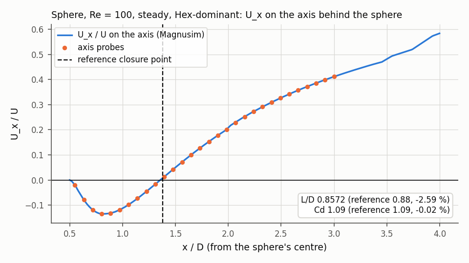
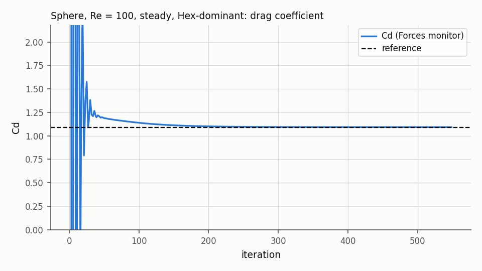
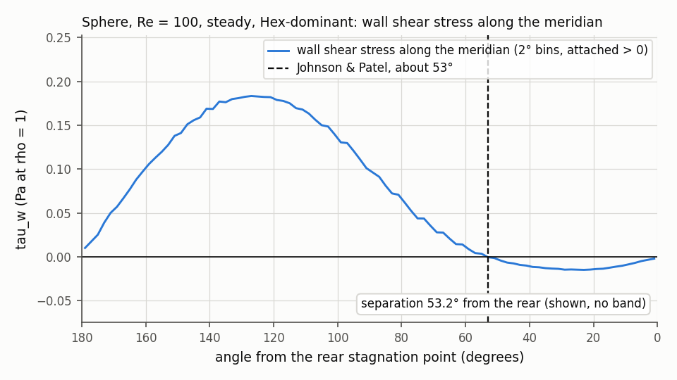
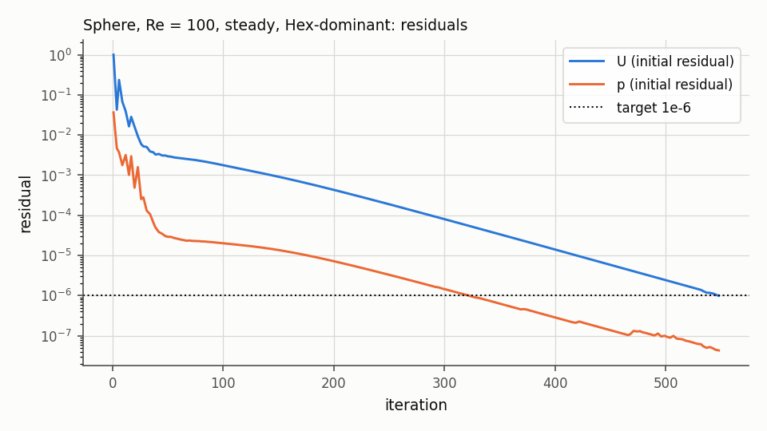

### References

- **Drag coefficient Cd (Re 100)**: 1.09 (correlation, SECONDARY). the mean of L. Schiller, A. Naumann (1933), Z. Ver. Dtsch. Ing. 77:318-320 (1.0917) and R. Clift, J. R. Grace, M. E. Weber (1978), Bubbles, Drops, and Particles, Academic Press, ch. 5 (1.0870); Cd 1.09 at Re 100: the reference data's value to use (section 6) (validation/refs/sphere_re100_cd.csv). Conditions: steady axisymmetric flow past a sphere in an unbounded uniform stream at Re = U D / nu = 100; Cd = F_x / (0.5 rho U^2 pi D^2 / 4). The correlations give 1.087 to 1.092 at Re 100 (about ±0.25 %); resolved computations give 1.06 to 1.14 (about ±4 %, refs/sphere_re100_scatter.csv).
- **Recirculation length L/D (Re 100)**: 0.88 (numerical, SECONDARY). T. A. Johnson, V. C. Patel (1999), J. Fluid Mech. 378:19-70 (via arXiv:2309.08882 Table V); L/D 0.88 at Re 100: the reference data's value to use (section 6) (validation/refs/sphere_re100.csv). Conditions: steady axisymmetric flow past a sphere in a uniform stream (axisymmetric for Re about 20 to 210) at Re = U D / nu = 100; L from the rear stagnation point to the closure point of the recirculation on the axis. The two quotations of Johnson & Patel's L/D differ by 0.02 (0.88, 0.86).

### Notes

- The values and bands are the reference data's (2026-11-04, section 6): Cd 1.09 ±5 % (the design's ±3 %), the mean of the Schiller-Naumann (1.0917) and Clift, Grace & Weber (1.0870) correlations, with Johnson & Patel's computed 1.08 beside it; L/D 0.88 ±7 % (Johnson & Patel), compared (the design had it as information, ±10 %), with Taneda's measured 0.89 beside it; the separation angle shown without a band. The design's box (8 D to each side, 20 D downstream) is replaced by the reference data's: at least 15 D to each side and about 15 D downstream; upstream stays the design's 8 D.
- All six sides are one Freestream BC (OpenFOAM v2606's freestreamVelocity and freestreamPressure, which blend face by face between the free stream's value and zero gradient by how the flow meets the face: the velocity held where it comes in, the pressure, 0 Pa, where it goes out). The sphere is a no-slip wall.
- The mesh is Hex-dominant at fineness 4 (its background cells 15.1 to 15.3 mm, about 1.5 D; every side refined to the walls' level 2, about 0.38 D) with three custom sizes on the sphere, each with Refine out to (gap G4, landed): D/32 out to 0.25 D, D/16 out to 1.5 D and D/8 out to 3 D, which the mesher's levels make cells of D/42, D/21 and D/10.5. Refine out to is a distance from the wall, so each band is a spherical shell round the sphere (upstream too), not a box along the wake: there is still no box refinement. An Inflate boundary layer of 4 layers, 0.6 mm (0.06 D) in all, on the sphere; the run asserts that the layers were applied.
- How much the mesh moves the answer (probes of 2026-11-06 at 4 cores, not reported): with the same sizes at fineness 3 (cells D/34, D/17 and D/8.4: 326 107 cells) Cd 1.0914, L/D 0.8487 and the separation angle 53.3°; at fineness 5 (D/53, D/26 and D/13: 1 359 124 cells, 4 of 4 layers kept) 1.0929, 0.8636 and 53.5°, against 1.0925, 0.8573 and 53.1° on the reported 669 786 cells: Cd moves by 0.04 % from the reported mesh to one 1.26 times finer, L/D by 0.7 % (1 % from the coarser one to it); a Richardson extrapolation of L/D from the three gives about 0.88 (rough: three meshes, their own order). Every custom size doubled at fineness 4 (166 824 cells) gave Cd 1.0853 and L/D 0.8045 (0.7 and 6.2 % from the reported run). The wake's band is a sphere round the sphere (Refine out to), so a finer wake costs cells upstream as well: the D/21 band, a shell from 0.75 D to 2 D from the centre, holds about 290 000 cells by its volume, of the reported mesh's 669 786.
- Earlier full runs of the same settings (2026-11-06) gave Cd 1.0925, L/D 0.8573 after 549 iterations (its worst face 46.42°) and Cd 1.0925, L/D 0.8573 after 548 iterations (its worst face 46.43°); the reported run Cd 1.0925, L/D 0.8573 after 549 iterations (its worst face 46.39°): snappyHexMesh in parallel is not bit for bit the same each time.
- The pre-run check's time estimates against what the solves took: Re 100 about 8.4 minutes, the solve 254 s (each run's facts give the check's whole line).
- Reference confidence: every value is SECONDARY (the compilations arXiv:2309.08882 Table V and the notus-cfd sphere page; the MFIX-Exa sphere tutorial and python-fluids for the correlations' formulas). Johnson & Patel's paper was not read: their Cd is quoted as 1.08 by two sources and as 1.086 or 1.112 by single ones, their L/D as 0.88 or 0.86. Schiller & Naumann's citation is from memory (UNCONFIRMED); the correlation values are computed from their formulas.
- L/D is read from U_x on the axis behind the sphere, sampled as Plot over path samples it with the velocity's components kept (Plot over path gives a vector's magnitude only, gap G2); the 30 axis probes are the cross-check. The separation angle is read from the wall shear stress the run saved on the sphere: its component along the meridian, from the front stagnation point towards the rear, averaged over the faces in bins of 2 degrees of the angle from the front, turns where the flow separates; the same in 8 sectors round the axis gives its spread (the faces are the snapped mesh's, not the exact sphere).

## Heat Transfer

Heat Transfer's own validation set: natural convection in a square cavity (de Vahl Davis), forced convection in a pipe (laminar and turbulent) and conduction through solids, each against its published value. Its runs go another way than the cases above: each case is a study set up in Python, meshed by the app's mesher and solved by the plugin's prepare job and solve.sh in WSL (the relay Start uses), not sent over the app's HTTP routes, so the two sets exercise different parts of the app. Report-only, as above. Its rows are the ones it committed (bundled-plugins/heat_transfer/validation/results.json, from pytest -m validation there); they were not run again for this report. Its own report: `bundled-plugins/heat_transfer/VALIDATION.md`.

Results of 2026-10-15 (Heat Transfer 0.1.0, OpenFOAM v2606 (build _481094f-20260618)).

| Case | Quantity | Reference | Magnusim | Error | Mesher | Cells | Iterations |
| --- | --- | --- | --- | --- | --- | --- | --- |
| de Vahl Davis cavity, Ra = 1e3 | Nu-bar (mean of the hot and cold walls) | 1.118 | 1.118 ± 0.00 % | +0.00 % | Hex-dominant | 105 518 | 1500 |
| de Vahl Davis cavity, Ra = 1e3 | Nu_max (hot wall) | 1.505 | 1.507 | +0.13 % | Hex-dominant | 105 518 | 1500 |
| de Vahl Davis cavity, Ra = 1e4 | Nu-bar (mean of the hot and cold walls) | 2.243 | 2.245 ± 0.00 % | +0.09 % | Hex-dominant | 105 518 | 2000 |
| de Vahl Davis cavity, Ra = 1e4 | Nu_max (hot wall) | 3.528 | 3.522 | -0.17 % | Hex-dominant | 105 518 | 2000 |
| de Vahl Davis cavity, Ra = 1e5 | Nu-bar (mean of the hot and cold walls) | 4.519 | 4.494 ± 0.00 % | -0.55 % | Hex-dominant | 105 518 | 2500 |
| de Vahl Davis cavity, Ra = 1e5 | Nu_max (hot wall) | 7.717 | 7.611 | -1.37 % | Hex-dominant | 105 518 | 2500 |
| de Vahl Davis cavity, Ra = 1e6 | Nu-bar (mean of the hot and cold walls) | 8.800 | 8.745 ± 0.89 % | -0.63 % | Hex-dominant | 196 640 | 4000 |
| de Vahl Davis cavity, Ra = 1e6 | Nu_max (hot wall) | 17.93 | 17.06 | -4.83 % | Hex-dominant | 196 640 | 4000 |
| Laminar pipe, fixed wall heat flux (10 W/m²) | Nu (fully developed) | 4.364 | 4.360 ± 1.44 % | -0.09 % | Hex-dominant | 124 242 | 3000 |
| Laminar pipe, fixed wall heat flux (10 W/m²) | Nu (fully developed) | 4.364 | 4.967 ± 0.18 % | +13.81 % | Standard | 139 169 | 3000 |
| Laminar pipe, fixed wall temperature (30 °C, inlet 20 °C) | Nu (fully developed) | 3.657 | 3.644 ± 1.77 % | -0.35 % | Hex-dominant | 124 662 | 3000 |
| Laminar pipe, fixed wall temperature (30 °C, inlet 20 °C) | Nu (fully developed) | 3.657 | 4.135 ± 0.35 % | +13.07 % | Standard | 139 200 | 3000 |
| Turbulent pipe, fixed wall heat flux (1000 W/m²) | Nu (17.5 to 22.5 D from the inlet) | 106.9 | 96.63 ± 0.13 % | -9.64 % | Hex-dominant | 59 736 | 2000 |
| Turbulent pipe, fixed wall heat flux (1000 W/m²) | Nu (17.5 to 22.5 D from the inlet) | 106.9 | 85.03 ± 0.39 % | -20.48 % | Standard | 36 219 | 2000 |
| Composite wall (steel 10 mm, stainless steel 20 mm) | Heat through the wall (W) | 5.338 | 5.343 | +0.11 % | Hex-dominant | 13 634 | 600 |
| Heated block (stainless steel, 10 W, h = 500 W/(m²·K)) | Heat out (W) | 10.00 | 10.00 | +0.00 % | Hex-dominant | 12 576 | 800 |
| Heated block (stainless steel, 10 W, h = 500 W/(m²·K)) | Highest temperature rise (K) | 14.60 | 14.60 | +0.03 % | Hex-dominant | 12 576 | 800 |

### Natural convection

**de Vahl Davis cavity, Ra = 1e3.**
square cavity L = 0.1 m as a 40 mm slab (symmetry on both faces), ΔT = 10 K, Pr = 0.71, β ΔT = 0.01 (Boussinesq), laminar, buoyantSimpleFoam, Accurate numerics.
Reference: G. de Vahl Davis, Natural convection of air in a square cavity: a bench mark numerical solution, Int. J. Numer. Methods Fluids 3 (1983) 249-264, Table IV.

- Nu-bar (mean of the hot and cold walls) on Hex-dominant: 1.118 ± 0.00 % against 1.118 (+0.00 %); mesh: Hex-dominant fineness 4, 4 layers on the hot and cold walls; hot wall 1.1180 (de Vahl Davis's hot-wall Nu_0 1.117), cold wall 1.1180: 0.00 % apart, half of it the ± here; the mean moved 0.001 % over the last fifth of the iterations; layers: cold 4 of 4 layers, 100 % of the thickness; hot 4 of 4 layers, 100 % of the thickness.
- Nu_max (hot wall) on Hex-dominant: 1.507 against 1.505 (+0.13 %); mesh: Hex-dominant fineness 4, 4 layers on the hot and cold walls; at y/L = 0.0930 (reference 0.092, 0.0010 off), read on the faces of the slab's middle half between y/L 0.01 and 0.99 (not the corner faces); layers: cold 4 of 4 layers, 100 % of the thickness; hot 4 of 4 layers, 100 % of the thickness.

**de Vahl Davis cavity, Ra = 1e4.**
square cavity L = 0.1 m as a 40 mm slab (symmetry on both faces), ΔT = 10 K, Pr = 0.71, β ΔT = 0.01 (Boussinesq), laminar, buoyantSimpleFoam, Accurate numerics.
Reference: G. de Vahl Davis, Natural convection of air in a square cavity: a bench mark numerical solution, Int. J. Numer. Methods Fluids 3 (1983) 249-264, Table IV.

- Nu-bar (mean of the hot and cold walls) on Hex-dominant: 2.245 ± 0.00 % against 2.243 (+0.09 %); mesh: Hex-dominant fineness 4, 4 layers on the hot and cold walls; hot wall 2.2449 (de Vahl Davis's hot-wall Nu_0 2.238), cold wall 2.2449: 0.00 % apart, half of it the ± here; the mean moved 0.000 % over the last fifth of the iterations; layers: cold 4 of 4 layers, 100 % of the thickness; hot 4 of 4 layers, 100 % of the thickness.
- Nu_max (hot wall) on Hex-dominant: 3.522 against 3.528 (-0.17 %); mesh: Hex-dominant fineness 4, 4 layers on the hot and cold walls; at y/L = 0.1388 (reference 0.143, 0.0042 off), read on the faces of the slab's middle half between y/L 0.01 and 0.99 (not the corner faces); layers: cold 4 of 4 layers, 100 % of the thickness; hot 4 of 4 layers, 100 % of the thickness.

**de Vahl Davis cavity, Ra = 1e5.**
square cavity L = 0.1 m as a 40 mm slab (symmetry on both faces), ΔT = 10 K, Pr = 0.71, β ΔT = 0.01 (Boussinesq), laminar, buoyantSimpleFoam, Accurate numerics.
Reference: G. de Vahl Davis, Natural convection of air in a square cavity: a bench mark numerical solution, Int. J. Numer. Methods Fluids 3 (1983) 249-264, Table IV.

- Nu-bar (mean of the hot and cold walls) on Hex-dominant: 4.494 ± 0.00 % against 4.519 (-0.55 %); mesh: Hex-dominant fineness 4, 4 layers on the hot and cold walls; hot wall 4.4940 (de Vahl Davis's hot-wall Nu_0 4.509), cold wall 4.4940: 0.00 % apart, half of it the ± here; the mean moved 0.000 % over the last fifth of the iterations; layers: cold 4 of 4 layers, 100 % of the thickness; hot 4 of 4 layers, 100 % of the thickness.
- Nu_max (hot wall) on Hex-dominant: 7.611 against 7.717 (-1.37 %); mesh: Hex-dominant fineness 4, 4 layers on the hot and cold walls; at y/L = 0.0815 (reference 0.081, 0.0005 off), read on the faces of the slab's middle half between y/L 0.01 and 0.99 (not the corner faces); layers: cold 4 of 4 layers, 100 % of the thickness; hot 4 of 4 layers, 100 % of the thickness.

**de Vahl Davis cavity, Ra = 1e6.**
square cavity L = 0.1 m as a 40 mm slab (symmetry on both faces), ΔT = 10 K, Pr = 0.71, β ΔT = 0.01 (Boussinesq), laminar, buoyantSimpleFoam, Accurate numerics.
Reference: G. de Vahl Davis, Natural convection of air in a square cavity: a bench mark numerical solution, Int. J. Numer. Methods Fluids 3 (1983) 249-264, Table IV.

- Nu-bar (mean of the hot and cold walls) on Hex-dominant: 8.745 ± 0.89 % against 8.800 (-0.63 %); mesh: Hex-dominant fineness 5, 5 layers on the hot and cold walls; hot wall 8.8219 (de Vahl Davis's hot-wall Nu_0 8.817), cold wall 8.6672: 1.77 % apart, half of it the ± here; the mean moved 0.051 % over the last fifth of the iterations; layers: cold 5 of 5 layers, 100 % of the thickness; hot 5 of 5 layers, 100 % of the thickness.
- Nu_max (hot wall) on Hex-dominant: 17.06 against 17.93 (-4.83 %); mesh: Hex-dominant fineness 5, 5 layers on the hot and cold walls; at y/L = 0.0330 (reference 0.0378, 0.0048 off), read on the faces of the slab's middle half between y/L 0.01 and 0.99 (not the corner faces); layers: cold 5 of 5 layers, 100 % of the thickness; hot 5 of 5 layers, 100 % of the thickness.

### Forced convection

**Laminar pipe, fixed wall heat flux (10 W/m²).**
pipe D = 20 mm, L = 300 mm, air with constant properties (Pr = 0.731), Re = 100 (uniform inlet 0.0758 m/s at 20 °C), gravity off, laminar, buoyantSimpleFoam; Nu the mean of ten 10 mm slices from x = 150 to 250 mm (x / (D Re Pr) from 0.10), its ± the standard error of that mean.
Reference: R. K. Shah and A. L. London, Laminar Flow Forced Convection in Ducts, Academic Press (1978), circular duct, fully developed.

- Nu (fully developed) on Hex-dominant: 4.360 ± 1.44 % against 4.364 (-0.09 %); mesh: Hex-dominant fineness 6, 4 layers on the wall; slices 155 mm: 4.407, 165 mm: 4.186, 175 mm: 4.295, 185 mm: 4.650, 195 mm: 4.223, 205 mm: 4.174, 215 mm: 4.614, 225 mm: 4.255, 235 mm: 4.171, 245 mm: 4.626 (lowest 4.171, highest 4.650); at 205 mm T_wall 299.457 K, T_bulk 297.551 K (mixing cup), q 10.000 W/m²; layers: heated 3.58 of 4 layers, 89.9 % of the thickness.
- Nu (fully developed) on Standard: 4.967 ± 0.18 % against 4.364 (+13.81 %); mesh: Standard fineness 6, layers on; slices 155 mm: 4.896, 165 mm: 4.992, 175 mm: 4.979, 185 mm: 4.973, 195 mm: 4.996, 205 mm: 4.972, 215 mm: 4.963, 225 mm: 4.965, 235 mm: 4.961, 245 mm: 4.973 (lowest 4.896, highest 4.996); at 205 mm T_wall 299.219 K, T_bulk 297.619 K (mixing cup), q 10.000 W/m²; layers applied: yes.

**Laminar pipe, fixed wall temperature (30 °C, inlet 20 °C).**
pipe D = 20 mm, L = 300 mm, air with constant properties (Pr = 0.731), Re = 100 (uniform inlet 0.0758 m/s at 20 °C), gravity off, laminar, buoyantSimpleFoam; Nu the mean of ten 10 mm slices from x = 150 to 250 mm (x / (D Re Pr) from 0.10), its ± the standard error of that mean.
Reference: R. K. Shah and A. L. London, Laminar Flow Forced Convection in Ducts, Academic Press (1978), circular duct, fully developed.

- Nu (fully developed) on Hex-dominant: 3.644 ± 1.77 % against 3.657 (-0.35 %); mesh: Hex-dominant fineness 6, 4 layers on the wall; slices 155 mm: 3.642, 165 mm: 3.479, 175 mm: 3.567, 185 mm: 3.937, 195 mm: 3.518, 205 mm: 3.464, 215 mm: 3.926, 225 mm: 3.524, 235 mm: 3.463, 245 mm: 3.925 (lowest 3.463, highest 3.937); at 205 mm T_wall 303.150 K, T_bulk 302.147 K (mixing cup), q 4.366 W/m²; layers: heated 3.6 of 4 layers, 90.4 % of the thickness.
- Nu (fully developed) on Standard: 4.135 ± 0.35 % against 3.657 (+13.07 %); mesh: Standard fineness 6, layers on; slices 155 mm: 4.046, 165 mm: 4.156, 175 mm: 4.171, 185 mm: 4.134, 195 mm: 4.193, 205 mm: 4.113, 215 mm: 4.107, 225 mm: 4.131, 235 mm: 4.194, 245 mm: 4.105 (lowest 4.046, highest 4.194); at 205 mm T_wall 303.150 K, T_bulk 302.439 K (mixing cup), q 3.675 W/m²; layers applied: yes.

**Turbulent pipe, fixed wall heat flux (1000 W/m²).**
pipe D = 20 mm, L = 500 mm, air with constant properties (Pr = 0.731), Re = 50 000 (uniform inlet 37.89 m/s at 20 °C, the inlet's default turbulence), gravity off, k-omega SST with wall functions (no layers), buoyantSimpleFoam; Nu the mean of five 20 mm slices from x = 350 to 450 mm (17.5 to 22.5 D after the uniform inlet: the flow is still developing there, and a developing flow's Nu is above the developed one, so the developed value would read lower still).
Reference: V. Gnielinski, New equations for heat and mass transfer in turbulent pipe and channel flow, Int. Chem. Eng. 16 (1976) 359-368, with Petukhov's friction factor.

- Nu (17.5 to 22.5 D from the inlet) on Hex-dominant: 96.63 ± 0.13 % against 106.9 (-9.64 %); mesh: Hex-dominant fineness 6, no layers; wall y+ in the slices 12.4 to 55.72 (mean 25.47); slices 360 mm: 96.495, 380 mm: 96.489, 400 mm: 96.514, 420 mm: 97.122, 440 mm: 96.548 (lowest 96.489, highest 97.122); at 400 mm T_wall 303.096 K, T_bulk 294.853 K, q 1000.00 W/m². An under-prediction not explained yet (Gnielinski's own scatter is about ±10 %).
- Nu (17.5 to 22.5 D from the inlet) on Standard: 85.03 ± 0.39 % against 106.9 (-20.48 %); mesh: Standard fineness 6, no layers; wall y+ in the slices 46.22 to 108.47 (mean 64.3); slices 360 mm: 84.436, 380 mm: 86.286, 400 mm: 85.039, 420 mm: 84.657, 440 mm: 84.753 (lowest 84.436, highest 86.286); at 400 mm T_wall 304.209 K, T_bulk 294.854 K, q 999.98 W/m². An under-prediction not explained yet (Gnielinski's own scatter is about ±10 %); layers applied: no.

### Conduction (CHT)

**Composite wall (steel 10 mm, stainless steel 20 mm).**
two solids 10 x 10 mm across, steel (k 63.9) 10 mm and stainless steel 304 (k 14.9) 20 mm, 100 °C and 20 °C on their outer faces, every other face adiabatic; chtMultiRegionSimpleFoam.
Reference: 1D conduction through two layers in series, q = ΔT / (L1/k1 + L2/k2).

- Heat through the wall (W) on Hex-dominant: 5.343 against 5.338 (+0.11 %); mesh: Hex-dominant fineness 3; heat out 5.34343 W; every cell within 0.48 % of ΔT of the 1D profile.

**Heated block (stainless steel, 10 W, h = 500 W/(m²·K)).**
stainless steel 304 block 40 x 40 x 10 mm, 10 W spread evenly, its bottom cooled by h = 500 W/(m²·K) to 20 °C, every other face adiabatic; chtMultiRegionSimpleFoam (one region).

- Heat out (W) on Hex-dominant: 10.00 against 10.00 (+0.00 %); reference: energy balance: the source's power; mesh: Hex-dominant fineness 3.
- Highest temperature rise (K) on Hex-dominant: 14.60 against 14.60 (+0.03 %); reference: 1D conduction with a uniform source: Q / (h A) + q''' L² / (2 k); mesh: Hex-dominant fineness 3.
